# 鳄鱼爸爸教你学：完整图文与提示词

五个主题，每个主题三个 Skill 版本；每套四页。图片标题与小标题不超过八字。


## 竹子 / 宝玉 · baoyu-xhs-images

发布标题：竹子是一种草？这张身份卡有点意外

竹林里这么高、这么硬的家伙，怎么会是一种草？

关键在“身份”：竹子属于禾本科，和水稻、小麦同科。高矮、软硬，不能单独决定植物分类。

① 为什么硬？常见木本竹的秆会木质化，所以可以坚硬挺拔。
② 地下有什么？像毛竹这样的散生竹，横着生长的竹鞭其实是地下茎，上面的芽能长成新笋。细细分枝的才是根。不同竹类的地下茎形态并不一样。

翻到最后一张，和孩子找一找：竹鞭和根，你能分清吗？

学通识，就找鳄鱼爸爸。
#鳄鱼爸爸教你学 #竹子 #植物科普 #亲子共学 #通识教育


### 视觉母版

视觉母版：严格3:4竖版，1080×1440构图，暖奶油纸底#F5F0E8，墨黑手绘粗标题，珊瑚红关键词，薄荷绿、淡蓝、杏色少量分区。遵循baoyu sketch-notes：高级科学手绘，轻微不规则线条、自然手涂色、弯曲箭头；充足留白，鲜明的大主体，绝不是满版小卡片或幼儿园贴纸。所有文字为清楚的中文手写黑体，标题极粗巨大。左右安全边距72，上下80。固定左上小栏目、右下页码。

### 第1张 · 竹子是一种草

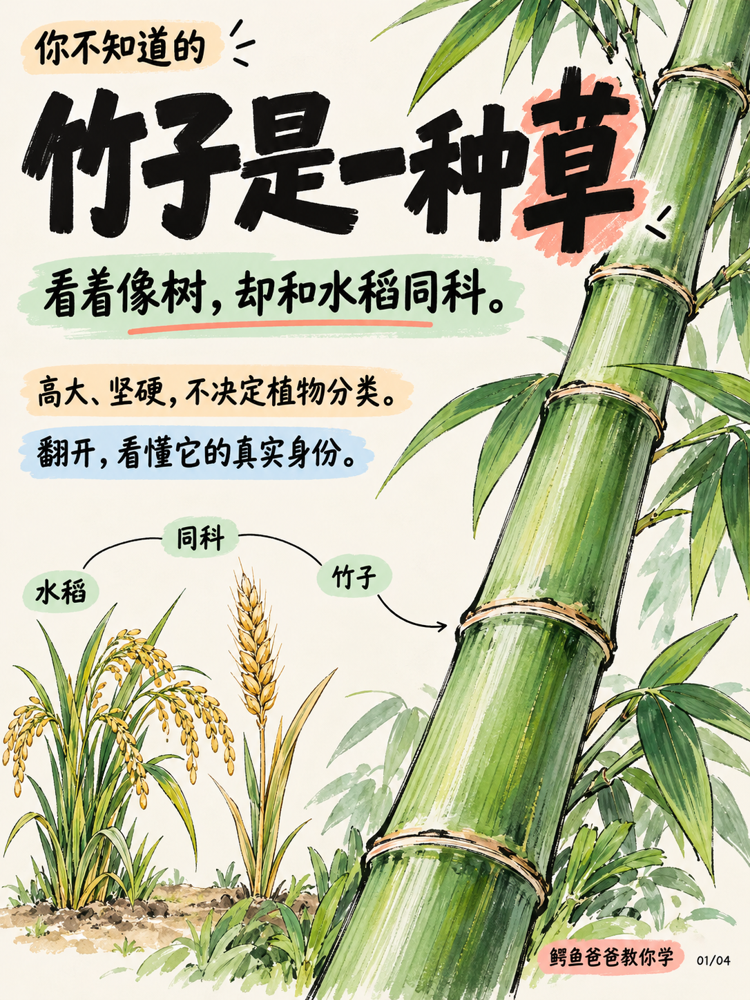

```text

视觉母版：严格3:4竖版，1080×1440构图，暖奶油纸底#F5F0E8，墨黑手绘粗标题，珊瑚红关键词，薄荷绿、淡蓝、杏色少量分区。遵循baoyu sketch-notes：高级科学手绘，轻微不规则线条、自然手涂色、弯曲箭头；充足留白，鲜明的大主体，绝不是满版小卡片或幼儿园贴纸。所有文字为清楚的中文手写黑体，标题极粗巨大。左右安全边距72，上下80。固定左上小栏目、右下页码。
Use case: scientific-educational. Generate ONE finished Xiaohongshu image, not contact sheet, not a mockup. 必须高质量完整中文图文，直接生成全部文字与插图，不留占位符。只使用下列指定文字，禁止添加英文、伪科学标签、网址或额外营销标题。图内每个主标题和小标题都不超过8字，字号须在手机信息流清晰可读。封面标题宽度占画布80%，主视觉55%左右，两者不要遮挡。右下页码细小不抢眼。署名文字严格为“鳄鱼爸爸教你学”（8字）。不要另绘鳄鱼头像，避免品牌形象变化。纸面设计平整满幅，没有外部场景或手机壳。无虚构数字和排名。
主题：bamboo；第1页/4，封面。
画面构图：巨大的青绿毛竹自底部斜向右上破出画面，叶片鲜活，秆有明显节与节间。左侧一小丛水稻与一穗小麦对照，高矮悬殊但不要误画成竹子长稻穗。以一个小小的分类连线把水稻与竹子连接；主体巨大、标题极醒目、非普通三栏列表。
需要逐字准确绘制的文字（按层级排版）：
栏目：你不知道的
主标题：竹子是一种草
说明：看着像树，却和水稻同科。
短句1：高大、坚硬，不决定植物分类。
短句2：翻开，看懂它的真实身份。
署名：鳄鱼爸爸教你学
页码：01/04
画面标注或注释只允许使用构图描述中指定的中文，不添加其他文字。no square image, no landscape, no inconsistent margins, no different template, no random layout shift.

```

### 第2张 · 它和水稻同科

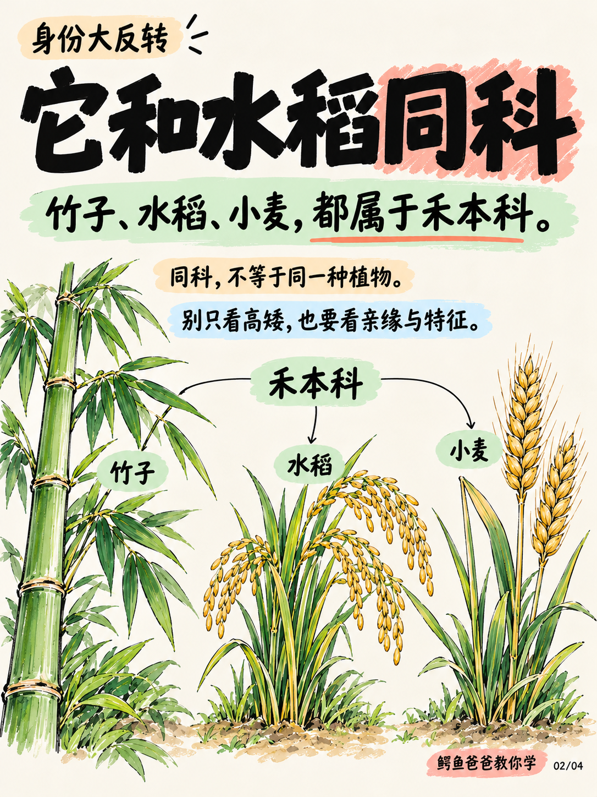

```text

视觉母版：严格3:4竖版，1080×1440构图，暖奶油纸底#F5F0E8，墨黑手绘粗标题，珊瑚红关键词，薄荷绿、淡蓝、杏色少量分区。遵循baoyu sketch-notes：高级科学手绘，轻微不规则线条、自然手涂色、弯曲箭头；充足留白，鲜明的大主体，绝不是满版小卡片或幼儿园贴纸。所有文字为清楚的中文手写黑体，标题极粗巨大。左右安全边距72，上下80。固定左上小栏目、右下页码。
Use case: scientific-educational. Generate ONE finished Xiaohongshu image, not contact sheet, not a mockup. 必须高质量完整中文图文，直接生成全部文字与插图，不留占位符。只使用下列指定文字，禁止添加英文、伪科学标签、网址或额外营销标题。图内每个主标题和小标题都不超过8字，字号须在手机信息流清晰可读。封面标题宽度占画布80%，主视觉55%左右，两者不要遮挡。右下页码细小不抢眼。署名文字严格为“鳄鱼爸爸教你学”（8字）。不要另绘鳄鱼头像，避免品牌形象变化。纸面设计平整满幅，没有外部场景或手机壳。无虚构数字和排名。
主题：bamboo；第2页/4，科普内页。沿用参考封面的颜色、字体和绘画语言，只改变本页构图与信息。
画面构图：三个清楚的科学植物标本：青竹枝秆与细叶、水稻下垂稻穗、小麦直立麦穗。用简洁支线共同连接到“禾本科”一个总标签，比例示意不作等比例。放大各自形态。标签为“竹子”“水稻”“小麦”“禾本科”，不画其他树，不暗示三者直接祖孙。
需要逐字准确绘制的文字（按层级排版）：
栏目：身份大反转
主标题：它和水稻同科
说明：竹子、水稻、小麦，都属于禾本科。
短句1：同科，不等于同一种植物。
短句2：别只看高矮，也要看亲缘与特征。
署名：鳄鱼爸爸教你学
页码：02/04
画面标注或注释只允许使用构图描述中指定的中文，不添加其他文字。no square image, no landscape, no inconsistent margins, no different template, no random layout shift.

```

### 第3张 · 草也能长得硬

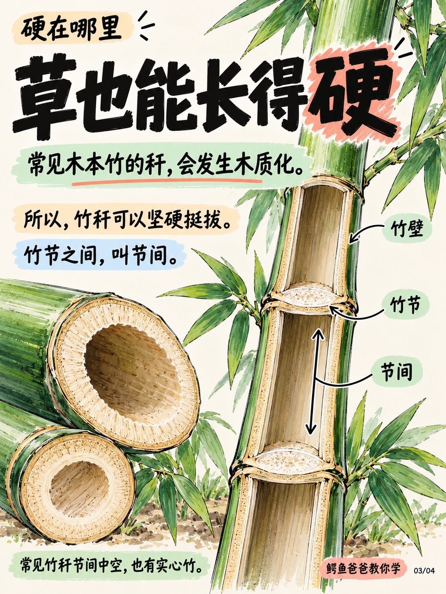

```text

视觉母版：严格3:4竖版，1080×1440构图，暖奶油纸底#F5F0E8，墨黑手绘粗标题，珊瑚红关键词，薄荷绿、淡蓝、杏色少量分区。遵循baoyu sketch-notes：高级科学手绘，轻微不规则线条、自然手涂色、弯曲箭头；充足留白，鲜明的大主体，绝不是满版小卡片或幼儿园贴纸。所有文字为清楚的中文手写黑体，标题极粗巨大。左右安全边距72，上下80。固定左上小栏目、右下页码。
Use case: scientific-educational. Generate ONE finished Xiaohongshu image, not contact sheet, not a mockup. 必须高质量完整中文图文，直接生成全部文字与插图，不留占位符。只使用下列指定文字，禁止添加英文、伪科学标签、网址或额外营销标题。图内每个主标题和小标题都不超过8字，字号须在手机信息流清晰可读。封面标题宽度占画布80%，主视觉55%左右，两者不要遮挡。右下页码细小不抢眼。署名文字严格为“鳄鱼爸爸教你学”（8字）。不要另绘鳄鱼头像，避免品牌形象变化。纸面设计平整满幅，没有外部场景或手机壳。无虚构数字和排名。
主题：bamboo；第3页/4，科普内页。沿用参考封面的颜色、字体和绘画语言，只改变本页构图与信息。
画面构图：一根毛竹纵向剖开，清楚画厚实的竹壁、节处隔膜与中空节间，两侧巨大的竹秆横切环形切面，天然纤维细节，3个简洁引线只标“竹壁”“竹节”“节间”。底部小注“常见竹秆节间中空，也有实心竹。”不要把所有竹子画为必然空心，不做放大细胞伪标签。
需要逐字准确绘制的文字（按层级排版）：
栏目：硬在哪里
主标题：草也能长得硬
说明：常见木本竹的秆，会发生木质化。
短句1：所以，竹秆可以坚硬挺拔。
短句2：竹节之间，叫节间。
署名：鳄鱼爸爸教你学
页码：03/04
画面标注或注释只允许使用构图描述中指定的中文，不添加其他文字。no square image, no landscape, no inconsistent margins, no different template, no random layout shift.

```

### 第4张 · 地下还藏着茎

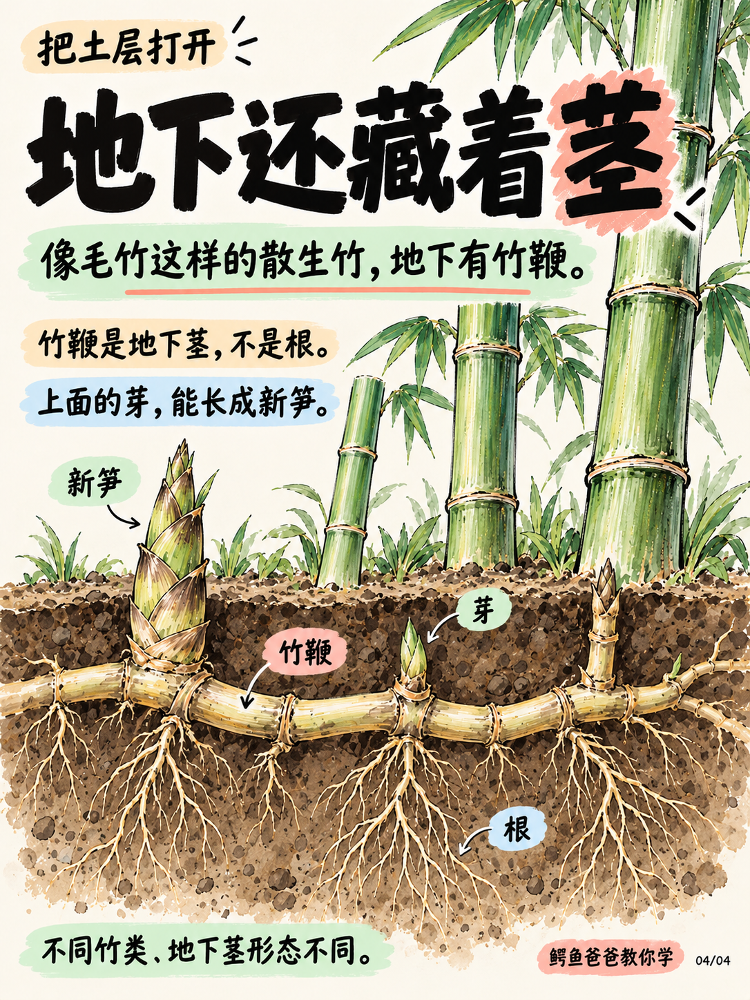

```text

视觉母版：严格3:4竖版，1080×1440构图，暖奶油纸底#F5F0E8，墨黑手绘粗标题，珊瑚红关键词，薄荷绿、淡蓝、杏色少量分区。遵循baoyu sketch-notes：高级科学手绘，轻微不规则线条、自然手涂色、弯曲箭头；充足留白，鲜明的大主体，绝不是满版小卡片或幼儿园贴纸。所有文字为清楚的中文手写黑体，标题极粗巨大。左右安全边距72，上下80。固定左上小栏目、右下页码。
Use case: scientific-educational. Generate ONE finished Xiaohongshu image, not contact sheet, not a mockup. 必须高质量完整中文图文，直接生成全部文字与插图，不留占位符。只使用下列指定文字，禁止添加英文、伪科学标签、网址或额外营销标题。图内每个主标题和小标题都不超过8字，字号须在手机信息流清晰可读。封面标题宽度占画布80%，主视觉55%左右，两者不要遮挡。右下页码细小不抢眼。署名文字严格为“鳄鱼爸爸教你学”（8字）。不要另绘鳄鱼头像，避免品牌形象变化。纸面设计平整满幅，没有外部场景或手机壳。无虚构数字和排名。
主题：bamboo；第4页/4，科普内页。沿用参考封面的颜色、字体和绘画语言，只改变本页构图与信息。
画面构图：完整土壤剖面：地上3根不同年龄竹秆和一个新笋，地下横走粗壮有节的竹鞭清楚连接向上新笋与竹秆；纤细根从竹鞭节附近向下分枝，根与地下茎明显区分。短标注“竹鞭”“芽”“根”“新笋”。底部小注“不同竹类，地下茎形态不同。”另放提问“竹鞭是根，还是茎？”不要把竹鞭画成细根。
需要逐字准确绘制的文字（按层级排版）：
栏目：把土层打开
主标题：地下还藏着茎
说明：像毛竹这样的散生竹，地下有竹鞭。
短句1：竹鞭是地下茎，不是根。
短句2：上面的芽，能长成新笋。
署名：鳄鱼爸爸教你学
页码：04/04
画面标注或注释只允许使用构图描述中指定的中文，不添加其他文字。no square image, no landscape, no inconsistent margins, no different template, no random layout shift.

```

## 竹子 / Auto-Redbook-Skills

发布标题：长成一片林，竹子居然还算草？

🌿 先猜一下：竹子、水稻、小麦，谁和谁是一家？
答案：它们都属于禾本科。竹子长得高、秆很硬，也没有因此换一个科。

🔍 四张图看三个问题：
身份看分类：同科，不等于同一种。
坚硬看结构：常见木本竹的秆会发生木质化；常见竹秆节间中空，但也有实心竹。
扩展看地下：像毛竹这样的散生竹，靠横走的地下茎——竹鞭，长出新笋。竹鞭和根是两回事，其他竹类的地下茎也可能不同。

下次走进竹林，可以试着问孩子：看着像树，就一定是树吗？

学通识，就找鳄鱼爸爸。
#鳄鱼爸爸教你学 #竹子是一种草 #自然观察 #植物科普 #亲子共学


### 视觉母版

视觉母版：严格3:4竖版，1080×1440构图。依据Auto-Redbook-Skills neo-brutalism CSS实际令牌：奶油白#FFFDF5、纯黑#000、黄色#FECA57、青色#00D2D3、少量红#FF4757。超粗无衬线中文标题，明确黑色细粗边和偏移硬阴影，非圆角卡片；一张精美科学切贴主体占半版，周围以2到3个大文字模块组织。大胆有设计感，黄色只强调关键结论，不要花哨贴纸、emoji、紫色渐变、网页截图或PPT。图文分稿，精确手动分页，每页单一知识任务。左右72px安全边距，署名左下页码右下。用户要求统一AI生图，故不使用HTML截图作为最终成品。

### 第1张 · 竹子是一种草

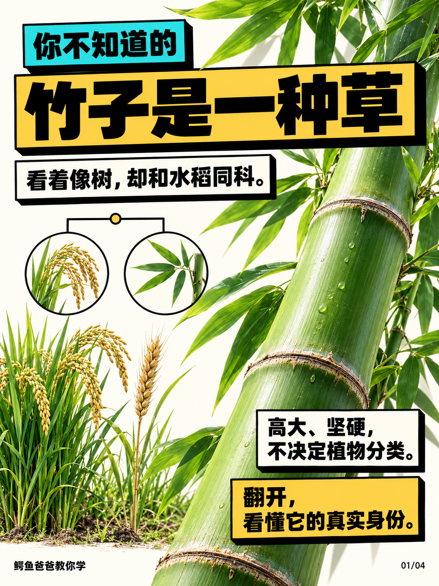

```text

视觉母版：严格3:4竖版，1080×1440构图。依据Auto-Redbook-Skills neo-brutalism CSS实际令牌：奶油白#FFFDF5、纯黑#000、黄色#FECA57、青色#00D2D3、少量红#FF4757。超粗无衬线中文标题，明确黑色细粗边和偏移硬阴影，非圆角卡片；一张精美科学切贴主体占半版，周围以2到3个大文字模块组织。大胆有设计感，黄色只强调关键结论，不要花哨贴纸、emoji、紫色渐变、网页截图或PPT。图文分稿，精确手动分页，每页单一知识任务。左右72px安全边距，署名左下页码右下。用户要求统一AI生图，故不使用HTML截图作为最终成品。
Use case: scientific-educational. Generate ONE finished Xiaohongshu image, not contact sheet, not a mockup. 必须高质量完整中文图文，直接生成全部文字与插图，不留占位符。只使用下列指定文字，禁止添加英文、伪科学标签、网址或额外营销标题。图内每个主标题和小标题都不超过8字，字号须在手机信息流清晰可读。封面标题宽度占画布80%，主视觉55%左右，两者不要遮挡。右下页码细小不抢眼。署名文字严格为“鳄鱼爸爸教你学”（8字）。不要另绘鳄鱼头像，避免品牌形象变化。纸面设计平整满幅，没有外部场景或手机壳。无虚构数字和排名。
主题：bamboo；第1页/4，封面。
画面构图：巨大的青绿毛竹自底部斜向右上破出画面，叶片鲜活，秆有明显节与节间。左侧一小丛水稻与一穗小麦对照，高矮悬殊但不要误画成竹子长稻穗。以一个小小的分类连线把水稻与竹子连接；主体巨大、标题极醒目、非普通三栏列表。
需要逐字准确绘制的文字（按层级排版）：
栏目：你不知道的
主标题：竹子是一种草
说明：看着像树，却和水稻同科。
短句1：高大、坚硬，不决定植物分类。
短句2：翻开，看懂它的真实身份。
署名：鳄鱼爸爸教你学
页码：01/04
画面标注或注释只允许使用构图描述中指定的中文，不添加其他文字。no square image, no landscape, no inconsistent margins, no different template, no random layout shift.

```

### 第2张 · 它和水稻同科

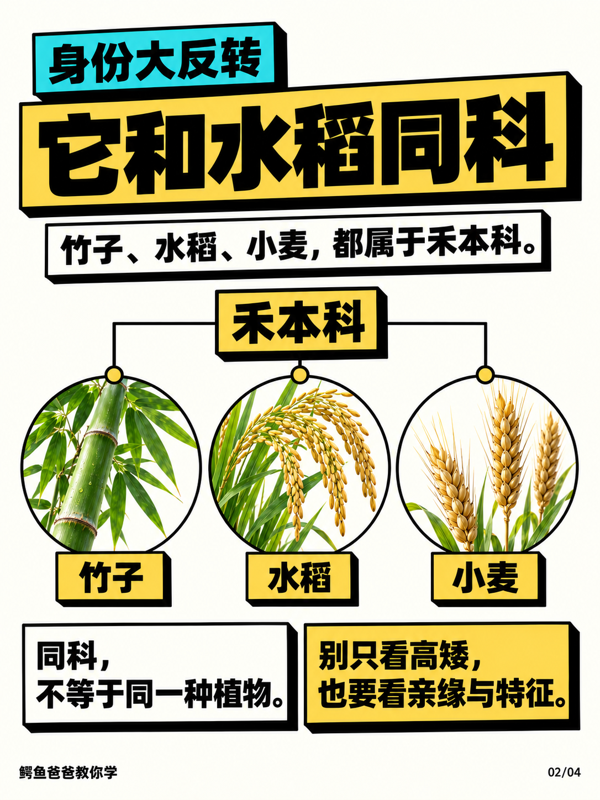

```text

视觉母版：严格3:4竖版，1080×1440构图。依据Auto-Redbook-Skills neo-brutalism CSS实际令牌：奶油白#FFFDF5、纯黑#000、黄色#FECA57、青色#00D2D3、少量红#FF4757。超粗无衬线中文标题，明确黑色细粗边和偏移硬阴影，非圆角卡片；一张精美科学切贴主体占半版，周围以2到3个大文字模块组织。大胆有设计感，黄色只强调关键结论，不要花哨贴纸、emoji、紫色渐变、网页截图或PPT。图文分稿，精确手动分页，每页单一知识任务。左右72px安全边距，署名左下页码右下。用户要求统一AI生图，故不使用HTML截图作为最终成品。
Use case: scientific-educational. Generate ONE finished Xiaohongshu image, not contact sheet, not a mockup. 必须高质量完整中文图文，直接生成全部文字与插图，不留占位符。只使用下列指定文字，禁止添加英文、伪科学标签、网址或额外营销标题。图内每个主标题和小标题都不超过8字，字号须在手机信息流清晰可读。封面标题宽度占画布80%，主视觉55%左右，两者不要遮挡。右下页码细小不抢眼。署名文字严格为“鳄鱼爸爸教你学”（8字）。不要另绘鳄鱼头像，避免品牌形象变化。纸面设计平整满幅，没有外部场景或手机壳。无虚构数字和排名。
主题：bamboo；第2页/4，科普内页。沿用参考封面的颜色、字体和绘画语言，只改变本页构图与信息。
画面构图：三个清楚的科学植物标本：青竹枝秆与细叶、水稻下垂稻穗、小麦直立麦穗。用简洁支线共同连接到“禾本科”一个总标签，比例示意不作等比例。放大各自形态。标签为“竹子”“水稻”“小麦”“禾本科”，不画其他树，不暗示三者直接祖孙。
需要逐字准确绘制的文字（按层级排版）：
栏目：身份大反转
主标题：它和水稻同科
说明：竹子、水稻、小麦，都属于禾本科。
短句1：同科，不等于同一种植物。
短句2：别只看高矮，也要看亲缘与特征。
署名：鳄鱼爸爸教你学
页码：02/04
画面标注或注释只允许使用构图描述中指定的中文，不添加其他文字。no square image, no landscape, no inconsistent margins, no different template, no random layout shift.

```

### 第3张 · 草也能长得硬

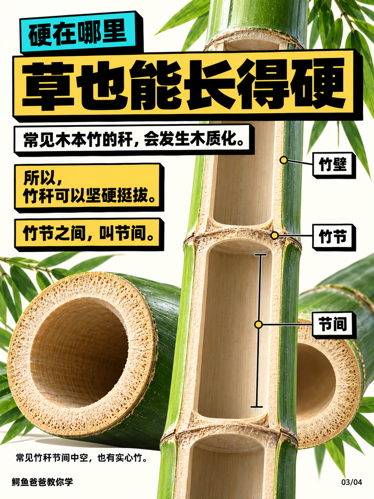

```text

视觉母版：严格3:4竖版，1080×1440构图。依据Auto-Redbook-Skills neo-brutalism CSS实际令牌：奶油白#FFFDF5、纯黑#000、黄色#FECA57、青色#00D2D3、少量红#FF4757。超粗无衬线中文标题，明确黑色细粗边和偏移硬阴影，非圆角卡片；一张精美科学切贴主体占半版，周围以2到3个大文字模块组织。大胆有设计感，黄色只强调关键结论，不要花哨贴纸、emoji、紫色渐变、网页截图或PPT。图文分稿，精确手动分页，每页单一知识任务。左右72px安全边距，署名左下页码右下。用户要求统一AI生图，故不使用HTML截图作为最终成品。
Use case: scientific-educational. Generate ONE finished Xiaohongshu image, not contact sheet, not a mockup. 必须高质量完整中文图文，直接生成全部文字与插图，不留占位符。只使用下列指定文字，禁止添加英文、伪科学标签、网址或额外营销标题。图内每个主标题和小标题都不超过8字，字号须在手机信息流清晰可读。封面标题宽度占画布80%，主视觉55%左右，两者不要遮挡。右下页码细小不抢眼。署名文字严格为“鳄鱼爸爸教你学”（8字）。不要另绘鳄鱼头像，避免品牌形象变化。纸面设计平整满幅，没有外部场景或手机壳。无虚构数字和排名。
主题：bamboo；第3页/4，科普内页。沿用参考封面的颜色、字体和绘画语言，只改变本页构图与信息。
画面构图：一根毛竹纵向剖开，清楚画厚实的竹壁、节处隔膜与中空节间，两侧巨大的竹秆横切环形切面，天然纤维细节，3个简洁引线只标“竹壁”“竹节”“节间”。底部小注“常见竹秆节间中空，也有实心竹。”不要把所有竹子画为必然空心，不做放大细胞伪标签。
需要逐字准确绘制的文字（按层级排版）：
栏目：硬在哪里
主标题：草也能长得硬
说明：常见木本竹的秆，会发生木质化。
短句1：所以，竹秆可以坚硬挺拔。
短句2：竹节之间，叫节间。
署名：鳄鱼爸爸教你学
页码：03/04
画面标注或注释只允许使用构图描述中指定的中文，不添加其他文字。no square image, no landscape, no inconsistent margins, no different template, no random layout shift.

```

### 第4张 · 地下还藏着茎

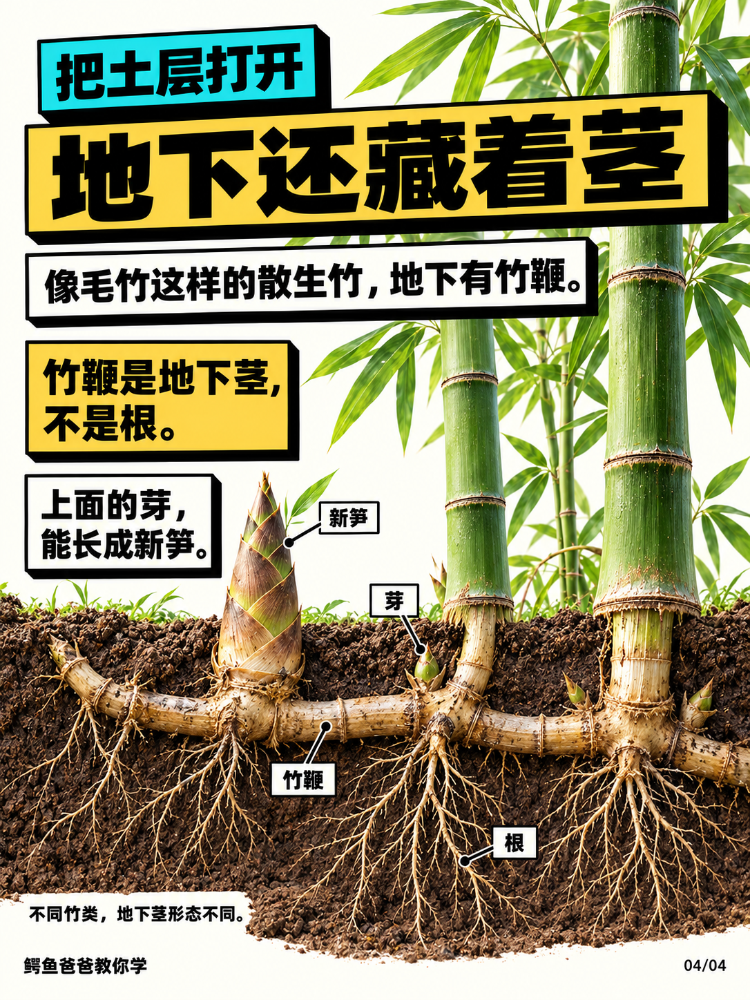

```text

视觉母版：严格3:4竖版，1080×1440构图。依据Auto-Redbook-Skills neo-brutalism CSS实际令牌：奶油白#FFFDF5、纯黑#000、黄色#FECA57、青色#00D2D3、少量红#FF4757。超粗无衬线中文标题，明确黑色细粗边和偏移硬阴影，非圆角卡片；一张精美科学切贴主体占半版，周围以2到3个大文字模块组织。大胆有设计感，黄色只强调关键结论，不要花哨贴纸、emoji、紫色渐变、网页截图或PPT。图文分稿，精确手动分页，每页单一知识任务。左右72px安全边距，署名左下页码右下。用户要求统一AI生图，故不使用HTML截图作为最终成品。
Use case: scientific-educational. Generate ONE finished Xiaohongshu image, not contact sheet, not a mockup. 必须高质量完整中文图文，直接生成全部文字与插图，不留占位符。只使用下列指定文字，禁止添加英文、伪科学标签、网址或额外营销标题。图内每个主标题和小标题都不超过8字，字号须在手机信息流清晰可读。封面标题宽度占画布80%，主视觉55%左右，两者不要遮挡。右下页码细小不抢眼。署名文字严格为“鳄鱼爸爸教你学”（8字）。不要另绘鳄鱼头像，避免品牌形象变化。纸面设计平整满幅，没有外部场景或手机壳。无虚构数字和排名。
主题：bamboo；第4页/4，科普内页。沿用参考封面的颜色、字体和绘画语言，只改变本页构图与信息。
画面构图：完整土壤剖面：地上3根不同年龄竹秆和一个新笋，地下横走粗壮有节的竹鞭清楚连接向上新笋与竹秆；纤细根从竹鞭节附近向下分枝，根与地下茎明显区分。短标注“竹鞭”“芽”“根”“新笋”。底部小注“不同竹类，地下茎形态不同。”另放提问“竹鞭是根，还是茎？”不要把竹鞭画成细根。
需要逐字准确绘制的文字（按层级排版）：
栏目：把土层打开
主标题：地下还藏着茎
说明：像毛竹这样的散生竹，地下有竹鞭。
短句1：竹鞭是地下茎，不是根。
短句2：上面的芽，能长成新笋。
署名：鳄鱼爸爸教你学
页码：04/04
画面标注或注释只允许使用构图描述中指定的中文，不添加其他文字。no square image, no landscape, no inconsistent margins, no different template, no random layout shift.

```

## 竹子 / XHS Visual Director

发布标题：给竹子验个身份：它真的是草

先看见竹林，再把目光移到脚下。

地上，是高大、坚硬的竹秆；地下，是藏着芽和新笋的茎。外表很像树的竹子，分类上却属于禾本科。水稻、小麦，也在这个大家族里。

竹子的“身份”和“硬度”要分开理解。常见木本竹的秆会木质化，硬，并不意味着它就不属于禾本科。常见竹秆节间中空，也有实心竹。

最后一张打开土层：以毛竹这类散生竹为例，粗而有节的竹鞭是地下茎，细细分枝的是根。竹鞭上的芽，可以长成新笋；不同竹类的地下茎并不都一样。

看完再回头看第一张：你对“草”的想象，变了吗？

学通识，就找鳄鱼爸爸。
#鳄鱼爸爸教你学 #竹子 #自然博物 #植物科普 #通识教育


### 视觉母版

Series visual master lock: create one page of the same Xiaohongshu carousel series, 1080x1440px, strict 3:4 vertical portrait canvas, no square, no landscape, no crop, no extra border. Identical safe margins 72px sides and 80px top/bottom, 12-column grid and 8px spacing, identical typography system, small bottom-right page number. 视觉导演母版：高级白底自然历史杂志风，淡象牙白#F7F3E9底、炭黑#18251E大字、森林绿#23563C、极少朱砂红#C34B36。像世界级自然博物馆科普特刊，生动精细的自然史写实插画/微距摄影质感，准确叶脉与虫体纹理，切面清晰、主体巨大。上方短黑体标题大胆占30%，留白精确，细编辑线和小标注，不用卡片堆叠，不用纯科技界面、霓虹、玻璃、塑料、低幼卡通。以视觉反差和局部放大讲解，而不是普通幻灯片。

### 第1张 · 竹子是一种草

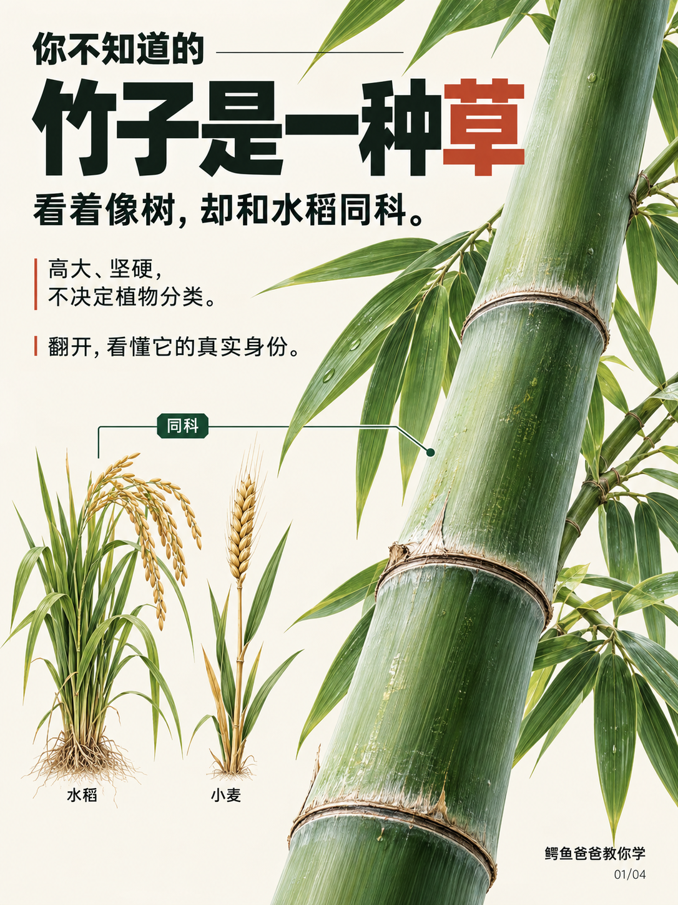

```text

Series visual master lock: create one page of the same Xiaohongshu carousel series, 1080x1440px, strict 3:4 vertical portrait canvas, no square, no landscape, no crop, no extra border. Identical safe margins 72px sides and 80px top/bottom, 12-column grid and 8px spacing, identical typography system, small bottom-right page number. 视觉导演母版：高级白底自然历史杂志风，淡象牙白#F7F3E9底、炭黑#18251E大字、森林绿#23563C、极少朱砂红#C34B36。像世界级自然博物馆科普特刊，生动精细的自然史写实插画/微距摄影质感，准确叶脉与虫体纹理，切面清晰、主体巨大。上方短黑体标题大胆占30%，留白精确，细编辑线和小标注，不用卡片堆叠，不用纯科技界面、霓虹、玻璃、塑料、低幼卡通。以视觉反差和局部放大讲解，而不是普通幻灯片。
Use case: scientific-educational. Generate ONE finished Xiaohongshu image, not contact sheet, not a mockup. 必须高质量完整中文图文，直接生成全部文字与插图，不留占位符。只使用下列指定文字，禁止添加英文、伪科学标签、网址或额外营销标题。图内每个主标题和小标题都不超过8字，字号须在手机信息流清晰可读。封面标题宽度占画布80%，主视觉55%左右，两者不要遮挡。右下页码细小不抢眼。署名文字严格为“鳄鱼爸爸教你学”（8字）。不要另绘鳄鱼头像，避免品牌形象变化。纸面设计平整满幅，没有外部场景或手机壳。无虚构数字和排名。
主题：bamboo；第1页/4，封面。
画面构图：巨大的青绿毛竹自底部斜向右上破出画面，叶片鲜活，秆有明显节与节间。左侧一小丛水稻与一穗小麦对照，高矮悬殊但不要误画成竹子长稻穗。以一个小小的分类连线把水稻与竹子连接；主体巨大、标题极醒目、非普通三栏列表。
需要逐字准确绘制的文字（按层级排版）：
栏目：你不知道的
主标题：竹子是一种草
说明：看着像树，却和水稻同科。
短句1：高大、坚硬，不决定植物分类。
短句2：翻开，看懂它的真实身份。
署名：鳄鱼爸爸教你学
页码：01/04
画面标注或注释只允许使用构图描述中指定的中文，不添加其他文字。no square image, no landscape, no inconsistent margins, no different template, no random layout shift.

```

### 第2张 · 它和水稻同科

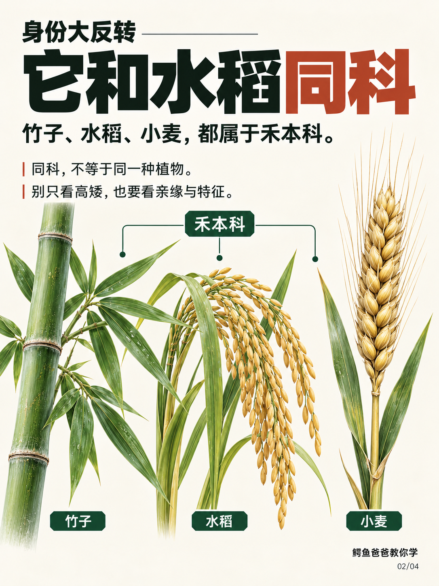

```text

Series visual master lock: create one page of the same Xiaohongshu carousel series, 1080x1440px, strict 3:4 vertical portrait canvas, no square, no landscape, no crop, no extra border. Identical safe margins 72px sides and 80px top/bottom, 12-column grid and 8px spacing, identical typography system, small bottom-right page number. 视觉导演母版：高级白底自然历史杂志风，淡象牙白#F7F3E9底、炭黑#18251E大字、森林绿#23563C、极少朱砂红#C34B36。像世界级自然博物馆科普特刊，生动精细的自然史写实插画/微距摄影质感，准确叶脉与虫体纹理，切面清晰、主体巨大。上方短黑体标题大胆占30%，留白精确，细编辑线和小标注，不用卡片堆叠，不用纯科技界面、霓虹、玻璃、塑料、低幼卡通。以视觉反差和局部放大讲解，而不是普通幻灯片。
Use case: scientific-educational. Generate ONE finished Xiaohongshu image, not contact sheet, not a mockup. 必须高质量完整中文图文，直接生成全部文字与插图，不留占位符。只使用下列指定文字，禁止添加英文、伪科学标签、网址或额外营销标题。图内每个主标题和小标题都不超过8字，字号须在手机信息流清晰可读。封面标题宽度占画布80%，主视觉55%左右，两者不要遮挡。右下页码细小不抢眼。署名文字严格为“鳄鱼爸爸教你学”（8字）。不要另绘鳄鱼头像，避免品牌形象变化。纸面设计平整满幅，没有外部场景或手机壳。无虚构数字和排名。
主题：bamboo；第2页/4，科普内页。沿用参考封面的颜色、字体和绘画语言，只改变本页构图与信息。
画面构图：三个清楚的科学植物标本：青竹枝秆与细叶、水稻下垂稻穗、小麦直立麦穗。用简洁支线共同连接到“禾本科”一个总标签，比例示意不作等比例。放大各自形态。标签为“竹子”“水稻”“小麦”“禾本科”，不画其他树，不暗示三者直接祖孙。
需要逐字准确绘制的文字（按层级排版）：
栏目：身份大反转
主标题：它和水稻同科
说明：竹子、水稻、小麦，都属于禾本科。
短句1：同科，不等于同一种植物。
短句2：别只看高矮，也要看亲缘与特征。
署名：鳄鱼爸爸教你学
页码：02/04
画面标注或注释只允许使用构图描述中指定的中文，不添加其他文字。no square image, no landscape, no inconsistent margins, no different template, no random layout shift.

```

### 第3张 · 草也能长得硬

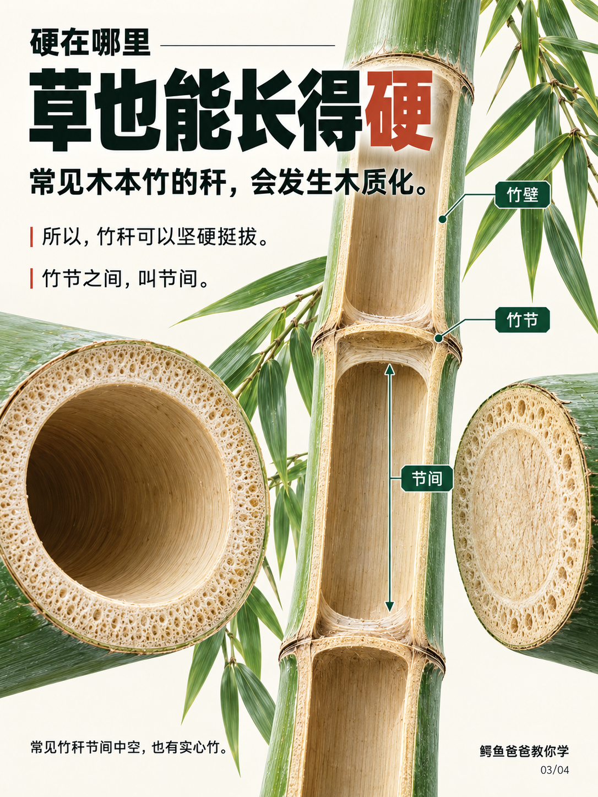

```text

Series visual master lock: create one page of the same Xiaohongshu carousel series, 1080x1440px, strict 3:4 vertical portrait canvas, no square, no landscape, no crop, no extra border. Identical safe margins 72px sides and 80px top/bottom, 12-column grid and 8px spacing, identical typography system, small bottom-right page number. 视觉导演母版：高级白底自然历史杂志风，淡象牙白#F7F3E9底、炭黑#18251E大字、森林绿#23563C、极少朱砂红#C34B36。像世界级自然博物馆科普特刊，生动精细的自然史写实插画/微距摄影质感，准确叶脉与虫体纹理，切面清晰、主体巨大。上方短黑体标题大胆占30%，留白精确，细编辑线和小标注，不用卡片堆叠，不用纯科技界面、霓虹、玻璃、塑料、低幼卡通。以视觉反差和局部放大讲解，而不是普通幻灯片。
Use case: scientific-educational. Generate ONE finished Xiaohongshu image, not contact sheet, not a mockup. 必须高质量完整中文图文，直接生成全部文字与插图，不留占位符。只使用下列指定文字，禁止添加英文、伪科学标签、网址或额外营销标题。图内每个主标题和小标题都不超过8字，字号须在手机信息流清晰可读。封面标题宽度占画布80%，主视觉55%左右，两者不要遮挡。右下页码细小不抢眼。署名文字严格为“鳄鱼爸爸教你学”（8字）。不要另绘鳄鱼头像，避免品牌形象变化。纸面设计平整满幅，没有外部场景或手机壳。无虚构数字和排名。
主题：bamboo；第3页/4，科普内页。沿用参考封面的颜色、字体和绘画语言，只改变本页构图与信息。
画面构图：一根毛竹纵向剖开，清楚画厚实的竹壁、节处隔膜与中空节间，两侧巨大的竹秆横切环形切面，天然纤维细节，3个简洁引线只标“竹壁”“竹节”“节间”。底部小注“常见竹秆节间中空，也有实心竹。”不要把所有竹子画为必然空心，不做放大细胞伪标签。
需要逐字准确绘制的文字（按层级排版）：
栏目：硬在哪里
主标题：草也能长得硬
说明：常见木本竹的秆，会发生木质化。
短句1：所以，竹秆可以坚硬挺拔。
短句2：竹节之间，叫节间。
署名：鳄鱼爸爸教你学
页码：03/04
画面标注或注释只允许使用构图描述中指定的中文，不添加其他文字。no square image, no landscape, no inconsistent margins, no different template, no random layout shift.

```

### 第4张 · 地下还藏着茎

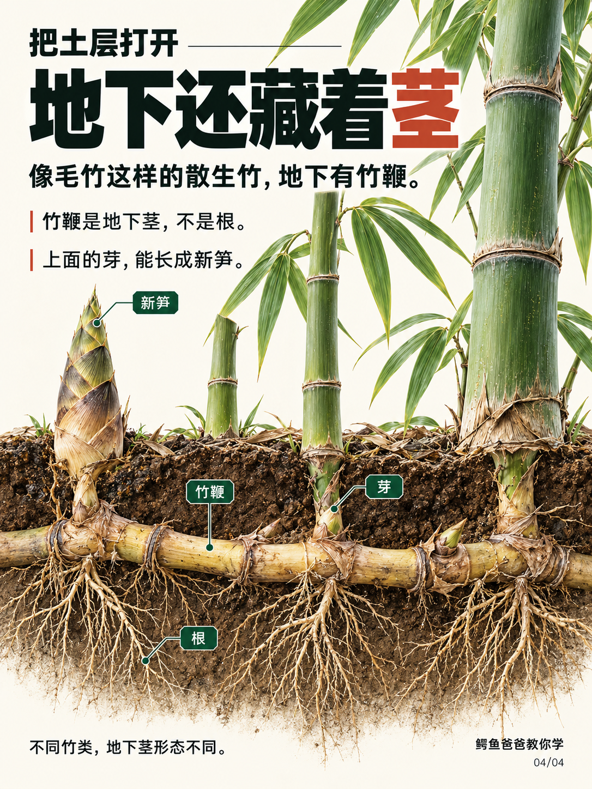

```text

Series visual master lock: create one page of the same Xiaohongshu carousel series, 1080x1440px, strict 3:4 vertical portrait canvas, no square, no landscape, no crop, no extra border. Identical safe margins 72px sides and 80px top/bottom, 12-column grid and 8px spacing, identical typography system, small bottom-right page number. 视觉导演母版：高级白底自然历史杂志风，淡象牙白#F7F3E9底、炭黑#18251E大字、森林绿#23563C、极少朱砂红#C34B36。像世界级自然博物馆科普特刊，生动精细的自然史写实插画/微距摄影质感，准确叶脉与虫体纹理，切面清晰、主体巨大。上方短黑体标题大胆占30%，留白精确，细编辑线和小标注，不用卡片堆叠，不用纯科技界面、霓虹、玻璃、塑料、低幼卡通。以视觉反差和局部放大讲解，而不是普通幻灯片。
Use case: scientific-educational. Generate ONE finished Xiaohongshu image, not contact sheet, not a mockup. 必须高质量完整中文图文，直接生成全部文字与插图，不留占位符。只使用下列指定文字，禁止添加英文、伪科学标签、网址或额外营销标题。图内每个主标题和小标题都不超过8字，字号须在手机信息流清晰可读。封面标题宽度占画布80%，主视觉55%左右，两者不要遮挡。右下页码细小不抢眼。署名文字严格为“鳄鱼爸爸教你学”（8字）。不要另绘鳄鱼头像，避免品牌形象变化。纸面设计平整满幅，没有外部场景或手机壳。无虚构数字和排名。
主题：bamboo；第4页/4，科普内页。沿用参考封面的颜色、字体和绘画语言，只改变本页构图与信息。
画面构图：完整土壤剖面：地上3根不同年龄竹秆和一个新笋，地下横走粗壮有节的竹鞭清楚连接向上新笋与竹秆；纤细根从竹鞭节附近向下分枝，根与地下茎明显区分。短标注“竹鞭”“芽”“根”“新笋”。底部小注“不同竹类，地下茎形态不同。”另放提问“竹鞭是根，还是茎？”不要把竹鞭画成细根。
需要逐字准确绘制的文字（按层级排版）：
栏目：把土层打开
主标题：地下还藏着茎
说明：像毛竹这样的散生竹，地下有竹鞭。
短句1：竹鞭是地下茎，不是根。
短句2：上面的芽，能长成新笋。
署名：鳄鱼爸爸教你学
页码：04/04
画面标注或注释只允许使用构图描述中指定的中文，不添加其他文字。no square image, no landscape, no inconsistent margins, no different template, no random layout shift.

```

## 蝴蝶 / 宝玉 · baoyu-xhs-images

发布标题：毛毛虫和蝴蝶，原来是同一个它

如果给一只蝴蝶拍成长照，前几张你可能认不出来。

第一张是卵，第二张是吃叶子的毛毛虫，接着是安静的蛹，最后才是展开翅膀的成虫。四种形态，属于同一个生命。

幼虫取食、长大、蜕皮；蛹期，身体继续发育与重组。蛹不是蚕茧，也不是毛毛虫在里面睡一觉。羽化后，成虫还要展开翅膀。

成虫可以繁殖，留下下一代的卵；这个个体最终也会死亡。循环延续的是一代又一代，不是同一只蝴蝶重新变成卵。寿命随种类、季节和环境等变化，不统一写“只活几天”。

和孩子找一找：四个阶段里，哪个最不像蝴蝶？

图中以凤蝶形态示意，不按实际大小绘制。学通识，就找鳄鱼爸爸。
#鳄鱼爸爸教你学 #蝴蝶的一生 #昆虫科普 #亲子共学 #通识教育


### 视觉母版

视觉母版：严格3:4竖版，1080×1440构图，暖奶油纸底#F5F0E8，墨黑手绘粗标题，珊瑚红关键词，薄荷绿、淡蓝、杏色少量分区。遵循baoyu sketch-notes：高级科学手绘，轻微不规则线条、自然手涂色、弯曲箭头；充足留白，鲜明的大主体，绝不是满版小卡片或幼儿园贴纸。所有文字为清楚的中文手写黑体，标题极粗巨大。左右安全边距72，上下80。固定左上小栏目、右下页码。

### 第1张 · 蝴蝶的一生

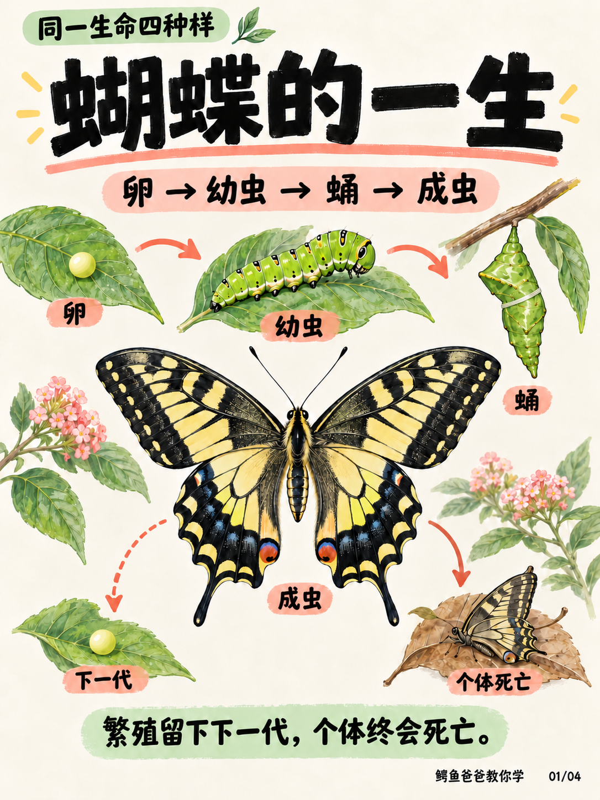

```text

视觉母版：严格3:4竖版，1080×1440构图，暖奶油纸底#F5F0E8，墨黑手绘粗标题，珊瑚红关键词，薄荷绿、淡蓝、杏色少量分区。遵循baoyu sketch-notes：高级科学手绘，轻微不规则线条、自然手涂色、弯曲箭头；充足留白，鲜明的大主体，绝不是满版小卡片或幼儿园贴纸。所有文字为清楚的中文手写黑体，标题极粗巨大。左右安全边距72，上下80。固定左上小栏目、右下页码。
Use case: scientific-educational. Generate ONE finished Xiaohongshu image, not contact sheet, not a mockup. 必须高质量完整中文图文，直接生成全部文字与插图，不留占位符。只使用下列指定文字，禁止添加英文、伪科学标签、网址或额外营销标题。图内每个主标题和小标题都不超过8字，字号须在手机信息流清晰可读。封面标题宽度占画布80%，主视觉55%左右，两者不要遮挡。右下页码细小不抢眼。署名文字严格为“鳄鱼爸爸教你学”（8字）。不要另绘鳄鱼头像，避免品牌形象变化。纸面设计平整满幅，没有外部场景或手机壳。无虚构数字和排名。
主题：butterfly；第1页/4，封面。
画面构图：精美凤蝶完整生命周期总览，中央一只张翅黑黄凤蝶主视觉，翅对称，有后翅尾突；四个较小阶段沿S形阅读线分别为叶面一颗卵、叶上绿色毛毛虫、以丝带固定枝条的绿色角形裸蛹、完整有六足的凤蝶成虫。箭头明确卵→幼虫→蛹→成虫。成虫分出两条终点，一条虚线指向另外一颗小卵，标“下一代”，另一条短支线指向落叶旁静止的蝶轮廓，标“个体死亡”。不可把死亡箭头接回卵。各阶段大小示意，不能茧裹蛹，不画幼虫长翅。标题最醒目，四个短标“卵”“幼虫”“蛹”“成虫”。
需要逐字准确绘制的文字（按层级排版）：
栏目：同一生命四种样
主标题：蝴蝶的一生
说明：卵 → 幼虫 → 蛹 → 成虫
短句1：繁殖留下下一代，个体终会死亡。
署名：鳄鱼爸爸教你学
页码：01/04
画面标注或注释只允许使用构图描述中指定的中文，不添加其他文字。no square image, no landscape, no inconsistent margins, no different template, no random layout shift.
最终修订约束：卵为近球形、光滑浅黄色小圆珠，不是长椭圆或棱纹谷粒。凤蝶蛹用细丝腰带固定，不缠成厚绷带。不画从蛹指向花朵的箭头；四阶段顺序由顶部文字箭头完整说明。

```

### 第2张 · 毛毛虫就是它

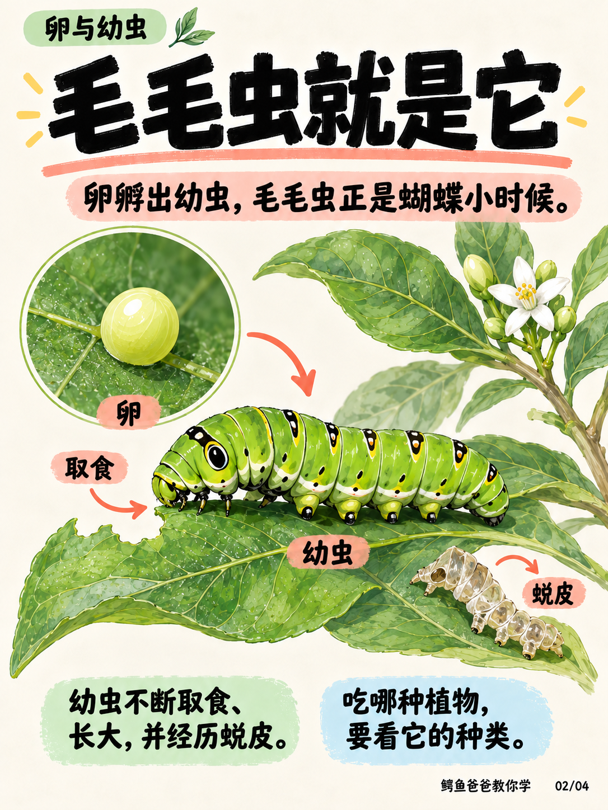

```text

视觉母版：严格3:4竖版，1080×1440构图，暖奶油纸底#F5F0E8，墨黑手绘粗标题，珊瑚红关键词，薄荷绿、淡蓝、杏色少量分区。遵循baoyu sketch-notes：高级科学手绘，轻微不规则线条、自然手涂色、弯曲箭头；充足留白，鲜明的大主体，绝不是满版小卡片或幼儿园贴纸。所有文字为清楚的中文手写黑体，标题极粗巨大。左右安全边距72，上下80。固定左上小栏目、右下页码。
Use case: scientific-educational. Generate ONE finished Xiaohongshu image, not contact sheet, not a mockup. 必须高质量完整中文图文，直接生成全部文字与插图，不留占位符。只使用下列指定文字，禁止添加英文、伪科学标签、网址或额外营销标题。图内每个主标题和小标题都不超过8字，字号须在手机信息流清晰可读。封面标题宽度占画布80%，主视觉55%左右，两者不要遮挡。右下页码细小不抢眼。署名文字严格为“鳄鱼爸爸教你学”（8字）。不要另绘鳄鱼头像，避免品牌形象变化。纸面设计平整满幅，没有外部场景或手机壳。无虚构数字和排名。
主题：butterfly；第2页/4，科普内页。沿用参考封面的颜色、字体和绘画语言，只改变本页构图与信息。
画面构图：上方柑橘叶片边缘一颗近球形、光滑无竖向棱纹、浅黄绿色的小卵（不要椭圆谷粒形卵），单独圆形微距放大；下方侧面完整绿色凤蝶幼虫在柑橘叶上取食，真实幼虫无翅膀、有腹足及胸足，叶片有咬痕；旁边一片小的空旧表皮表示蜕皮。用弯箭头连卵和幼虫，标签“卵”“幼虫”“取食”“蜕皮”，不画有翼小蝴蝶从卵中出来，不画所有虫都吃柑橘的结论。
需要逐字准确绘制的文字（按层级排版）：
栏目：卵与幼虫
主标题：毛毛虫就是它
说明：卵孵出幼虫，毛毛虫正是蝴蝶小时候。
短句1：幼虫不断取食、长大，并经历蜕皮。
短句2：吃哪种植物，要看它的种类。
署名：鳄鱼爸爸教你学
页码：02/04
画面标注或注释只允许使用构图描述中指定的中文，不添加其他文字。no square image, no landscape, no inconsistent margins, no different template, no random layout shift.

```

### 第3张 · 蛹里忙着变身

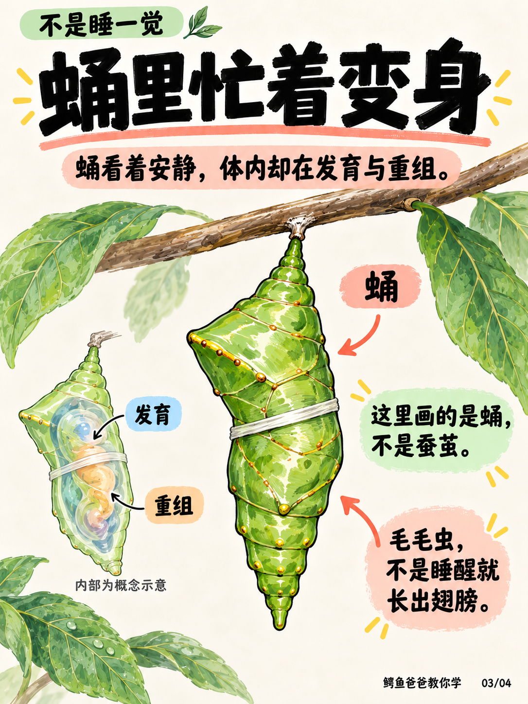

```text

视觉母版：严格3:4竖版，1080×1440构图，暖奶油纸底#F5F0E8，墨黑手绘粗标题，珊瑚红关键词，薄荷绿、淡蓝、杏色少量分区。遵循baoyu sketch-notes：高级科学手绘，轻微不规则线条、自然手涂色、弯曲箭头；充足留白，鲜明的大主体，绝不是满版小卡片或幼儿园贴纸。所有文字为清楚的中文手写黑体，标题极粗巨大。左右安全边距72，上下80。固定左上小栏目、右下页码。
Use case: scientific-educational. Generate ONE finished Xiaohongshu image, not contact sheet, not a mockup. 必须高质量完整中文图文，直接生成全部文字与插图，不留占位符。只使用下列指定文字，禁止添加英文、伪科学标签、网址或额外营销标题。图内每个主标题和小标题都不超过8字，字号须在手机信息流清晰可读。封面标题宽度占画布80%，主视觉55%左右，两者不要遮挡。右下页码细小不抢眼。署名文字严格为“鳄鱼爸爸教你学”（8字）。不要另绘鳄鱼头像，避免品牌形象变化。纸面设计平整满幅，没有外部场景或手机壳。无虚构数字和排名。
主题：butterfly；第3页/4，科普内页。沿用参考封面的颜色、字体和绘画语言，只改变本页构图与信息。
画面构图：巨大凤蝶绿色角形蛹，头向上，尾端固定枝条，有一条真实细丝带绕胸固定，不悬垂成帝王蝶J形蛹，也没有丝茧包裹。左下同一蛹小的半透明概念示意，内部以抽象柔和组织轮廓表示发育重组；不可画成睡着的毛毛虫、微型成蝶或可辨器官解剖。小标只用“蛹”“发育”“重组”，小注“内部为概念示意”。
需要逐字准确绘制的文字（按层级排版）：
栏目：不是睡一觉
主标题：蛹里忙着变身
说明：蛹看着安静，体内却在发育与重组。
短句1：这里画的是蛹，不是蚕茧。
短句2：毛毛虫，不是睡醒就长出翅膀。
署名：鳄鱼爸爸教你学
页码：03/04
画面标注或注释只允许使用构图描述中指定的中文，不添加其他文字。no square image, no landscape, no inconsistent margins, no different template, no random layout shift.

```

### 第4张 · 翅膀不是终点

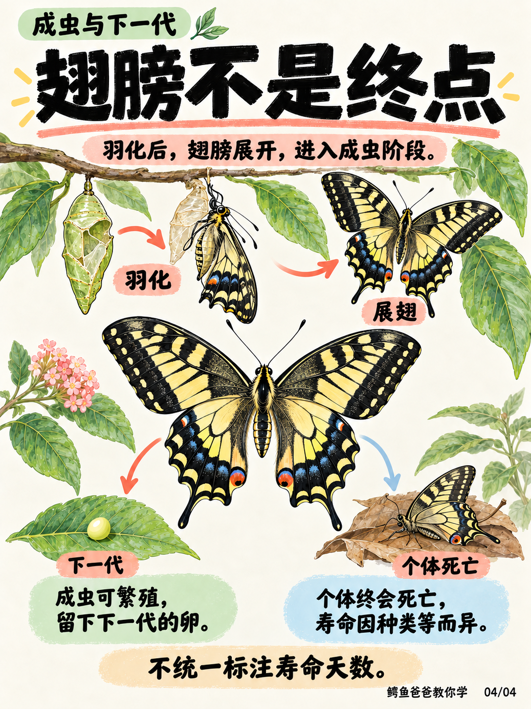

```text

视觉母版：严格3:4竖版，1080×1440构图，暖奶油纸底#F5F0E8，墨黑手绘粗标题，珊瑚红关键词，薄荷绿、淡蓝、杏色少量分区。遵循baoyu sketch-notes：高级科学手绘，轻微不规则线条、自然手涂色、弯曲箭头；充足留白，鲜明的大主体，绝不是满版小卡片或幼儿园贴纸。所有文字为清楚的中文手写黑体，标题极粗巨大。左右安全边距72，上下80。固定左上小栏目、右下页码。
Use case: scientific-educational. Generate ONE finished Xiaohongshu image, not contact sheet, not a mockup. 必须高质量完整中文图文，直接生成全部文字与插图，不留占位符。只使用下列指定文字，禁止添加英文、伪科学标签、网址或额外营销标题。图内每个主标题和小标题都不超过8字，字号须在手机信息流清晰可读。封面标题宽度占画布80%，主视觉55%左右，两者不要遮挡。右下页码细小不抢眼。署名文字严格为“鳄鱼爸爸教你学”（8字）。不要另绘鳄鱼头像，避免品牌形象变化。纸面设计平整满幅，没有外部场景或手机壳。无虚构数字和排名。
主题：butterfly；第4页/4，科普内页。沿用参考封面的颜色、字体和绘画语言，只改变本页构图与信息。
画面构图：上方枝条上空蛹壳，旁边刚羽化的凤蝶垂挂展开翅膀，中部一只展开黑黄翅完整凤蝶成为主视觉。下方两条简明支路：一条到叶片小卵标“下一代”，另一条到落叶上静止成蝶标“个体死亡”，死亡不接回卵。标签“羽化”“展翅”“繁殖”“下一代”“个体死亡”。底部小注“不统一标注寿命天数。”不可暗示每个个体必定繁殖或成虫就是完整一生。
需要逐字准确绘制的文字（按层级排版）：
栏目：成虫与下一代
主标题：翅膀不是终点
说明：羽化后，翅膀展开，进入成虫阶段。
短句1：成虫可繁殖，留下下一代的卵。
短句2：个体终会死亡，寿命因种类等而异。
署名：鳄鱼爸爸教你学
页码：04/04
画面标注或注释只允许使用构图描述中指定的中文，不添加其他文字。no square image, no landscape, no inconsistent margins, no different template, no random layout shift.

```

## 蝴蝶 / Auto-Redbook-Skills

发布标题：蝴蝶的成长照，前三张你认得吗

🦋 先别只盯着翅膀。蝴蝶的一生，要把这四种形态连起来看：卵→幼虫→蛹→成虫。

🍃 毛毛虫就是它的幼虫阶段。它取食、长大，并经历蜕皮；不同种类的幼虫，有各自适合的寄主植物。

🔍 蛹并不是“睡袋”。蛹期体内仍在发育和重组，图里的凤蝶蛹也不是蚕茧。羽化后，翅膀展开，才进入成虫的飞行生活。

最后要分清两个箭头：繁殖，通向下一代；死亡，是这个个体的生命终点。不能把循环图读成“同一只蝴蝶复活”。寿命也不能给所有种类统一一个数字。

把第一张给孩子看：哪一个阶段最让他意外？

图中凤蝶为形态示意，不按实际大小。学通识，就找鳄鱼爸爸。
#鳄鱼爸爸教你学 #蝴蝶 #完全变态 #自然观察 #亲子科普


### 视觉母版

视觉母版：严格3:4竖版，1080×1440构图。依据Auto-Redbook-Skills neo-brutalism CSS实际令牌：奶油白#FFFDF5、纯黑#000、黄色#FECA57、青色#00D2D3、少量红#FF4757。超粗无衬线中文标题，明确黑色细粗边和偏移硬阴影，非圆角卡片；一张精美科学切贴主体占半版，周围以2到3个大文字模块组织。大胆有设计感，黄色只强调关键结论，不要花哨贴纸、emoji、紫色渐变、网页截图或PPT。图文分稿，精确手动分页，每页单一知识任务。左右72px安全边距，署名左下页码右下。用户要求统一AI生图，故不使用HTML截图作为最终成品。

### 第1张 · 蝴蝶的一生

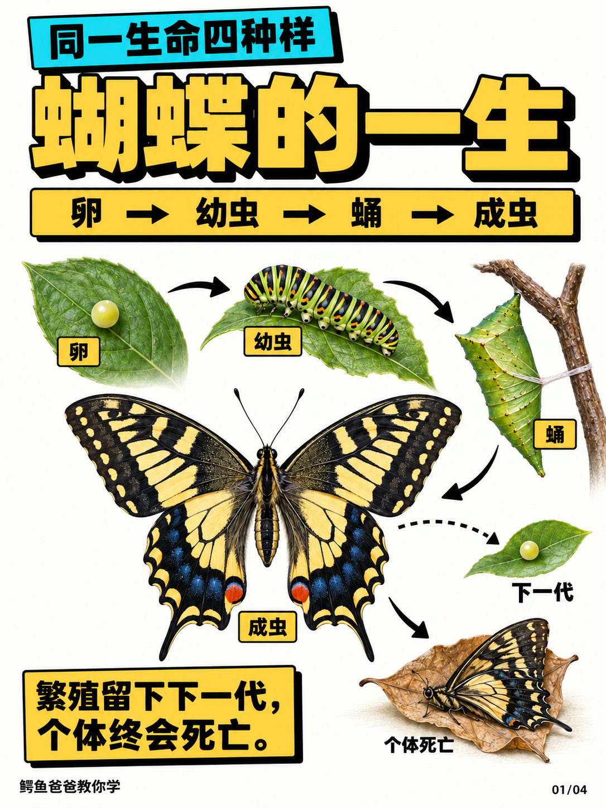

```text

视觉母版：严格3:4竖版，1080×1440构图。依据Auto-Redbook-Skills neo-brutalism CSS实际令牌：奶油白#FFFDF5、纯黑#000、黄色#FECA57、青色#00D2D3、少量红#FF4757。超粗无衬线中文标题，明确黑色细粗边和偏移硬阴影，非圆角卡片；一张精美科学切贴主体占半版，周围以2到3个大文字模块组织。大胆有设计感，黄色只强调关键结论，不要花哨贴纸、emoji、紫色渐变、网页截图或PPT。图文分稿，精确手动分页，每页单一知识任务。左右72px安全边距，署名左下页码右下。用户要求统一AI生图，故不使用HTML截图作为最终成品。
Use case: scientific-educational. Generate ONE finished Xiaohongshu image, not contact sheet, not a mockup. 必须高质量完整中文图文，直接生成全部文字与插图，不留占位符。只使用下列指定文字，禁止添加英文、伪科学标签、网址或额外营销标题。图内每个主标题和小标题都不超过8字，字号须在手机信息流清晰可读。封面标题宽度占画布80%，主视觉55%左右，两者不要遮挡。右下页码细小不抢眼。署名文字严格为“鳄鱼爸爸教你学”（8字）。不要另绘鳄鱼头像，避免品牌形象变化。纸面设计平整满幅，没有外部场景或手机壳。无虚构数字和排名。
主题：butterfly；第1页/4，封面。
画面构图：精美凤蝶完整生命周期总览，中央一只张翅黑黄凤蝶主视觉，翅对称，有后翅尾突；四个较小阶段沿S形阅读线分别为叶面一颗卵、叶上绿色毛毛虫、以丝带固定枝条的绿色角形裸蛹、完整有六足的凤蝶成虫。箭头明确卵→幼虫→蛹→成虫。成虫分出两条终点，一条虚线指向另外一颗小卵，标“下一代”，另一条短支线指向落叶旁静止的蝶轮廓，标“个体死亡”。不可把死亡箭头接回卵。各阶段大小示意，不能茧裹蛹，不画幼虫长翅。标题最醒目，四个短标“卵”“幼虫”“蛹”“成虫”。
需要逐字准确绘制的文字（按层级排版）：
栏目：同一生命四种样
主标题：蝴蝶的一生
说明：卵 → 幼虫 → 蛹 → 成虫
短句1：繁殖留下下一代，个体终会死亡。
署名：鳄鱼爸爸教你学
页码：01/04
画面标注或注释只允许使用构图描述中指定的中文，不添加其他文字。no square image, no landscape, no inconsistent margins, no different template, no random layout shift.
最终修订约束：卵为近球形、光滑浅黄色小圆珠，不是长椭圆或棱纹谷粒。凤蝶蛹用细丝腰带固定，不缠成厚绷带。

```

### 第2张 · 毛毛虫就是它

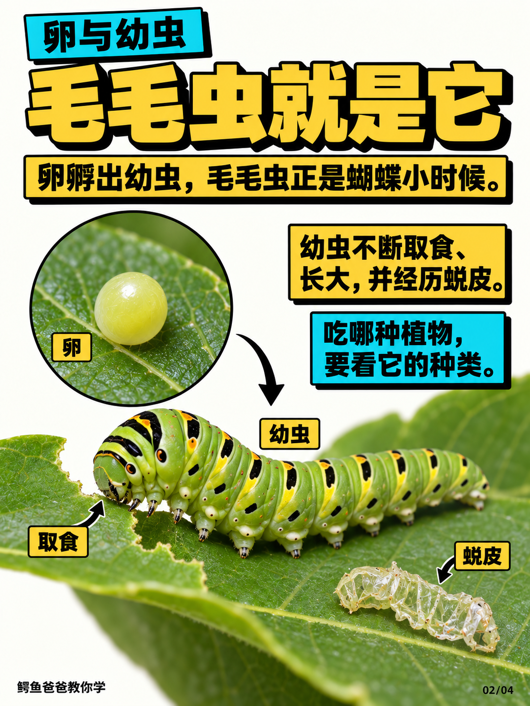

```text

视觉母版：严格3:4竖版，1080×1440构图。依据Auto-Redbook-Skills neo-brutalism CSS实际令牌：奶油白#FFFDF5、纯黑#000、黄色#FECA57、青色#00D2D3、少量红#FF4757。超粗无衬线中文标题，明确黑色细粗边和偏移硬阴影，非圆角卡片；一张精美科学切贴主体占半版，周围以2到3个大文字模块组织。大胆有设计感，黄色只强调关键结论，不要花哨贴纸、emoji、紫色渐变、网页截图或PPT。图文分稿，精确手动分页，每页单一知识任务。左右72px安全边距，署名左下页码右下。用户要求统一AI生图，故不使用HTML截图作为最终成品。
Use case: scientific-educational. Generate ONE finished Xiaohongshu image, not contact sheet, not a mockup. 必须高质量完整中文图文，直接生成全部文字与插图，不留占位符。只使用下列指定文字，禁止添加英文、伪科学标签、网址或额外营销标题。图内每个主标题和小标题都不超过8字，字号须在手机信息流清晰可读。封面标题宽度占画布80%，主视觉55%左右，两者不要遮挡。右下页码细小不抢眼。署名文字严格为“鳄鱼爸爸教你学”（8字）。不要另绘鳄鱼头像，避免品牌形象变化。纸面设计平整满幅，没有外部场景或手机壳。无虚构数字和排名。
主题：butterfly；第2页/4，科普内页。沿用参考封面的颜色、字体和绘画语言，只改变本页构图与信息。
画面构图：上方柑橘叶片边缘一颗近球形、光滑无竖向棱纹、浅黄绿色的小卵（不要椭圆谷粒形卵），单独圆形微距放大；下方侧面完整绿色凤蝶幼虫在柑橘叶上取食，真实幼虫无翅膀、有腹足及胸足，叶片有咬痕；旁边一片小的空旧表皮表示蜕皮。用弯箭头连卵和幼虫，标签“卵”“幼虫”“取食”“蜕皮”，不画有翼小蝴蝶从卵中出来，不画所有虫都吃柑橘的结论。
需要逐字准确绘制的文字（按层级排版）：
栏目：卵与幼虫
主标题：毛毛虫就是它
说明：卵孵出幼虫，毛毛虫正是蝴蝶小时候。
短句1：幼虫不断取食、长大，并经历蜕皮。
短句2：吃哪种植物，要看它的种类。
署名：鳄鱼爸爸教你学
页码：02/04
画面标注或注释只允许使用构图描述中指定的中文，不添加其他文字。no square image, no landscape, no inconsistent margins, no different template, no random layout shift.

```

### 第3张 · 蛹里忙着变身

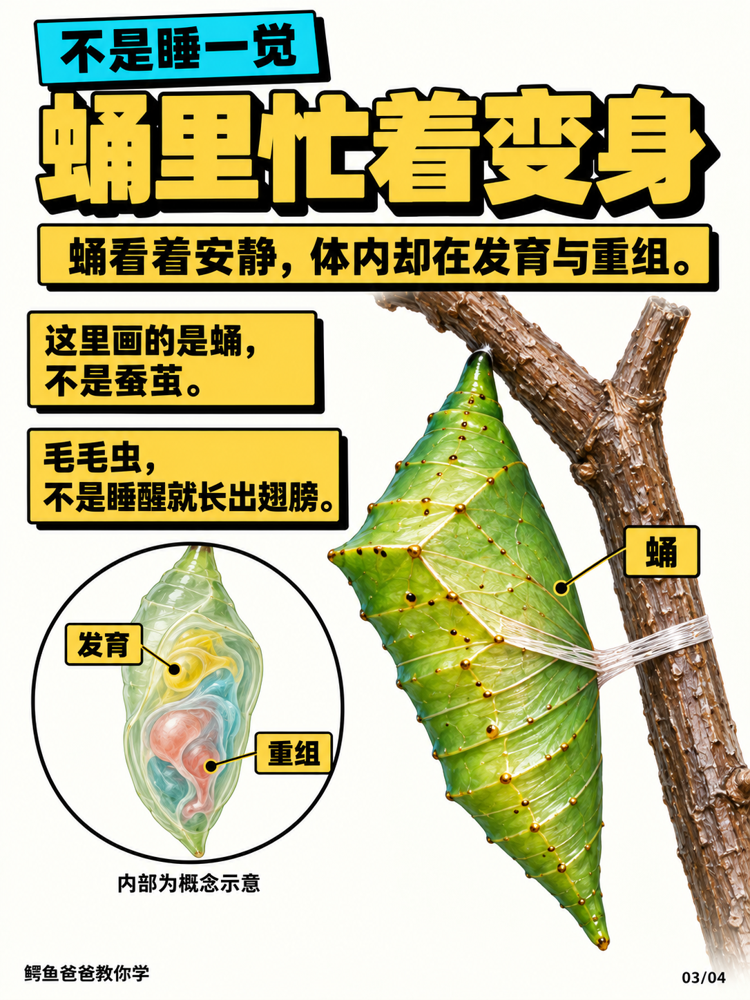

```text

视觉母版：严格3:4竖版，1080×1440构图。依据Auto-Redbook-Skills neo-brutalism CSS实际令牌：奶油白#FFFDF5、纯黑#000、黄色#FECA57、青色#00D2D3、少量红#FF4757。超粗无衬线中文标题，明确黑色细粗边和偏移硬阴影，非圆角卡片；一张精美科学切贴主体占半版，周围以2到3个大文字模块组织。大胆有设计感，黄色只强调关键结论，不要花哨贴纸、emoji、紫色渐变、网页截图或PPT。图文分稿，精确手动分页，每页单一知识任务。左右72px安全边距，署名左下页码右下。用户要求统一AI生图，故不使用HTML截图作为最终成品。
Use case: scientific-educational. Generate ONE finished Xiaohongshu image, not contact sheet, not a mockup. 必须高质量完整中文图文，直接生成全部文字与插图，不留占位符。只使用下列指定文字，禁止添加英文、伪科学标签、网址或额外营销标题。图内每个主标题和小标题都不超过8字，字号须在手机信息流清晰可读。封面标题宽度占画布80%，主视觉55%左右，两者不要遮挡。右下页码细小不抢眼。署名文字严格为“鳄鱼爸爸教你学”（8字）。不要另绘鳄鱼头像，避免品牌形象变化。纸面设计平整满幅，没有外部场景或手机壳。无虚构数字和排名。
主题：butterfly；第3页/4，科普内页。沿用参考封面的颜色、字体和绘画语言，只改变本页构图与信息。
画面构图：巨大凤蝶绿色角形蛹，头向上，尾端固定枝条，有一条真实细丝带绕胸固定，不悬垂成帝王蝶J形蛹，也没有丝茧包裹。左下同一蛹小的半透明概念示意，内部以抽象柔和组织轮廓表示发育重组；不可画成睡着的毛毛虫、微型成蝶或可辨器官解剖。小标只用“蛹”“发育”“重组”，小注“内部为概念示意”。
需要逐字准确绘制的文字（按层级排版）：
栏目：不是睡一觉
主标题：蛹里忙着变身
说明：蛹看着安静，体内却在发育与重组。
短句1：这里画的是蛹，不是蚕茧。
短句2：毛毛虫，不是睡醒就长出翅膀。
署名：鳄鱼爸爸教你学
页码：03/04
画面标注或注释只允许使用构图描述中指定的中文，不添加其他文字。no square image, no landscape, no inconsistent margins, no different template, no random layout shift.

```

### 第4张 · 翅膀不是终点

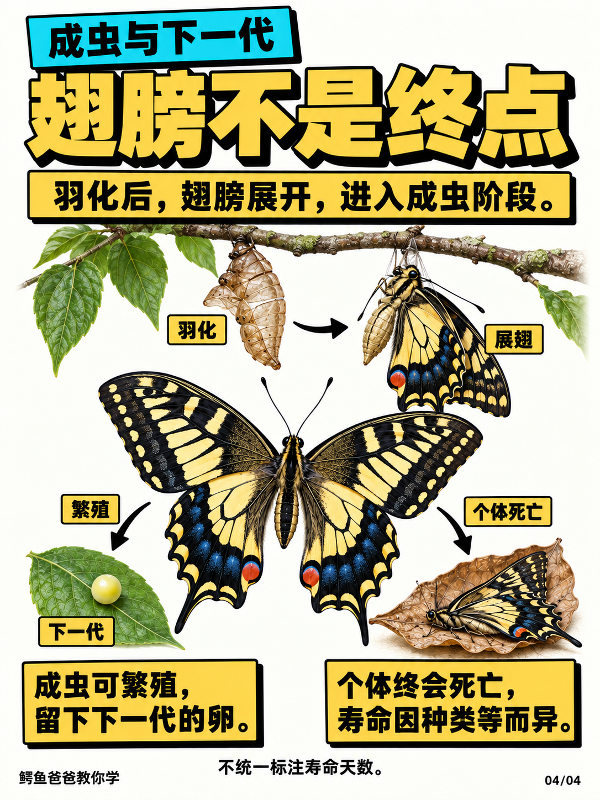

```text

视觉母版：严格3:4竖版，1080×1440构图。依据Auto-Redbook-Skills neo-brutalism CSS实际令牌：奶油白#FFFDF5、纯黑#000、黄色#FECA57、青色#00D2D3、少量红#FF4757。超粗无衬线中文标题，明确黑色细粗边和偏移硬阴影，非圆角卡片；一张精美科学切贴主体占半版，周围以2到3个大文字模块组织。大胆有设计感，黄色只强调关键结论，不要花哨贴纸、emoji、紫色渐变、网页截图或PPT。图文分稿，精确手动分页，每页单一知识任务。左右72px安全边距，署名左下页码右下。用户要求统一AI生图，故不使用HTML截图作为最终成品。
Use case: scientific-educational. Generate ONE finished Xiaohongshu image, not contact sheet, not a mockup. 必须高质量完整中文图文，直接生成全部文字与插图，不留占位符。只使用下列指定文字，禁止添加英文、伪科学标签、网址或额外营销标题。图内每个主标题和小标题都不超过8字，字号须在手机信息流清晰可读。封面标题宽度占画布80%，主视觉55%左右，两者不要遮挡。右下页码细小不抢眼。署名文字严格为“鳄鱼爸爸教你学”（8字）。不要另绘鳄鱼头像，避免品牌形象变化。纸面设计平整满幅，没有外部场景或手机壳。无虚构数字和排名。
主题：butterfly；第4页/4，科普内页。沿用参考封面的颜色、字体和绘画语言，只改变本页构图与信息。
画面构图：上方枝条上空蛹壳，旁边刚羽化的凤蝶垂挂展开翅膀，中部一只展开黑黄翅完整凤蝶成为主视觉。下方两条简明支路：一条到叶片小卵标“下一代”，另一条到落叶上静止成蝶标“个体死亡”，死亡不接回卵。标签“羽化”“展翅”“繁殖”“下一代”“个体死亡”。底部小注“不统一标注寿命天数。”不可暗示每个个体必定繁殖或成虫就是完整一生。
需要逐字准确绘制的文字（按层级排版）：
栏目：成虫与下一代
主标题：翅膀不是终点
说明：羽化后，翅膀展开，进入成虫阶段。
短句1：成虫可繁殖，留下下一代的卵。
短句2：个体终会死亡，寿命因种类等而异。
署名：鳄鱼爸爸教你学
页码：04/04
画面标注或注释只允许使用构图描述中指定的中文，不添加其他文字。no square image, no landscape, no inconsistent margins, no different template, no random layout shift.

```

## 蝴蝶 / XHS Visual Director

发布标题：你看见翅膀时，它已经变过很多次

一只蝴蝶飞到你面前时，你只看见了它生命中的一个阶段。

在此之前，它是一颗卵、一条取食和蜕皮的幼虫、一枚看起来安静的蛹。蛹期发生的，是身体的继续发育与重组，不是毛毛虫简单长出一对翅膀。

从蛹中羽化，翅膀展开，它成为成虫。此后可以繁殖，也终会走向死亡。下一代从新的卵开始：图上的循环说的是世代延续，不是个体重生。

这套图用凤蝶形态示意，不把蛹画成茧，不给所有蝴蝶统一的寿命天数。卵、幼虫、蛹、成虫，四个阶段要一起看，才是一段完整的生活史。

下次见到毛毛虫，试着先问：它现在处在哪一站？

学通识，就找鳄鱼爸爸。
#鳄鱼爸爸教你学 #蝴蝶的一生 #自然博物 #昆虫科普 #通识教育


### 视觉母版

Series visual master lock: create one page of the same Xiaohongshu carousel series, 1080x1440px, strict 3:4 vertical portrait canvas, no square, no landscape, no crop, no extra border. Identical safe margins 72px sides and 80px top/bottom, 12-column grid and 8px spacing, identical typography system, small bottom-right page number. 视觉导演母版：高级白底自然历史杂志风，淡象牙白#F7F3E9底、炭黑#18251E大字、森林绿#23563C、极少朱砂红#C34B36。像世界级自然博物馆科普特刊，生动精细的自然史写实插画/微距摄影质感，准确叶脉与虫体纹理，切面清晰、主体巨大。上方短黑体标题大胆占30%，留白精确，细编辑线和小标注，不用卡片堆叠，不用纯科技界面、霓虹、玻璃、塑料、低幼卡通。以视觉反差和局部放大讲解，而不是普通幻灯片。

### 第1张 · 蝴蝶的一生

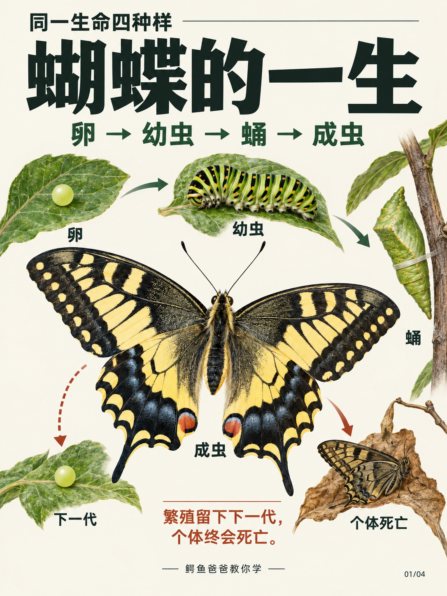

```text

Series visual master lock: create one page of the same Xiaohongshu carousel series, 1080x1440px, strict 3:4 vertical portrait canvas, no square, no landscape, no crop, no extra border. Identical safe margins 72px sides and 80px top/bottom, 12-column grid and 8px spacing, identical typography system, small bottom-right page number. 视觉导演母版：高级白底自然历史杂志风，淡象牙白#F7F3E9底、炭黑#18251E大字、森林绿#23563C、极少朱砂红#C34B36。像世界级自然博物馆科普特刊，生动精细的自然史写实插画/微距摄影质感，准确叶脉与虫体纹理，切面清晰、主体巨大。上方短黑体标题大胆占30%，留白精确，细编辑线和小标注，不用卡片堆叠，不用纯科技界面、霓虹、玻璃、塑料、低幼卡通。以视觉反差和局部放大讲解，而不是普通幻灯片。
Use case: scientific-educational. Generate ONE finished Xiaohongshu image, not contact sheet, not a mockup. 必须高质量完整中文图文，直接生成全部文字与插图，不留占位符。只使用下列指定文字，禁止添加英文、伪科学标签、网址或额外营销标题。图内每个主标题和小标题都不超过8字，字号须在手机信息流清晰可读。封面标题宽度占画布80%，主视觉55%左右，两者不要遮挡。右下页码细小不抢眼。署名文字严格为“鳄鱼爸爸教你学”（8字）。不要另绘鳄鱼头像，避免品牌形象变化。纸面设计平整满幅，没有外部场景或手机壳。无虚构数字和排名。
主题：butterfly；第1页/4，封面。
画面构图：精美凤蝶完整生命周期总览，中央一只张翅黑黄凤蝶主视觉，翅对称，有后翅尾突；四个较小阶段沿S形阅读线分别为叶面一颗卵、叶上绿色毛毛虫、以丝带固定枝条的绿色角形裸蛹、完整有六足的凤蝶成虫。箭头明确卵→幼虫→蛹→成虫。成虫分出两条终点，一条虚线指向另外一颗小卵，标“下一代”，另一条短支线指向落叶旁静止的蝶轮廓，标“个体死亡”。不可把死亡箭头接回卵。各阶段大小示意，不能茧裹蛹，不画幼虫长翅。标题最醒目，四个短标“卵”“幼虫”“蛹”“成虫”。
需要逐字准确绘制的文字（按层级排版）：
栏目：同一生命四种样
主标题：蝴蝶的一生
说明：卵 → 幼虫 → 蛹 → 成虫
短句1：繁殖留下下一代，个体终会死亡。
署名：鳄鱼爸爸教你学
页码：01/04
画面标注或注释只允许使用构图描述中指定的中文，不添加其他文字。no square image, no landscape, no inconsistent margins, no different template, no random layout shift.
最终修订约束：卵为近球形、光滑浅黄色小圆珠，不是长椭圆或棱纹谷粒。凤蝶蛹用细丝腰带固定，不缠成厚绷带。

```

### 第2张 · 毛毛虫就是它

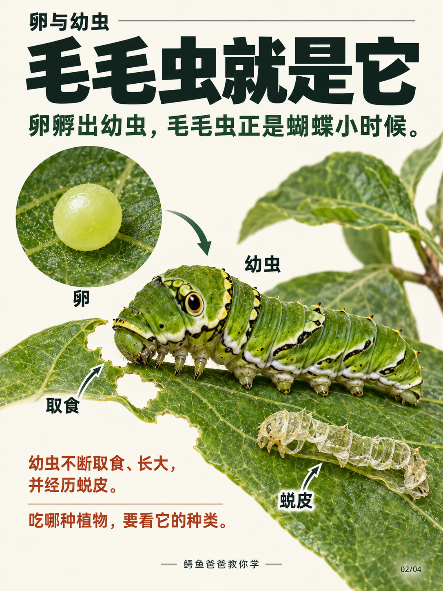

```text

Series visual master lock: create one page of the same Xiaohongshu carousel series, 1080x1440px, strict 3:4 vertical portrait canvas, no square, no landscape, no crop, no extra border. Identical safe margins 72px sides and 80px top/bottom, 12-column grid and 8px spacing, identical typography system, small bottom-right page number. 视觉导演母版：高级白底自然历史杂志风，淡象牙白#F7F3E9底、炭黑#18251E大字、森林绿#23563C、极少朱砂红#C34B36。像世界级自然博物馆科普特刊，生动精细的自然史写实插画/微距摄影质感，准确叶脉与虫体纹理，切面清晰、主体巨大。上方短黑体标题大胆占30%，留白精确，细编辑线和小标注，不用卡片堆叠，不用纯科技界面、霓虹、玻璃、塑料、低幼卡通。以视觉反差和局部放大讲解，而不是普通幻灯片。
Use case: scientific-educational. Generate ONE finished Xiaohongshu image, not contact sheet, not a mockup. 必须高质量完整中文图文，直接生成全部文字与插图，不留占位符。只使用下列指定文字，禁止添加英文、伪科学标签、网址或额外营销标题。图内每个主标题和小标题都不超过8字，字号须在手机信息流清晰可读。封面标题宽度占画布80%，主视觉55%左右，两者不要遮挡。右下页码细小不抢眼。署名文字严格为“鳄鱼爸爸教你学”（8字）。不要另绘鳄鱼头像，避免品牌形象变化。纸面设计平整满幅，没有外部场景或手机壳。无虚构数字和排名。
主题：butterfly；第2页/4，科普内页。沿用参考封面的颜色、字体和绘画语言，只改变本页构图与信息。
画面构图：上方柑橘叶片边缘一颗近球形、光滑无竖向棱纹、浅黄绿色的小卵（不要椭圆谷粒形卵），单独圆形微距放大；下方侧面完整绿色凤蝶幼虫在柑橘叶上取食，真实幼虫无翅膀、有腹足及胸足，叶片有咬痕；旁边一片小的空旧表皮表示蜕皮。用弯箭头连卵和幼虫，标签“卵”“幼虫”“取食”“蜕皮”，不画有翼小蝴蝶从卵中出来，不画所有虫都吃柑橘的结论。
需要逐字准确绘制的文字（按层级排版）：
栏目：卵与幼虫
主标题：毛毛虫就是它
说明：卵孵出幼虫，毛毛虫正是蝴蝶小时候。
短句1：幼虫不断取食、长大，并经历蜕皮。
短句2：吃哪种植物，要看它的种类。
署名：鳄鱼爸爸教你学
页码：02/04
画面标注或注释只允许使用构图描述中指定的中文，不添加其他文字。no square image, no landscape, no inconsistent margins, no different template, no random layout shift.

```

### 第3张 · 蛹里忙着变身

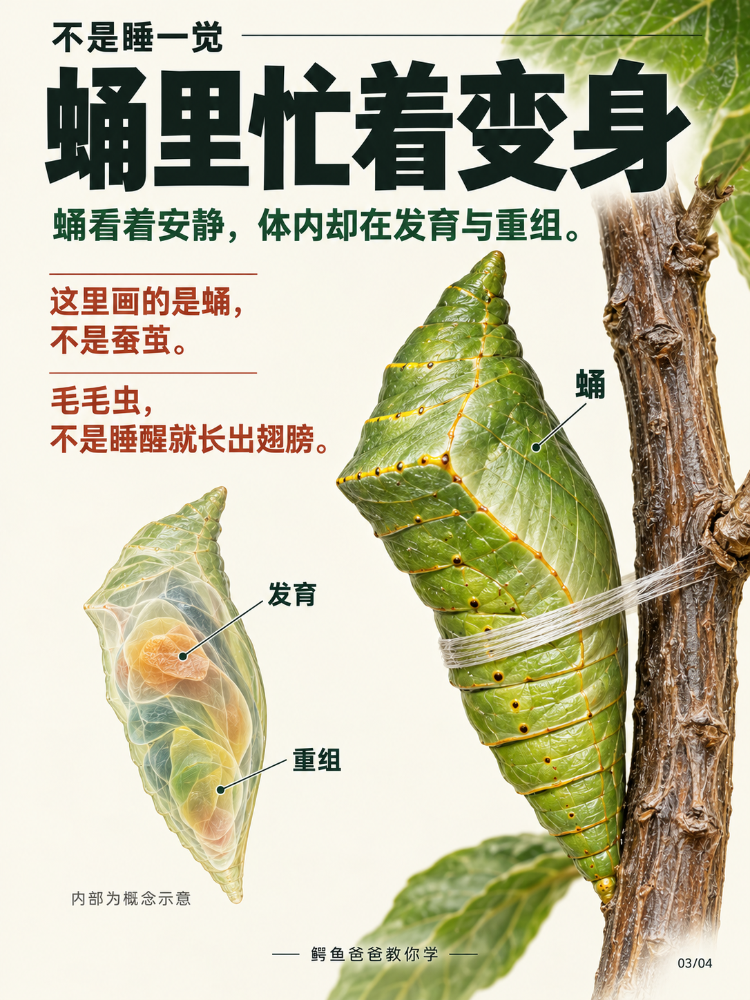

```text

Series visual master lock: create one page of the same Xiaohongshu carousel series, 1080x1440px, strict 3:4 vertical portrait canvas, no square, no landscape, no crop, no extra border. Identical safe margins 72px sides and 80px top/bottom, 12-column grid and 8px spacing, identical typography system, small bottom-right page number. 视觉导演母版：高级白底自然历史杂志风，淡象牙白#F7F3E9底、炭黑#18251E大字、森林绿#23563C、极少朱砂红#C34B36。像世界级自然博物馆科普特刊，生动精细的自然史写实插画/微距摄影质感，准确叶脉与虫体纹理，切面清晰、主体巨大。上方短黑体标题大胆占30%，留白精确，细编辑线和小标注，不用卡片堆叠，不用纯科技界面、霓虹、玻璃、塑料、低幼卡通。以视觉反差和局部放大讲解，而不是普通幻灯片。
Use case: scientific-educational. Generate ONE finished Xiaohongshu image, not contact sheet, not a mockup. 必须高质量完整中文图文，直接生成全部文字与插图，不留占位符。只使用下列指定文字，禁止添加英文、伪科学标签、网址或额外营销标题。图内每个主标题和小标题都不超过8字，字号须在手机信息流清晰可读。封面标题宽度占画布80%，主视觉55%左右，两者不要遮挡。右下页码细小不抢眼。署名文字严格为“鳄鱼爸爸教你学”（8字）。不要另绘鳄鱼头像，避免品牌形象变化。纸面设计平整满幅，没有外部场景或手机壳。无虚构数字和排名。
主题：butterfly；第3页/4，科普内页。沿用参考封面的颜色、字体和绘画语言，只改变本页构图与信息。
画面构图：巨大凤蝶绿色角形蛹，头向上，尾端固定枝条，有一条真实细丝带绕胸固定，不悬垂成帝王蝶J形蛹，也没有丝茧包裹。左下同一蛹小的半透明概念示意，内部以抽象柔和组织轮廓表示发育重组；不可画成睡着的毛毛虫、微型成蝶或可辨器官解剖。小标只用“蛹”“发育”“重组”，小注“内部为概念示意”。
需要逐字准确绘制的文字（按层级排版）：
栏目：不是睡一觉
主标题：蛹里忙着变身
说明：蛹看着安静，体内却在发育与重组。
短句1：这里画的是蛹，不是蚕茧。
短句2：毛毛虫，不是睡醒就长出翅膀。
署名：鳄鱼爸爸教你学
页码：03/04
画面标注或注释只允许使用构图描述中指定的中文，不添加其他文字。no square image, no landscape, no inconsistent margins, no different template, no random layout shift.

```

### 第4张 · 翅膀不是终点

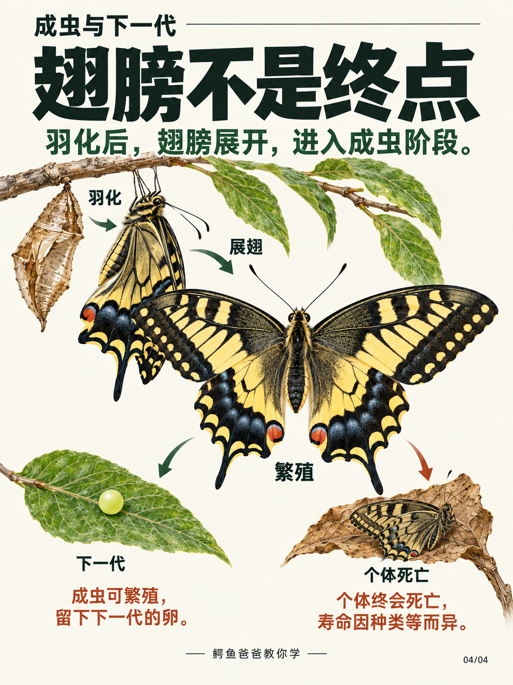

```text

Series visual master lock: create one page of the same Xiaohongshu carousel series, 1080x1440px, strict 3:4 vertical portrait canvas, no square, no landscape, no crop, no extra border. Identical safe margins 72px sides and 80px top/bottom, 12-column grid and 8px spacing, identical typography system, small bottom-right page number. 视觉导演母版：高级白底自然历史杂志风，淡象牙白#F7F3E9底、炭黑#18251E大字、森林绿#23563C、极少朱砂红#C34B36。像世界级自然博物馆科普特刊，生动精细的自然史写实插画/微距摄影质感，准确叶脉与虫体纹理，切面清晰、主体巨大。上方短黑体标题大胆占30%，留白精确，细编辑线和小标注，不用卡片堆叠，不用纯科技界面、霓虹、玻璃、塑料、低幼卡通。以视觉反差和局部放大讲解，而不是普通幻灯片。
Use case: scientific-educational. Generate ONE finished Xiaohongshu image, not contact sheet, not a mockup. 必须高质量完整中文图文，直接生成全部文字与插图，不留占位符。只使用下列指定文字，禁止添加英文、伪科学标签、网址或额外营销标题。图内每个主标题和小标题都不超过8字，字号须在手机信息流清晰可读。封面标题宽度占画布80%，主视觉55%左右，两者不要遮挡。右下页码细小不抢眼。署名文字严格为“鳄鱼爸爸教你学”（8字）。不要另绘鳄鱼头像，避免品牌形象变化。纸面设计平整满幅，没有外部场景或手机壳。无虚构数字和排名。
主题：butterfly；第4页/4，科普内页。沿用参考封面的颜色、字体和绘画语言，只改变本页构图与信息。
画面构图：上方枝条上空蛹壳，旁边刚羽化的凤蝶垂挂展开翅膀，中部一只展开黑黄翅完整凤蝶成为主视觉。下方两条简明支路：一条到叶片小卵标“下一代”，另一条到落叶上静止成蝶标“个体死亡”，死亡不接回卵。标签“羽化”“展翅”“繁殖”“下一代”“个体死亡”。底部小注“不统一标注寿命天数。”不可暗示每个个体必定繁殖或成虫就是完整一生。
需要逐字准确绘制的文字（按层级排版）：
栏目：成虫与下一代
主标题：翅膀不是终点
说明：羽化后，翅膀展开，进入成虫阶段。
短句1：成虫可繁殖，留下下一代的卵。
短句2：个体终会死亡，寿命因种类等而异。
署名：鳄鱼爸爸教你学
页码：04/04
画面标注或注释只允许使用构图描述中指定的中文，不添加其他文字。no square image, no landscape, no inconsistent margins, no different template, no random layout shift.

```

## 烧水壶 / 宝玉 · baoyu-xhs-images

发布标题：烧水壶的秘密：谁在水开后按开关

每天那声“咔哒”，到底是谁在按开关？

把常见蒸汽式电热水壶透视一下：加热盘先把水烧开；蒸汽从壶盖附近的入口，沿通道到达温控器；双金属片受热后突然翻转，推动机构把电触点分开。电路断了，加热就停了。

双金属片由膨胀程度不同的金属结合而成。它的门道，是把受热变形做成干脆、可重复的“跳变”，再让触点可靠断开。材料、成形、装配、寿命测试，都有功夫。

所以，它通常不是把一根探针插进水里，等显示100℃才关。水的沸点随气压变化，蒸汽触发与精确恒温也不是同一件事。防干烧保护则另管底盘异常过热。智能恒温壶可能采用不同方案。

和孩子听一听那声开关声就好，不拆壶、不堵蒸汽口。你还想透视哪个家电？

学通识，就找鳄鱼爸爸。
#鳄鱼爸爸教你学 #通识教育 #亲子共学 #烧水壶 #科普


### 视觉母版

视觉母版：严格3:4竖版，1080×1440构图，暖奶油纸底#F5F0E8，墨黑手绘粗标题，珊瑚红关键词，薄荷绿、淡蓝、杏色少量分区。遵循baoyu sketch-notes：高级科学手绘，轻微不规则线条、自然手涂色、弯曲箭头；充足留白，鲜明的大主体，绝不是满版小卡片或幼儿园贴纸。所有文字为清楚的中文手写黑体，标题极粗巨大。左右安全边距72，上下80。固定左上小栏目、右下页码。

### 第1张 · 烧水壶的秘密

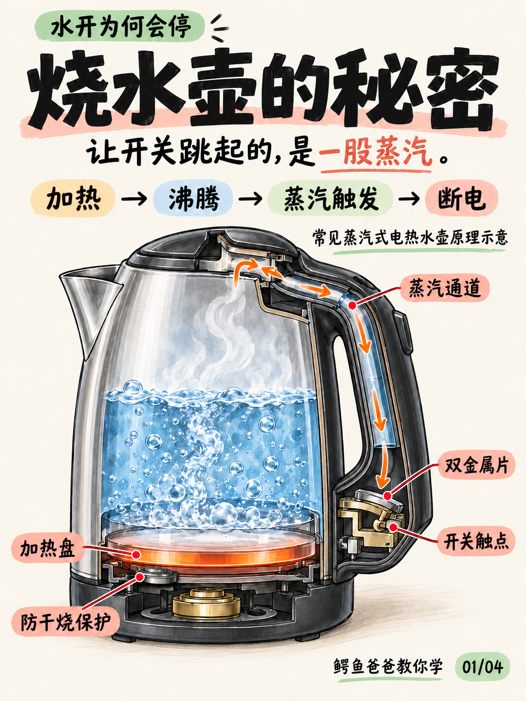

```text

视觉母版：严格3:4竖版，1080×1440构图，暖奶油纸底#F5F0E8，墨黑手绘粗标题，珊瑚红关键词，薄荷绿、淡蓝、杏色少量分区。遵循baoyu sketch-notes：高级科学手绘，轻微不规则线条、自然手涂色、弯曲箭头；充足留白，鲜明的大主体，绝不是满版小卡片或幼儿园贴纸。所有文字为清楚的中文手写黑体，标题极粗巨大。左右安全边距72，上下80。固定左上小栏目、右下页码。
Series visual master lock: 1080x1440px, strict 3:4 vertical portrait canvas. Same safe margins 72px horizontal 80px vertical; 12-column grid, 8px spacing. ONE finished premium Xiaohongshu infographic, not mockup, no contact sheet, no square, no landscape, no different template. 清楚准确的简体中文，全幅原创插图与文字，不加额外标题。标题最大不超过8字，必须醒目，手机缩略图可读。标题上方小栏目、底部署名和右下页码。不要另绘鳄鱼头像或装饰卡通脸，不要二维码网址。每页最多三段短说明，科学图解为视觉主角，拒绝平庸PPT分栏和过密字堆。
封面：标题占宽80%，主视觉巨大，制造好奇。
画面：占画面65%的巨大不锈钢电热水壶，左侧壶嘴、右侧黑色把手。壶体部分剖开透明，蓝色水在金属底盘上沸腾。壶盖内侧入口通向把手内的独立细蒸汽通道，再向下通往把手根部的控制器。用橙色箭头明确蒸汽从水面上方经壶盖入口沿把手向下流，绝不能画成从壶底管道上升。加热盘在水下的密封金属底板下方，控制器在干燥外壳内。五条细引线精确标注：加热盘、蒸汽通道、双金属片、开关触点、防干烧保护；双金属片与开关触点位于把手底部控制器，防干烧保护另指底盘下与盘接触的温控元件。不要水中探针、不要电线进水。大标题顶部两行，关键路径一眼看懂，专业工程剖视插图，非家电广告。
逐字绘制文字：
栏目：水开为何会停
主标题：烧水壶的秘密
说明：让开关跳起的，是一股蒸汽。
短句：加热 → 沸腾 → 蒸汽触发 → 断电
短句：常见蒸汽式电热水壶原理示意
署名：鳄鱼爸爸教你学
页码：01/04
仅使用上列文字与画面指定标签，不得补造数字、因果或排名。工程与自然插画须结构可信，不加无关英文。
复核修订：防干烧保护的引线准确指向贴紧加热盘底部的过热温控器，禁止指向底座中央供电连接器。

```

### 第2张 · 蒸汽去报信

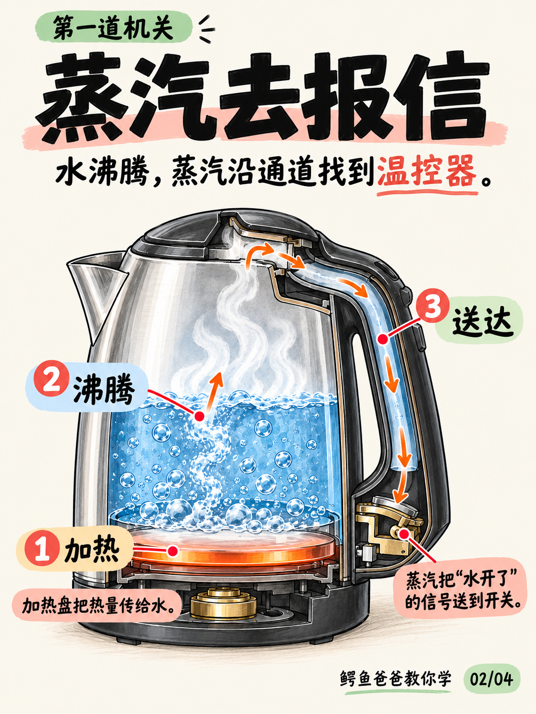

```text

视觉母版：严格3:4竖版，1080×1440构图，暖奶油纸底#F5F0E8，墨黑手绘粗标题，珊瑚红关键词，薄荷绿、淡蓝、杏色少量分区。遵循baoyu sketch-notes：高级科学手绘，轻微不规则线条、自然手涂色、弯曲箭头；充足留白，鲜明的大主体，绝不是满版小卡片或幼儿园贴纸。所有文字为清楚的中文手写黑体，标题极粗巨大。左右安全边距72，上下80。固定左上小栏目、右下页码。
Series visual master lock: 1080x1440px, strict 3:4 vertical portrait canvas. Same safe margins 72px horizontal 80px vertical; 12-column grid, 8px spacing. ONE finished premium Xiaohongshu infographic, not mockup, no contact sheet, no square, no landscape, no different template. 清楚准确的简体中文，全幅原创插图与文字，不加额外标题。标题最大不超过8字，必须醒目，手机缩略图可读。标题上方小栏目、底部署名和右下页码。不要另绘鳄鱼头像或装饰卡通脸，不要二维码网址。每页最多三段短说明，科学图解为视觉主角，拒绝平庸PPT分栏和过密字堆。
本页为同一系列内页，参考封面锁定调色、字体与插画语言，改变信息构图而不换模板。
画面：沿用封面水壶造型，中央剖视简化成三个巨大连续视觉节点：底部加热盘在密封金属底板下加热蓝色水，水面之上产生蒸汽，蒸汽从上方入口进入把手内独立通道向下到达控制器。数字1/2/3依次标注，加热、沸腾、送达三标签。不画温度计探针，不画蒸汽直接切断电线。箭头严格水面→壶盖内入口→把手内通道→下方控制器。
逐字绘制文字：
栏目：第一道机关
主标题：蒸汽去报信
说明：水沸腾，蒸汽沿通道找到温控器。
短句：加热盘把热量传给水。
短句：蒸汽把“水开了”的信号送到开关。
署名：鳄鱼爸爸教你学
页码：02/04
仅使用上列文字与画面指定标签，不得补造数字、因果或排名。工程与自然插画须结构可信，不加无关英文。

```

### 第3张 · 金属片会跳

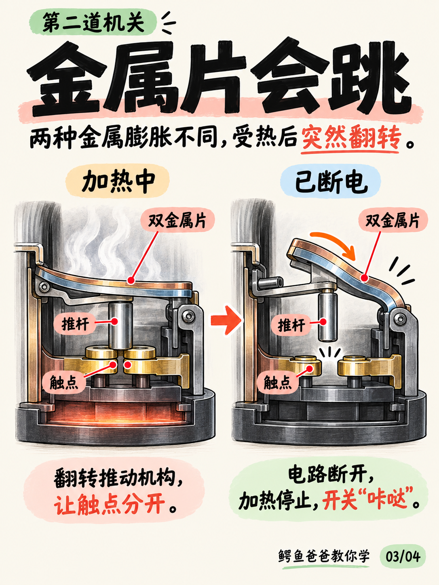

```text

视觉母版：严格3:4竖版，1080×1440构图，暖奶油纸底#F5F0E8，墨黑手绘粗标题，珊瑚红关键词，薄荷绿、淡蓝、杏色少量分区。遵循baoyu sketch-notes：高级科学手绘，轻微不规则线条、自然手涂色、弯曲箭头；充足留白，鲜明的大主体，绝不是满版小卡片或幼儿园贴纸。所有文字为清楚的中文手写黑体，标题极粗巨大。左右安全边距72，上下80。固定左上小栏目、右下页码。
Series visual master lock: 1080x1440px, strict 3:4 vertical portrait canvas. Same safe margins 72px horizontal 80px vertical; 12-column grid, 8px spacing. ONE finished premium Xiaohongshu infographic, not mockup, no contact sheet, no square, no landscape, no different template. 清楚准确的简体中文，全幅原创插图与文字，不加额外标题。标题最大不超过8字，必须醒目，手机缩略图可读。标题上方小栏目、底部署名和右下页码。不要另绘鳄鱼头像或装饰卡通脸，不要二维码网址。每页最多三段短说明，科学图解为视觉主角，拒绝平庸PPT分栏和过密字堆。
本页为同一系列内页，参考封面锁定调色、字体与插画语言，改变信息构图而不换模板。
画面：微距放大控制器。并列两个清楚状态，左“加热中”：两层粘合的弯曲金属圆片，推杆及一对接触的金色触点；右“已断电”：同一双金属圆片受热突然反向弯曲，推动机械杠杆使同一对触点离开，有明显空气间隙。两个颜色不同的金属层紧密结合，不画两条独立线。标签只用双金属片、推杆、触点、加热中、已断电。蒸汽是热量输入，不是物理吹动叶轮，无芯片，无电子探针。
逐字绘制文字：
栏目：第二道机关
主标题：金属片会跳
说明：两种金属膨胀不同，受热后突然翻转。
短句：翻转推动机构，让触点分开。
短句：电路断开，加热停止，开关“咔哒”。
署名：鳄鱼爸爸教你学
页码：03/04
仅使用上列文字与画面指定标签，不得补造数字、因果或排名。工程与自然插画须结构可信，不加无关英文。

```

### 第4张 · 小开关有门道

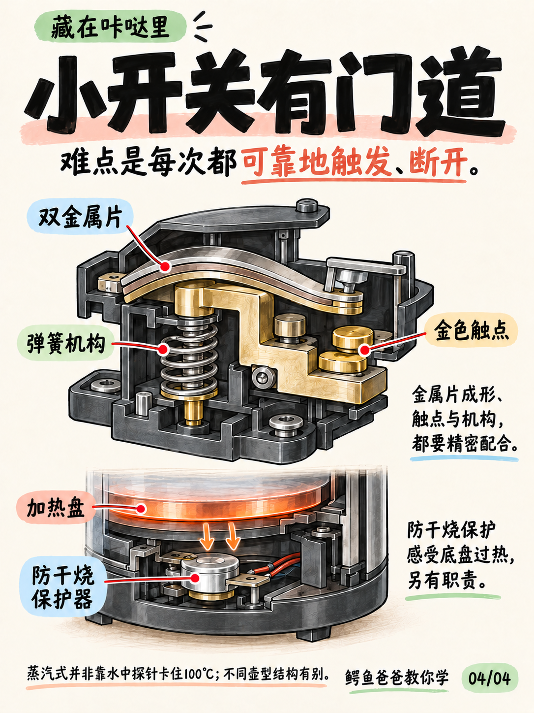

```text

视觉母版：严格3:4竖版，1080×1440构图，暖奶油纸底#F5F0E8，墨黑手绘粗标题，珊瑚红关键词，薄荷绿、淡蓝、杏色少量分区。遵循baoyu sketch-notes：高级科学手绘，轻微不规则线条、自然手涂色、弯曲箭头；充足留白，鲜明的大主体，绝不是满版小卡片或幼儿园贴纸。所有文字为清楚的中文手写黑体，标题极粗巨大。左右安全边距72，上下80。固定左上小栏目、右下页码。
Series visual master lock: 1080x1440px, strict 3:4 vertical portrait canvas. Same safe margins 72px horizontal 80px vertical; 12-column grid, 8px spacing. ONE finished premium Xiaohongshu infographic, not mockup, no contact sheet, no square, no landscape, no different template. 清楚准确的简体中文，全幅原创插图与文字，不加额外标题。标题最大不超过8字，必须醒目，手机缩略图可读。标题上方小栏目、底部署名和右下页码。不要另绘鳄鱼头像或装饰卡通脸，不要二维码网址。每页最多三段短说明，科学图解为视觉主角，拒绝平庸PPT分栏和过密字堆。
本页为同一系列内页，参考封面锁定调色、字体与插画语言，改变信息构图而不换模板。
画面：精致爆炸图聚焦一枚真实结构感的温控器：双金属片、弹簧机构、金色触点，旁边微小重复循环箭头表达耐用但不标虚构次数。下半区只用一条底盘切面显示独立防干烧保护器贴近加热盘，箭头从底盘传热到它；绝无空壶通电实验。页脚清楚小注“蒸汽式并非靠水中探针卡住100℃；不同壶型结构有别。” 标题区域宽裕，结构爆炸图不变成购物产品清单。
逐字绘制文字：
栏目：藏在咔哒里
主标题：小开关有门道
说明：难点是每次都可靠地触发、断开。
短句：金属片成形、触点与机构，都要精密配合。
短句：防干烧保护感受底盘过热，另有职责。
署名：鳄鱼爸爸教你学
页码：04/04
仅使用上列文字与画面指定标签，不得补造数字、因果或排名。工程与自然插画须结构可信，不加无关英文。
复核修订：不得添加“蒸汽推动”的标签、气流喷出或蒸汽压力推动开关的画面；温度让双金属片变形，机构才断开触点。

```

## 烧水壶 / Auto-Redbook-Skills

发布标题：水壶不是数到100才断电？

水壶会“数到100”吗？

拆开这个误会，只需跟着一股蒸汽走：
① 加热盘发热，热量传给水。
② 水沸腾，蒸汽顺着专门通道到达温控器。
③ 双金属片受热跳变，推动机构断开触点。
④ 电路一断，开关弹起，加热停止。

🔎 真正厉害的是小零件的可靠性：两种金属怎样结合、片形怎样控制、触点怎样断得干脆，决定了这声“咔哒”能否一次次准时发生。防干烧保护还有另一套底盘过热检测职责。

本文画的是常见蒸汽式结构，不代表所有恒温壶。正常气压下水约100℃沸腾，气压变了，沸点也会变；它并不等于用水中探针盯死100℃。

收藏这四张，下次水开就能给孩子讲明白。

学通识，就找鳄鱼爸爸。
#鳄鱼爸爸教你学 #通识教育 #亲子共学 #烧水壶 #科普


### 视觉母版

视觉母版：严格3:4竖版，1080×1440构图。依据Auto-Redbook-Skills neo-brutalism CSS实际令牌：奶油白#FFFDF5、纯黑#000、黄色#FECA57、青色#00D2D3、少量红#FF4757。超粗无衬线中文标题，明确黑色细粗边和偏移硬阴影，非圆角卡片；一张精美科学切贴主体占半版，周围以2到3个大文字模块组织。大胆有设计感，黄色只强调关键结论，不要花哨贴纸、emoji、紫色渐变、网页截图或PPT。图文分稿，精确手动分页，每页单一知识任务。左右72px安全边距，署名左下页码右下。用户要求统一AI生图，故不使用HTML截图作为最终成品。

### 第1张 · 烧水壶的秘密

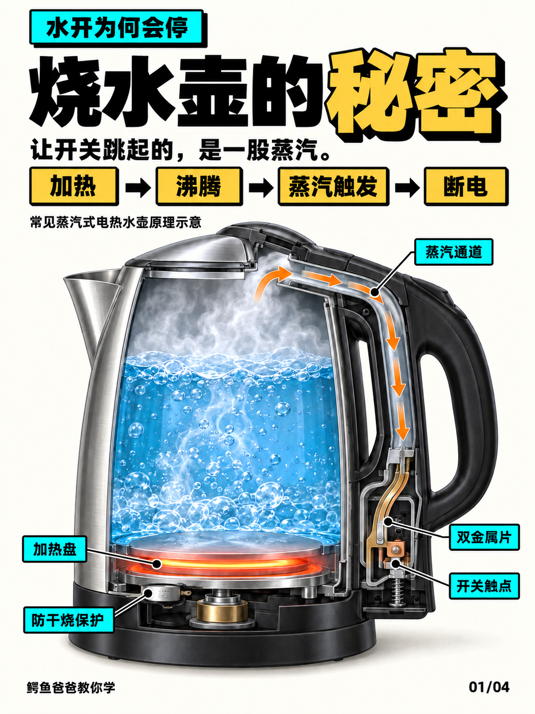

```text

视觉母版：严格3:4竖版，1080×1440构图。依据Auto-Redbook-Skills neo-brutalism CSS实际令牌：奶油白#FFFDF5、纯黑#000、黄色#FECA57、青色#00D2D3、少量红#FF4757。超粗无衬线中文标题，明确黑色细粗边和偏移硬阴影，非圆角卡片；一张精美科学切贴主体占半版，周围以2到3个大文字模块组织。大胆有设计感，黄色只强调关键结论，不要花哨贴纸、emoji、紫色渐变、网页截图或PPT。图文分稿，精确手动分页，每页单一知识任务。左右72px安全边距，署名左下页码右下。用户要求统一AI生图，故不使用HTML截图作为最终成品。
Series visual master lock: 1080x1440px, strict 3:4 vertical portrait canvas. Same safe margins 72px horizontal 80px vertical; 12-column grid, 8px spacing. ONE finished premium Xiaohongshu infographic, not mockup, no contact sheet, no square, no landscape, no different template. 清楚准确的简体中文，全幅原创插图与文字，不加额外标题。标题最大不超过8字，必须醒目，手机缩略图可读。标题上方小栏目、底部署名和右下页码。不要另绘鳄鱼头像或装饰卡通脸，不要二维码网址。每页最多三段短说明，科学图解为视觉主角，拒绝平庸PPT分栏和过密字堆。
封面：标题占宽80%，主视觉巨大，制造好奇。
画面：占画面65%的巨大不锈钢电热水壶，左侧壶嘴、右侧黑色把手。壶体部分剖开透明，蓝色水在金属底盘上沸腾。壶盖内侧入口通向把手内的独立细蒸汽通道，再向下通往把手根部的控制器。用橙色箭头明确蒸汽从水面上方经壶盖入口沿把手向下流，绝不能画成从壶底管道上升。加热盘在水下的密封金属底板下方，控制器在干燥外壳内。五条细引线精确标注：加热盘、蒸汽通道、双金属片、开关触点、防干烧保护；双金属片与开关触点位于把手底部控制器，防干烧保护另指底盘下与盘接触的温控元件。不要水中探针、不要电线进水。大标题顶部两行，关键路径一眼看懂，专业工程剖视插图，非家电广告。
逐字绘制文字：
栏目：水开为何会停
主标题：烧水壶的秘密
说明：让开关跳起的，是一股蒸汽。
短句：加热 → 沸腾 → 蒸汽触发 → 断电
短句：常见蒸汽式电热水壶原理示意
署名：鳄鱼爸爸教你学
页码：01/04
仅使用上列文字与画面指定标签，不得补造数字、因果或排名。工程与自然插画须结构可信，不加无关英文。
复核修订：防干烧保护的引线准确指向贴紧加热盘底部的过热温控器，禁止指向底座中央供电连接器。

```

### 第2张 · 蒸汽去报信

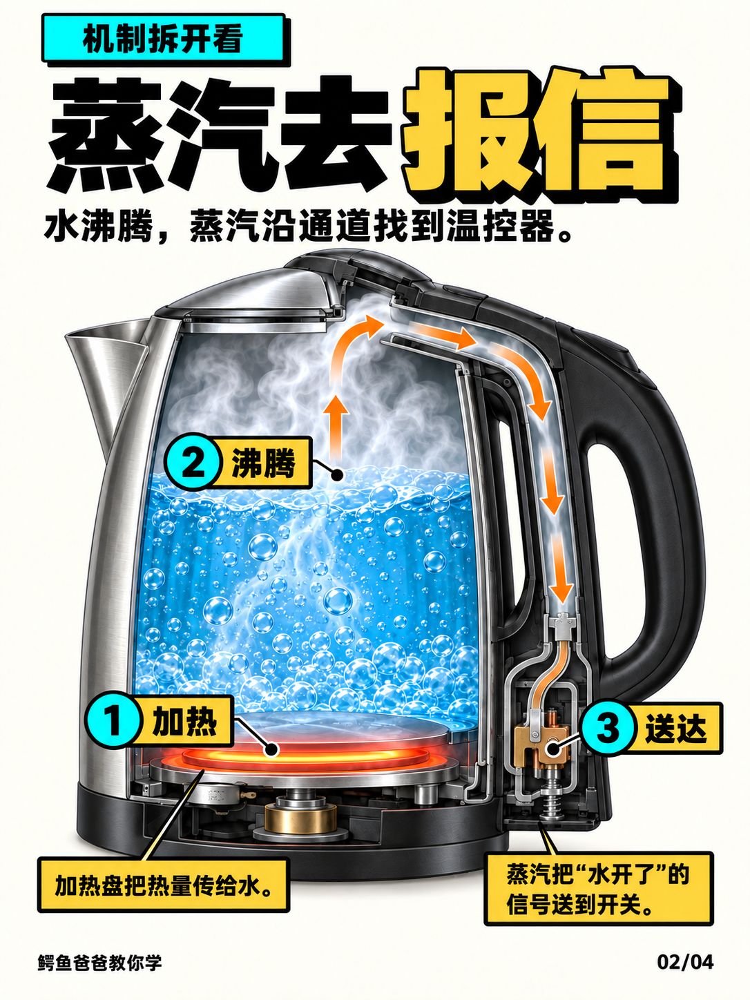

```text

视觉母版：严格3:4竖版，1080×1440构图。依据Auto-Redbook-Skills neo-brutalism CSS实际令牌：奶油白#FFFDF5、纯黑#000、黄色#FECA57、青色#00D2D3、少量红#FF4757。超粗无衬线中文标题，明确黑色细粗边和偏移硬阴影，非圆角卡片；一张精美科学切贴主体占半版，周围以2到3个大文字模块组织。大胆有设计感，黄色只强调关键结论，不要花哨贴纸、emoji、紫色渐变、网页截图或PPT。图文分稿，精确手动分页，每页单一知识任务。左右72px安全边距，署名左下页码右下。用户要求统一AI生图，故不使用HTML截图作为最终成品。
Series visual master lock: 1080x1440px, strict 3:4 vertical portrait canvas. Same safe margins 72px horizontal 80px vertical; 12-column grid, 8px spacing. ONE finished premium Xiaohongshu infographic, not mockup, no contact sheet, no square, no landscape, no different template. 清楚准确的简体中文，全幅原创插图与文字，不加额外标题。标题最大不超过8字，必须醒目，手机缩略图可读。标题上方小栏目、底部署名和右下页码。不要另绘鳄鱼头像或装饰卡通脸，不要二维码网址。每页最多三段短说明，科学图解为视觉主角，拒绝平庸PPT分栏和过密字堆。
本页为同一系列内页，参考封面锁定调色、字体与插画语言，改变信息构图而不换模板。
画面：沿用封面水壶造型，中央剖视简化成三个巨大连续视觉节点：底部加热盘在密封金属底板下加热蓝色水，水面之上产生蒸汽，蒸汽从上方入口进入把手内独立通道向下到达控制器。数字1/2/3依次标注，加热、沸腾、送达三标签。不画温度计探针，不画蒸汽直接切断电线。箭头严格水面→壶盖内入口→把手内通道→下方控制器。
逐字绘制文字：
栏目：机制拆开看
主标题：蒸汽去报信
说明：水沸腾，蒸汽沿通道找到温控器。
短句：加热盘把热量传给水。
短句：蒸汽把“水开了”的信号送到开关。
署名：鳄鱼爸爸教你学
页码：02/04
仅使用上列文字与画面指定标签，不得补造数字、因果或排名。工程与自然插画须结构可信，不加无关英文。

```

### 第3张 · 金属片会跳

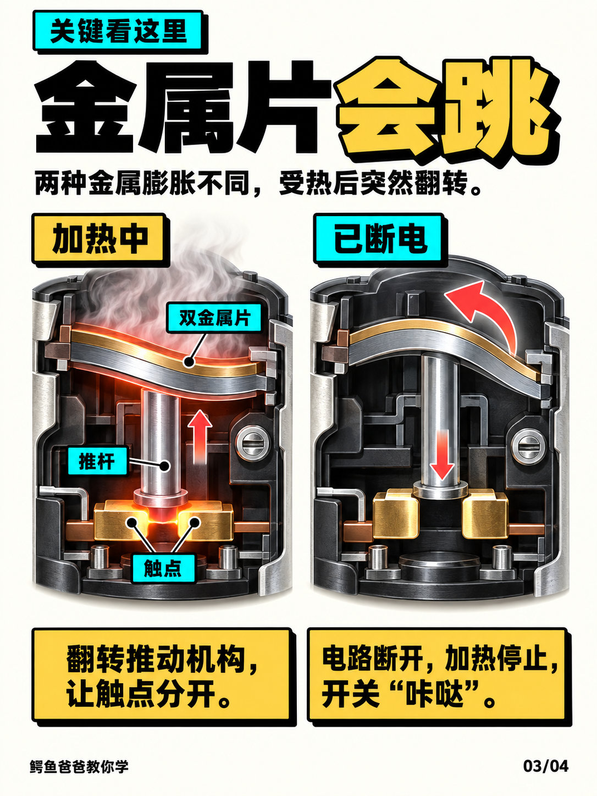

```text

视觉母版：严格3:4竖版，1080×1440构图。依据Auto-Redbook-Skills neo-brutalism CSS实际令牌：奶油白#FFFDF5、纯黑#000、黄色#FECA57、青色#00D2D3、少量红#FF4757。超粗无衬线中文标题，明确黑色细粗边和偏移硬阴影，非圆角卡片；一张精美科学切贴主体占半版，周围以2到3个大文字模块组织。大胆有设计感，黄色只强调关键结论，不要花哨贴纸、emoji、紫色渐变、网页截图或PPT。图文分稿，精确手动分页，每页单一知识任务。左右72px安全边距，署名左下页码右下。用户要求统一AI生图，故不使用HTML截图作为最终成品。
Series visual master lock: 1080x1440px, strict 3:4 vertical portrait canvas. Same safe margins 72px horizontal 80px vertical; 12-column grid, 8px spacing. ONE finished premium Xiaohongshu infographic, not mockup, no contact sheet, no square, no landscape, no different template. 清楚准确的简体中文，全幅原创插图与文字，不加额外标题。标题最大不超过8字，必须醒目，手机缩略图可读。标题上方小栏目、底部署名和右下页码。不要另绘鳄鱼头像或装饰卡通脸，不要二维码网址。每页最多三段短说明，科学图解为视觉主角，拒绝平庸PPT分栏和过密字堆。
本页为同一系列内页，参考封面锁定调色、字体与插画语言，改变信息构图而不换模板。
画面：微距放大控制器。并列两个清楚状态，左“加热中”：两层粘合的弯曲金属圆片，推杆及一对接触的金色触点；右“已断电”：同一双金属圆片受热突然反向弯曲，推动机械杠杆使同一对触点离开，有明显空气间隙。两个颜色不同的金属层紧密结合，不画两条独立线。标签只用双金属片、推杆、触点、加热中、已断电。蒸汽是热量输入，不是物理吹动叶轮，无芯片，无电子探针。
逐字绘制文字：
栏目：关键看这里
主标题：金属片会跳
说明：两种金属膨胀不同，受热后突然翻转。
短句：翻转推动机构，让触点分开。
短句：电路断开，加热停止，开关“咔哒”。
署名：鳄鱼爸爸教你学
页码：03/04
仅使用上列文字与画面指定标签，不得补造数字、因果或排名。工程与自然插画须结构可信，不加无关英文。

```

### 第4张 · 小开关有门道

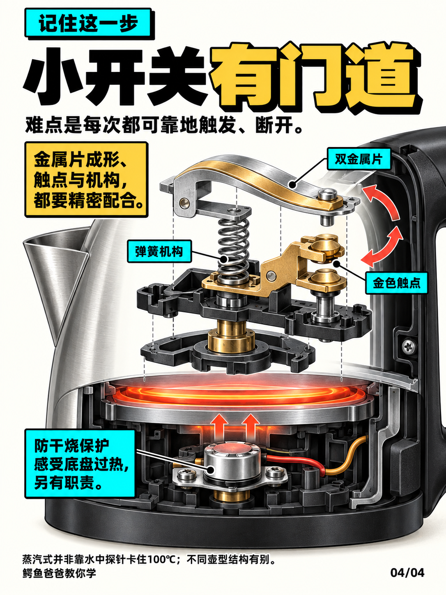

```text

视觉母版：严格3:4竖版，1080×1440构图。依据Auto-Redbook-Skills neo-brutalism CSS实际令牌：奶油白#FFFDF5、纯黑#000、黄色#FECA57、青色#00D2D3、少量红#FF4757。超粗无衬线中文标题，明确黑色细粗边和偏移硬阴影，非圆角卡片；一张精美科学切贴主体占半版，周围以2到3个大文字模块组织。大胆有设计感，黄色只强调关键结论，不要花哨贴纸、emoji、紫色渐变、网页截图或PPT。图文分稿，精确手动分页，每页单一知识任务。左右72px安全边距，署名左下页码右下。用户要求统一AI生图，故不使用HTML截图作为最终成品。
Series visual master lock: 1080x1440px, strict 3:4 vertical portrait canvas. Same safe margins 72px horizontal 80px vertical; 12-column grid, 8px spacing. ONE finished premium Xiaohongshu infographic, not mockup, no contact sheet, no square, no landscape, no different template. 清楚准确的简体中文，全幅原创插图与文字，不加额外标题。标题最大不超过8字，必须醒目，手机缩略图可读。标题上方小栏目、底部署名和右下页码。不要另绘鳄鱼头像或装饰卡通脸，不要二维码网址。每页最多三段短说明，科学图解为视觉主角，拒绝平庸PPT分栏和过密字堆。
本页为同一系列内页，参考封面锁定调色、字体与插画语言，改变信息构图而不换模板。
画面：精致爆炸图聚焦一枚真实结构感的温控器：双金属片、弹簧机构、金色触点，旁边微小重复循环箭头表达耐用但不标虚构次数。下半区只用一条底盘切面显示独立防干烧保护器贴近加热盘，箭头从底盘传热到它；绝无空壶通电实验。页脚清楚小注“蒸汽式并非靠水中探针卡住100℃；不同壶型结构有别。” 标题区域宽裕，结构爆炸图不变成购物产品清单。
逐字绘制文字：
栏目：记住这一步
主标题：小开关有门道
说明：难点是每次都可靠地触发、断开。
短句：金属片成形、触点与机构，都要精密配合。
短句：防干烧保护感受底盘过热，另有职责。
署名：鳄鱼爸爸教你学
页码：04/04
仅使用上列文字与画面指定标签，不得补造数字、因果或排名。工程与自然插画须结构可信，不加无关英文。

```

## 烧水壶 / XHS Visual Director

发布标题：水开那声咔哒，藏着什么机关

一只水壶，把热变成了一个机械动作。

水烧开后，蒸汽沿隐藏通道抵达温控器。由不同金属结合而成的双金属片，因为受热膨胀程度不同而改变形状；在设定条件下，它突然翻转，经机构让电触点分开。

开关声背后，是一条很短的链：沸腾—蒸汽—跳变—断电。

制造的难处藏在细节里：材料与成形的一致性、机构动作的稳定性、触点反复通断的可靠性。小，不等于简单。另一个贴近加热盘的过热保护，还要应对缺水干烧等异常。

本图是常见蒸汽式水壶的原理示意，元件位置依机型而异。它不是所有壶通用的结构图，也不是“水温恰到100℃才断电”的电子测温图。

那声咔哒，你现在能解释了吗？

学通识，就找鳄鱼爸爸。
#鳄鱼爸爸教你学 #通识教育 #亲子共学 #烧水壶 #科普


### 视觉母版

Series visual master lock: create one page of the same Xiaohongshu carousel series, 1080x1440px, strict 3:4 vertical portrait canvas, no square, no landscape, no crop, no extra border. Identical safe margins 72px sides and 80px top/bottom, 12-column grid and 8px spacing, identical typography system, small bottom-right page number. 视觉导演母版：高级白底自然历史杂志风，淡象牙白#F7F3E9底、炭黑#18251E大字、森林绿#23563C、极少朱砂红#C34B36。像世界级自然博物馆科普特刊，生动精细的自然史写实插画/微距摄影质感，准确叶脉与虫体纹理，切面清晰、主体巨大。上方短黑体标题大胆占30%，留白精确，细编辑线和小标注，不用卡片堆叠，不用纯科技界面、霓虹、玻璃、塑料、低幼卡通。以视觉反差和局部放大讲解，而不是普通幻灯片。

### 第1张 · 烧水壶的秘密

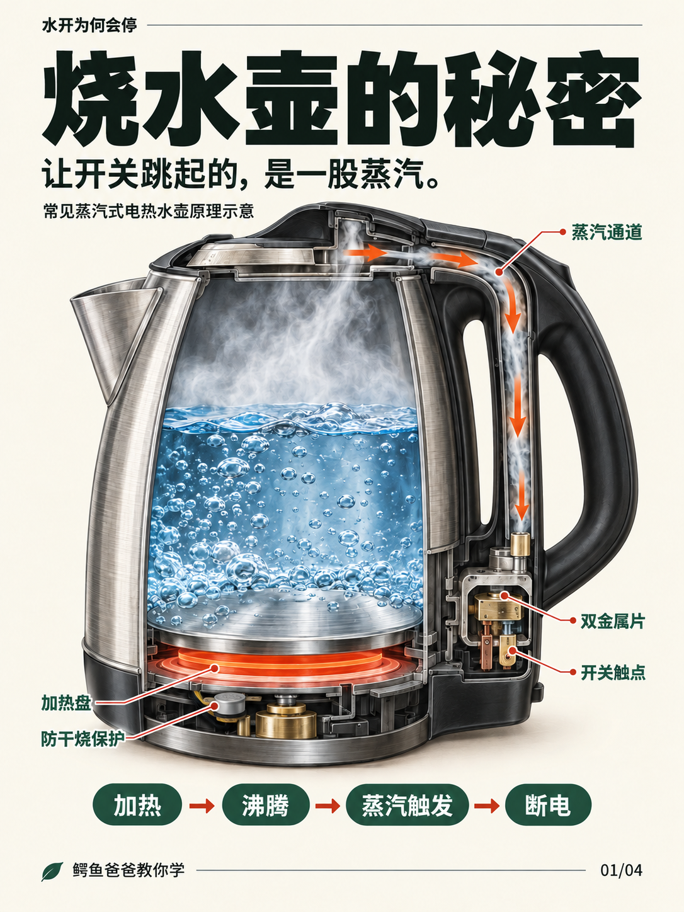

```text

Series visual master lock: create one page of the same Xiaohongshu carousel series, 1080x1440px, strict 3:4 vertical portrait canvas, no square, no landscape, no crop, no extra border. Identical safe margins 72px sides and 80px top/bottom, 12-column grid and 8px spacing, identical typography system, small bottom-right page number. 视觉导演母版：高级白底自然历史杂志风，淡象牙白#F7F3E9底、炭黑#18251E大字、森林绿#23563C、极少朱砂红#C34B36。像世界级自然博物馆科普特刊，生动精细的自然史写实插画/微距摄影质感，准确叶脉与虫体纹理，切面清晰、主体巨大。上方短黑体标题大胆占30%，留白精确，细编辑线和小标注，不用卡片堆叠，不用纯科技界面、霓虹、玻璃、塑料、低幼卡通。以视觉反差和局部放大讲解，而不是普通幻灯片。
Series visual master lock: 1080x1440px, strict 3:4 vertical portrait canvas. Same safe margins 72px horizontal 80px vertical; 12-column grid, 8px spacing. ONE finished premium Xiaohongshu infographic, not mockup, no contact sheet, no square, no landscape, no different template. 清楚准确的简体中文，全幅原创插图与文字，不加额外标题。标题最大不超过8字，必须醒目，手机缩略图可读。标题上方小栏目、底部署名和右下页码。不要另绘鳄鱼头像或装饰卡通脸，不要二维码网址。每页最多三段短说明，科学图解为视觉主角，拒绝平庸PPT分栏和过密字堆。
封面：标题占宽80%，主视觉巨大，制造好奇。
画面：占画面65%的巨大不锈钢电热水壶，左侧壶嘴、右侧黑色把手。壶体部分剖开透明，蓝色水在金属底盘上沸腾。壶盖内侧入口通向把手内的独立细蒸汽通道，再向下通往把手根部的控制器。用橙色箭头明确蒸汽从水面上方经壶盖入口沿把手向下流，绝不能画成从壶底管道上升。加热盘在水下的密封金属底板下方，控制器在干燥外壳内。五条细引线精确标注：加热盘、蒸汽通道、双金属片、开关触点、防干烧保护；双金属片与开关触点位于把手底部控制器，防干烧保护另指底盘下与盘接触的温控元件。不要水中探针、不要电线进水。大标题顶部两行，关键路径一眼看懂，专业工程剖视插图，非家电广告。
逐字绘制文字：
栏目：水开为何会停
主标题：烧水壶的秘密
说明：让开关跳起的，是一股蒸汽。
短句：加热 → 沸腾 → 蒸汽触发 → 断电
短句：常见蒸汽式电热水壶原理示意
署名：鳄鱼爸爸教你学
页码：01/04
仅使用上列文字与画面指定标签，不得补造数字、因果或排名。工程与自然插画须结构可信，不加无关英文。
复核修订：防干烧保护的引线准确指向贴紧加热盘底部的过热温控器，禁止指向底座中央供电连接器。

```

### 第2张 · 蒸汽去报信

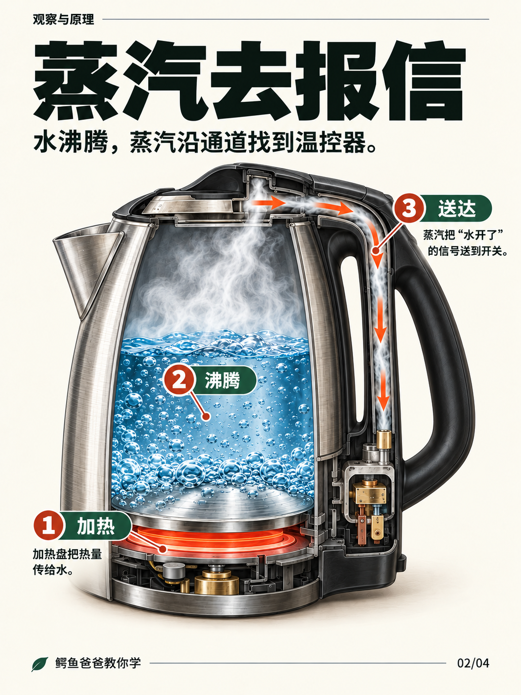

```text

Series visual master lock: create one page of the same Xiaohongshu carousel series, 1080x1440px, strict 3:4 vertical portrait canvas, no square, no landscape, no crop, no extra border. Identical safe margins 72px sides and 80px top/bottom, 12-column grid and 8px spacing, identical typography system, small bottom-right page number. 视觉导演母版：高级白底自然历史杂志风，淡象牙白#F7F3E9底、炭黑#18251E大字、森林绿#23563C、极少朱砂红#C34B36。像世界级自然博物馆科普特刊，生动精细的自然史写实插画/微距摄影质感，准确叶脉与虫体纹理，切面清晰、主体巨大。上方短黑体标题大胆占30%，留白精确，细编辑线和小标注，不用卡片堆叠，不用纯科技界面、霓虹、玻璃、塑料、低幼卡通。以视觉反差和局部放大讲解，而不是普通幻灯片。
Series visual master lock: 1080x1440px, strict 3:4 vertical portrait canvas. Same safe margins 72px horizontal 80px vertical; 12-column grid, 8px spacing. ONE finished premium Xiaohongshu infographic, not mockup, no contact sheet, no square, no landscape, no different template. 清楚准确的简体中文，全幅原创插图与文字，不加额外标题。标题最大不超过8字，必须醒目，手机缩略图可读。标题上方小栏目、底部署名和右下页码。不要另绘鳄鱼头像或装饰卡通脸，不要二维码网址。每页最多三段短说明，科学图解为视觉主角，拒绝平庸PPT分栏和过密字堆。
本页为同一系列内页，参考封面锁定调色、字体与插画语言，改变信息构图而不换模板。
画面：沿用封面水壶造型，中央剖视简化成三个巨大连续视觉节点：底部加热盘在密封金属底板下加热蓝色水，水面之上产生蒸汽，蒸汽从上方入口进入把手内独立通道向下到达控制器。数字1/2/3依次标注，加热、沸腾、送达三标签。不画温度计探针，不画蒸汽直接切断电线。箭头严格水面→壶盖内入口→把手内通道→下方控制器。
逐字绘制文字：
栏目：观察与原理
主标题：蒸汽去报信
说明：水沸腾，蒸汽沿通道找到温控器。
短句：加热盘把热量传给水。
短句：蒸汽把“水开了”的信号送到开关。
署名：鳄鱼爸爸教你学
页码：02/04
仅使用上列文字与画面指定标签，不得补造数字、因果或排名。工程与自然插画须结构可信，不加无关英文。

```

### 第3张 · 金属片会跳

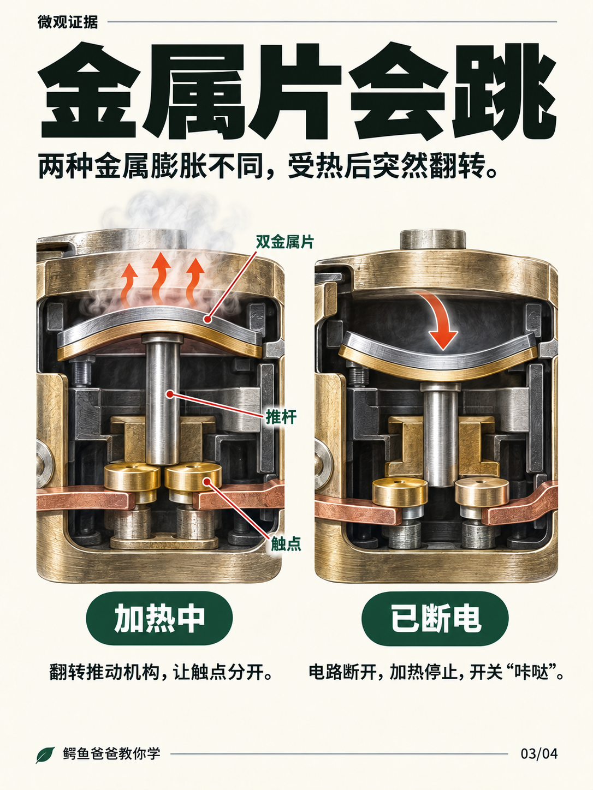

```text

Series visual master lock: create one page of the same Xiaohongshu carousel series, 1080x1440px, strict 3:4 vertical portrait canvas, no square, no landscape, no crop, no extra border. Identical safe margins 72px sides and 80px top/bottom, 12-column grid and 8px spacing, identical typography system, small bottom-right page number. 视觉导演母版：高级白底自然历史杂志风，淡象牙白#F7F3E9底、炭黑#18251E大字、森林绿#23563C、极少朱砂红#C34B36。像世界级自然博物馆科普特刊，生动精细的自然史写实插画/微距摄影质感，准确叶脉与虫体纹理，切面清晰、主体巨大。上方短黑体标题大胆占30%，留白精确，细编辑线和小标注，不用卡片堆叠，不用纯科技界面、霓虹、玻璃、塑料、低幼卡通。以视觉反差和局部放大讲解，而不是普通幻灯片。
Series visual master lock: 1080x1440px, strict 3:4 vertical portrait canvas. Same safe margins 72px horizontal 80px vertical; 12-column grid, 8px spacing. ONE finished premium Xiaohongshu infographic, not mockup, no contact sheet, no square, no landscape, no different template. 清楚准确的简体中文，全幅原创插图与文字，不加额外标题。标题最大不超过8字，必须醒目，手机缩略图可读。标题上方小栏目、底部署名和右下页码。不要另绘鳄鱼头像或装饰卡通脸，不要二维码网址。每页最多三段短说明，科学图解为视觉主角，拒绝平庸PPT分栏和过密字堆。
本页为同一系列内页，参考封面锁定调色、字体与插画语言，改变信息构图而不换模板。
画面：微距放大控制器。并列两个清楚状态，左“加热中”：两层粘合的弯曲金属圆片，推杆及一对接触的金色触点；右“已断电”：同一双金属圆片受热突然反向弯曲，推动机械杠杆使同一对触点离开，有明显空气间隙。两个颜色不同的金属层紧密结合，不画两条独立线。标签只用双金属片、推杆、触点、加热中、已断电。蒸汽是热量输入，不是物理吹动叶轮，无芯片，无电子探针。
逐字绘制文字：
栏目：微观证据
主标题：金属片会跳
说明：两种金属膨胀不同，受热后突然翻转。
短句：翻转推动机构，让触点分开。
短句：电路断开，加热停止，开关“咔哒”。
署名：鳄鱼爸爸教你学
页码：03/04
仅使用上列文字与画面指定标签，不得补造数字、因果或排名。工程与自然插画须结构可信，不加无关英文。

```

### 第4张 · 小开关有门道

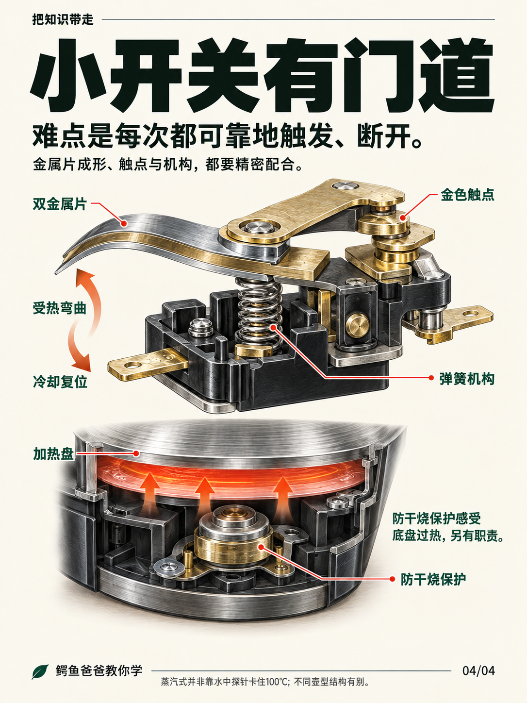

```text

Series visual master lock: create one page of the same Xiaohongshu carousel series, 1080x1440px, strict 3:4 vertical portrait canvas, no square, no landscape, no crop, no extra border. Identical safe margins 72px sides and 80px top/bottom, 12-column grid and 8px spacing, identical typography system, small bottom-right page number. 视觉导演母版：高级白底自然历史杂志风，淡象牙白#F7F3E9底、炭黑#18251E大字、森林绿#23563C、极少朱砂红#C34B36。像世界级自然博物馆科普特刊，生动精细的自然史写实插画/微距摄影质感，准确叶脉与虫体纹理，切面清晰、主体巨大。上方短黑体标题大胆占30%，留白精确，细编辑线和小标注，不用卡片堆叠，不用纯科技界面、霓虹、玻璃、塑料、低幼卡通。以视觉反差和局部放大讲解，而不是普通幻灯片。
Series visual master lock: 1080x1440px, strict 3:4 vertical portrait canvas. Same safe margins 72px horizontal 80px vertical; 12-column grid, 8px spacing. ONE finished premium Xiaohongshu infographic, not mockup, no contact sheet, no square, no landscape, no different template. 清楚准确的简体中文，全幅原创插图与文字，不加额外标题。标题最大不超过8字，必须醒目，手机缩略图可读。标题上方小栏目、底部署名和右下页码。不要另绘鳄鱼头像或装饰卡通脸，不要二维码网址。每页最多三段短说明，科学图解为视觉主角，拒绝平庸PPT分栏和过密字堆。
本页为同一系列内页，参考封面锁定调色、字体与插画语言，改变信息构图而不换模板。
画面：精致爆炸图聚焦一枚真实结构感的温控器：双金属片、弹簧机构、金色触点，旁边微小重复循环箭头表达耐用但不标虚构次数。下半区只用一条底盘切面显示独立防干烧保护器贴近加热盘，箭头从底盘传热到它；绝无空壶通电实验。页脚清楚小注“蒸汽式并非靠水中探针卡住100℃；不同壶型结构有别。” 标题区域宽裕，结构爆炸图不变成购物产品清单。
逐字绘制文字：
栏目：把知识带走
主标题：小开关有门道
说明：难点是每次都可靠地触发、断开。
短句：金属片成形、触点与机构，都要精密配合。
短句：防干烧保护感受底盘过热，另有职责。
署名：鳄鱼爸爸教你学
页码：04/04
仅使用上列文字与画面指定标签，不得补造数字、因果或排名。工程与自然插画须结构可信，不加无关英文。

```

## 蜜蜂 / 宝玉 · baoyu-xhs-images

发布标题：假如蜜蜂消失，早餐会少什么？

假如有一天，蜜蜂从早餐桌旁消失了，最先变少的会是什么？

不只是蜂蜜。蜜蜂访花时，会把花粉从雄蕊带到同种花的柱头，帮助许多植物完成授粉，结出果实和种子。

少了蜂类，一些水果、坚果及蔬菜种子生产就会遇到麻烦，产量或品质可能下降。但每种作物的依赖程度不同，不能一概说全部消失。水稻、小麦、玉米这些主粮，不依赖蜜蜂传粉。

传粉队伍还有食蚜蝇、蝶等伙伴，它们能提供帮助，也不能保证在每种作物、每个地方填满蜂类留下的缺口。

所以，真正的变化可能是餐桌没那么丰富、生产更费力，不是“人类只剩四年”。本篇讨论蜂类缺失的假设，不把它等同于所有传粉动物消失。

和孩子选一种水果，查查它的花粉是谁送来的。

学通识，就找鳄鱼爸爸。
#鳄鱼爸爸教你学 #通识教育 #亲子共学 #蜜蜂 #科普


### 视觉母版

视觉母版：严格3:4竖版，1080×1440构图，暖奶油纸底#F5F0E8，墨黑手绘粗标题，珊瑚红关键词，薄荷绿、淡蓝、杏色少量分区。遵循baoyu sketch-notes：高级科学手绘，轻微不规则线条、自然手涂色、弯曲箭头；充足留白，鲜明的大主体，绝不是满版小卡片或幼儿园贴纸。所有文字为清楚的中文手写黑体，标题极粗巨大。左右安全边距72，上下80。固定左上小栏目、右下页码。

### 第1张 · 假如蜜蜂消失

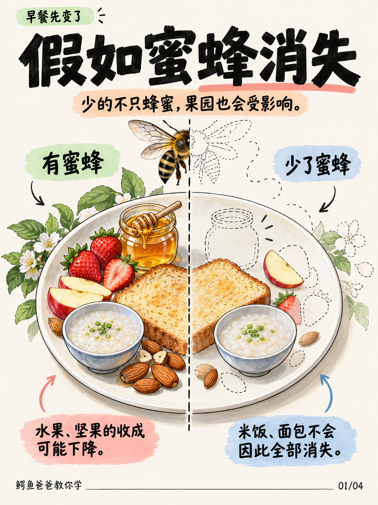

```text

视觉母版：严格3:4竖版，1080×1440构图，暖奶油纸底#F5F0E8，墨黑手绘粗标题，珊瑚红关键词，薄荷绿、淡蓝、杏色少量分区。遵循baoyu sketch-notes：高级科学手绘，轻微不规则线条、自然手涂色、弯曲箭头；充足留白，鲜明的大主体，绝不是满版小卡片或幼儿园贴纸。所有文字为清楚的中文手写黑体，标题极粗巨大。左右安全边距72，上下80。固定左上小栏目、右下页码。
Series visual master lock: 1080x1440px, strict 3:4 vertical portrait canvas. Same safe margins 72px horizontal 80px vertical; 12-column grid, 8px spacing. ONE finished premium Xiaohongshu infographic, not mockup, no contact sheet, no square, no landscape, no different template. 清楚准确的简体中文，全幅原创插图与文字，不加额外标题。标题最大不超过8字，必须醒目，手机缩略图可读。标题上方小栏目、底部署名和右下页码。不要另绘鳄鱼头像或装饰卡通脸，不要二维码网址。每页最多三段短说明，科学图解为视觉主角，拒绝平庸PPT分栏和过密字堆。
封面：标题占宽80%，主视觉巨大，制造好奇。
画面：一个极有食欲的巨大早餐餐盘被细线从中分成同一世界的两半，左边自然丰盛：吐司、一小碗米粥、苹果片、草莓、杏仁、蜂蜜；右边仍有相同吐司和米粥，但蜂蜜罐轮廓变空，水果坚果少量淡化成虚线缺口。不是右半全空或骷髅末日。上方一只精细蜜蜂局部消失成轮廓，标题巨大。标签只用有蜜蜂、少了蜜蜂。右侧食物变化是概念示意，不代表这些食物全灭或精确预测。
逐字绘制文字：
栏目：早餐先变了
主标题：假如蜜蜂消失
说明：少的不只蜂蜜，果园也会受影响。
短句：水果、坚果的收成可能下降。
短句：米饭、面包不会因此全部消失。
署名：鳄鱼爸爸教你学
页码：01/04
仅使用上列文字与画面指定标签，不得补造数字、因果或排名。工程与自然插画须结构可信，不加无关英文。

```

### 第2张 · 花粉谁来送

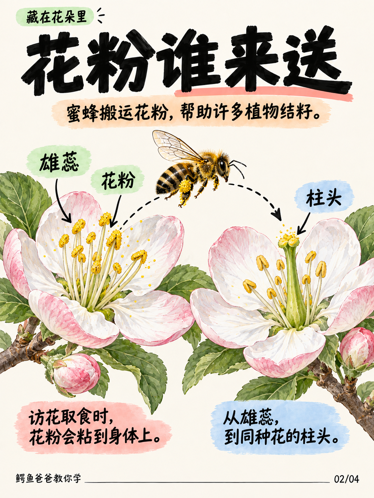

```text

视觉母版：严格3:4竖版，1080×1440构图，暖奶油纸底#F5F0E8，墨黑手绘粗标题，珊瑚红关键词，薄荷绿、淡蓝、杏色少量分区。遵循baoyu sketch-notes：高级科学手绘，轻微不规则线条、自然手涂色、弯曲箭头；充足留白，鲜明的大主体，绝不是满版小卡片或幼儿园贴纸。所有文字为清楚的中文手写黑体，标题极粗巨大。左右安全边距72，上下80。固定左上小栏目、右下页码。
Series visual master lock: 1080x1440px, strict 3:4 vertical portrait canvas. Same safe margins 72px horizontal 80px vertical; 12-column grid, 8px spacing. ONE finished premium Xiaohongshu infographic, not mockup, no contact sheet, no square, no landscape, no different template. 清楚准确的简体中文，全幅原创插图与文字，不加额外标题。标题最大不超过8字，必须醒目，手机缩略图可读。标题上方小栏目、底部署名和右下页码。不要另绘鳄鱼头像或装饰卡通脸，不要二维码网址。每页最多三段短说明，科学图解为视觉主角，拒绝平庸PPT分栏和过密字堆。
本页为同一系列内页，参考封面锁定调色、字体与插画语言，改变信息构图而不换模板。
画面：中央两个巨大苹果花纵剖科学插画，左花有细长雄蕊及黄色花粉，右花中央柱头有粘到的黄色花粉；一只真实蜜蜂沿弧线路径从左花雄蕊飞向右花柱头。不要花粉直接变成果实或蜂蜜，不画蜂从花里搬种子。只标雄蕊、花粉、柱头，路径一条清楚方向左→右。苹果花五瓣，昆虫六足且两对翅，不拟人化。
逐字绘制文字：
栏目：藏在花朵里
主标题：花粉谁来送
说明：蜜蜂搬运花粉，帮助许多植物结籽。
短句：从雄蕊，到同种花的柱头。
短句：访花取食时，花粉会粘到身体上。
署名：鳄鱼爸爸教你学
页码：02/04
仅使用上列文字与画面指定标签，不得补造数字、因果或排名。工程与自然插画须结构可信，不加无关英文。

```

### 第3张 · 餐桌会少什么

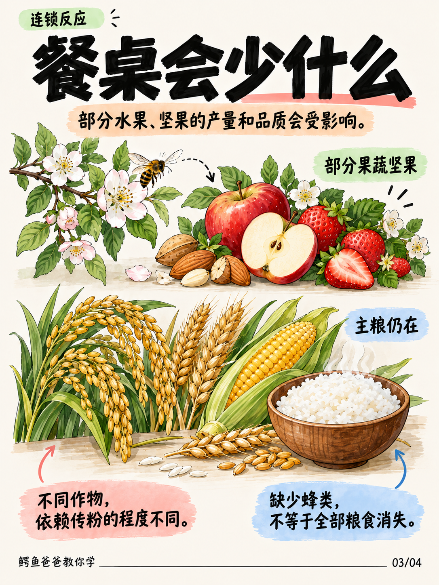

```text

视觉母版：严格3:4竖版，1080×1440构图，暖奶油纸底#F5F0E8，墨黑手绘粗标题，珊瑚红关键词，薄荷绿、淡蓝、杏色少量分区。遵循baoyu sketch-notes：高级科学手绘，轻微不规则线条、自然手涂色、弯曲箭头；充足留白，鲜明的大主体，绝不是满版小卡片或幼儿园贴纸。所有文字为清楚的中文手写黑体，标题极粗巨大。左右安全边距72，上下80。固定左上小栏目、右下页码。
Series visual master lock: 1080x1440px, strict 3:4 vertical portrait canvas. Same safe margins 72px horizontal 80px vertical; 12-column grid, 8px spacing. ONE finished premium Xiaohongshu infographic, not mockup, no contact sheet, no square, no landscape, no different template. 清楚准确的简体中文，全幅原创插图与文字，不加额外标题。标题最大不超过8字，必须醒目，手机缩略图可读。标题上方小栏目、底部署名和右下页码。不要另绘鳄鱼头像或装饰卡通脸，不要二维码网址。每页最多三段短说明，科学图解为视觉主角，拒绝平庸PPT分栏和过密字堆。
本页为同一系列内页，参考封面锁定调色、字体与插画语言，改变信息构图而不换模板。
画面：上下分明的丰盛食物平铺。上方苹果、草莓、杏仁及开花枝条，配标签部分果蔬坚果，显示较少的果实与更多未结果花枝的并置概念；下方稻穗、小麦、玉米及一碗米饭，完整保留，标签主粮仍在。不加75%食物消失等数字。不把蜜蜂画为水稻小麦玉米授粉必需者。画面有明确从花到果实因果，科学食物插画而非购物清单。
逐字绘制文字：
栏目：连锁反应
主标题：餐桌会少什么
说明：部分水果、坚果的产量和品质会受影响。
短句：不同作物，依赖传粉的程度不同。
短句：缺少蜂类，不等于全部粮食消失。
署名：鳄鱼爸爸教你学
页码：03/04
仅使用上列文字与画面指定标签，不得补造数字、因果或排名。工程与自然插画须结构可信，不加无关英文。

```

### 第4张 · 还有谁在帮忙

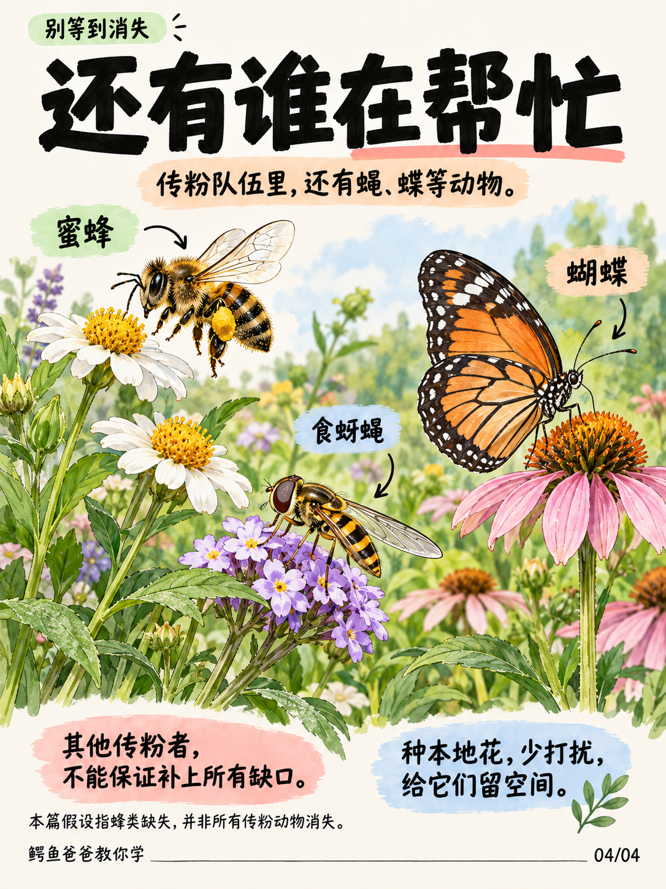

```text

视觉母版：严格3:4竖版，1080×1440构图，暖奶油纸底#F5F0E8，墨黑手绘粗标题，珊瑚红关键词，薄荷绿、淡蓝、杏色少量分区。遵循baoyu sketch-notes：高级科学手绘，轻微不规则线条、自然手涂色、弯曲箭头；充足留白，鲜明的大主体，绝不是满版小卡片或幼儿园贴纸。所有文字为清楚的中文手写黑体，标题极粗巨大。左右安全边距72，上下80。固定左上小栏目、右下页码。
Series visual master lock: 1080x1440px, strict 3:4 vertical portrait canvas. Same safe margins 72px horizontal 80px vertical; 12-column grid, 8px spacing. ONE finished premium Xiaohongshu infographic, not mockup, no contact sheet, no square, no landscape, no different template. 清楚准确的简体中文，全幅原创插图与文字，不加额外标题。标题最大不超过8字，必须醒目，手机缩略图可读。标题上方小栏目、底部署名和右下页码。不要另绘鳄鱼头像或装饰卡通脸，不要二维码网址。每页最多三段短说明，科学图解为视觉主角，拒绝平庸PPT分栏和过密字堆。
本页为同一系列内页，参考封面锁定调色、字体与插画语言，改变信息构图而不换模板。
画面：一幅美丽的本地花丛生态微景观，主角有蜜蜂、食蚜蝇、蝴蝶，物种形态可分：蜜蜂较多毛两对翅，食蚜蝇一对翅大复眼，蝶鳞翅。三条细引线标蜜蜂、食蚜蝇、蝴蝶，背景只有健康自然栖息地，没有人伸手摸昆虫或端水盘。底部小注“本篇假设指蜂类缺失，并非所有传粉动物消失。” 结尾温柔有行动，不画人类灭亡倒计时。
逐字绘制文字：
栏目：别等到消失
主标题：还有谁在帮忙
说明：传粉队伍里，还有蝇、蝶等动物。
短句：其他传粉者，不能保证补上所有缺口。
短句：种本地花，少打扰，给它们留空间。
署名：鳄鱼爸爸教你学
页码：04/04
仅使用上列文字与画面指定标签，不得补造数字、因果或排名。工程与自然插画须结构可信，不加无关英文。

```

## 蜜蜂 / Auto-Redbook-Skills

发布标题：蜜蜂没了，米饭也会没吗？

蜜蜂没了，早餐会直接清空吗？

🍯 蜂蜜来源会受影响，部分水果、坚果的收成也会受影响。
🍚 米饭、面包仍能在：稻、麦、玉米不靠蜜蜂完成传粉。
🌼 关键差别，是每种作物对动物传粉的依赖不一样。

蜜蜂不是把花蜜“变成果实”。它访花时搬运花粉，帮助许多植物授粉、结籽；蜂蜜与传粉，是两件相关却不同的事。

食蚜蝇、蝴蝶等也是传粉者，但不能保证接替蜂类的全部工作。这里讨论的是蜂类缺失，不是所有传粉动物一起消失。

别被“75%的食物都会没了”吓到：常见统计谈的是许多作物种类不同程度依赖传粉，不能换成食物总量。

给本地花草留点空间，少打扰访花昆虫。你早餐里哪样食物，最可能需要它们帮忙？

学通识，就找鳄鱼爸爸。
#鳄鱼爸爸教你学 #通识教育 #亲子共学 #蜜蜂 #科普


### 视觉母版

视觉母版：严格3:4竖版，1080×1440构图。依据Auto-Redbook-Skills neo-brutalism CSS实际令牌：奶油白#FFFDF5、纯黑#000、黄色#FECA57、青色#00D2D3、少量红#FF4757。超粗无衬线中文标题，明确黑色细粗边和偏移硬阴影，非圆角卡片；一张精美科学切贴主体占半版，周围以2到3个大文字模块组织。大胆有设计感，黄色只强调关键结论，不要花哨贴纸、emoji、紫色渐变、网页截图或PPT。图文分稿，精确手动分页，每页单一知识任务。左右72px安全边距，署名左下页码右下。用户要求统一AI生图，故不使用HTML截图作为最终成品。

### 第1张 · 假如蜜蜂消失

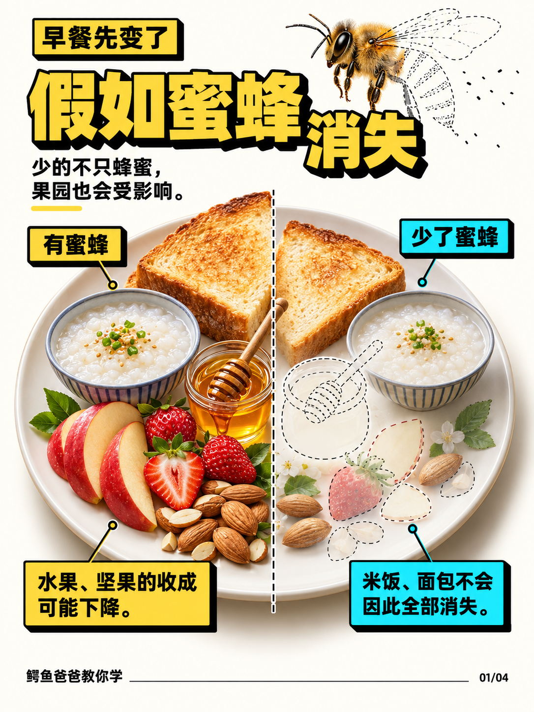

```text

视觉母版：严格3:4竖版，1080×1440构图。依据Auto-Redbook-Skills neo-brutalism CSS实际令牌：奶油白#FFFDF5、纯黑#000、黄色#FECA57、青色#00D2D3、少量红#FF4757。超粗无衬线中文标题，明确黑色细粗边和偏移硬阴影，非圆角卡片；一张精美科学切贴主体占半版，周围以2到3个大文字模块组织。大胆有设计感，黄色只强调关键结论，不要花哨贴纸、emoji、紫色渐变、网页截图或PPT。图文分稿，精确手动分页，每页单一知识任务。左右72px安全边距，署名左下页码右下。用户要求统一AI生图，故不使用HTML截图作为最终成品。
Series visual master lock: 1080x1440px, strict 3:4 vertical portrait canvas. Same safe margins 72px horizontal 80px vertical; 12-column grid, 8px spacing. ONE finished premium Xiaohongshu infographic, not mockup, no contact sheet, no square, no landscape, no different template. 清楚准确的简体中文，全幅原创插图与文字，不加额外标题。标题最大不超过8字，必须醒目，手机缩略图可读。标题上方小栏目、底部署名和右下页码。不要另绘鳄鱼头像或装饰卡通脸，不要二维码网址。每页最多三段短说明，科学图解为视觉主角，拒绝平庸PPT分栏和过密字堆。
封面：标题占宽80%，主视觉巨大，制造好奇。
画面：一个极有食欲的巨大早餐餐盘被细线从中分成同一世界的两半，左边自然丰盛：吐司、一小碗米粥、苹果片、草莓、杏仁、蜂蜜；右边仍有相同吐司和米粥，但蜂蜜罐轮廓变空，水果坚果少量淡化成虚线缺口。不是右半全空或骷髅末日。上方一只精细蜜蜂局部消失成轮廓，标题巨大。标签只用有蜜蜂、少了蜜蜂。右侧食物变化是概念示意，不代表这些食物全灭或精确预测。
逐字绘制文字：
栏目：早餐先变了
主标题：假如蜜蜂消失
说明：少的不只蜂蜜，果园也会受影响。
短句：水果、坚果的收成可能下降。
短句：米饭、面包不会因此全部消失。
署名：鳄鱼爸爸教你学
页码：01/04
仅使用上列文字与画面指定标签，不得补造数字、因果或排名。工程与自然插画须结构可信，不加无关英文。

```

### 第2张 · 花粉谁来送

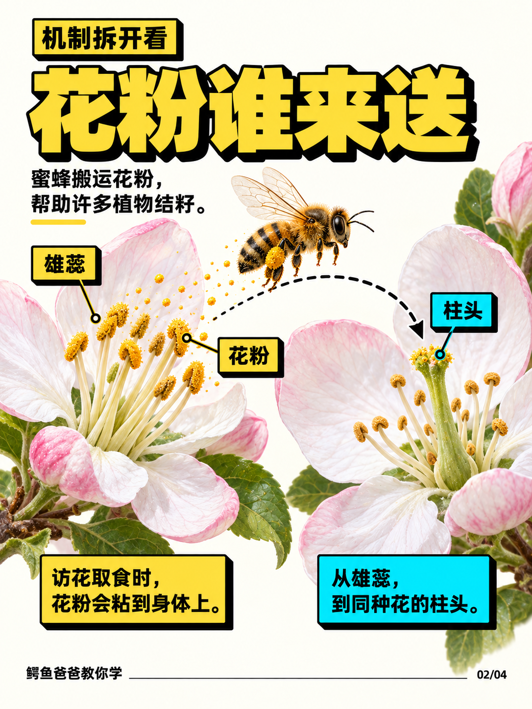

```text

视觉母版：严格3:4竖版，1080×1440构图。依据Auto-Redbook-Skills neo-brutalism CSS实际令牌：奶油白#FFFDF5、纯黑#000、黄色#FECA57、青色#00D2D3、少量红#FF4757。超粗无衬线中文标题，明确黑色细粗边和偏移硬阴影，非圆角卡片；一张精美科学切贴主体占半版，周围以2到3个大文字模块组织。大胆有设计感，黄色只强调关键结论，不要花哨贴纸、emoji、紫色渐变、网页截图或PPT。图文分稿，精确手动分页，每页单一知识任务。左右72px安全边距，署名左下页码右下。用户要求统一AI生图，故不使用HTML截图作为最终成品。
Series visual master lock: 1080x1440px, strict 3:4 vertical portrait canvas. Same safe margins 72px horizontal 80px vertical; 12-column grid, 8px spacing. ONE finished premium Xiaohongshu infographic, not mockup, no contact sheet, no square, no landscape, no different template. 清楚准确的简体中文，全幅原创插图与文字，不加额外标题。标题最大不超过8字，必须醒目，手机缩略图可读。标题上方小栏目、底部署名和右下页码。不要另绘鳄鱼头像或装饰卡通脸，不要二维码网址。每页最多三段短说明，科学图解为视觉主角，拒绝平庸PPT分栏和过密字堆。
本页为同一系列内页，参考封面锁定调色、字体与插画语言，改变信息构图而不换模板。
画面：中央两个巨大苹果花纵剖科学插画，左花有细长雄蕊及黄色花粉，右花中央柱头有粘到的黄色花粉；一只真实蜜蜂沿弧线路径从左花雄蕊飞向右花柱头。不要花粉直接变成果实或蜂蜜，不画蜂从花里搬种子。只标雄蕊、花粉、柱头，路径一条清楚方向左→右。苹果花五瓣，昆虫六足且两对翅，不拟人化。
逐字绘制文字：
栏目：机制拆开看
主标题：花粉谁来送
说明：蜜蜂搬运花粉，帮助许多植物结籽。
短句：从雄蕊，到同种花的柱头。
短句：访花取食时，花粉会粘到身体上。
署名：鳄鱼爸爸教你学
页码：02/04
仅使用上列文字与画面指定标签，不得补造数字、因果或排名。工程与自然插画须结构可信，不加无关英文。

```

### 第3张 · 餐桌会少什么

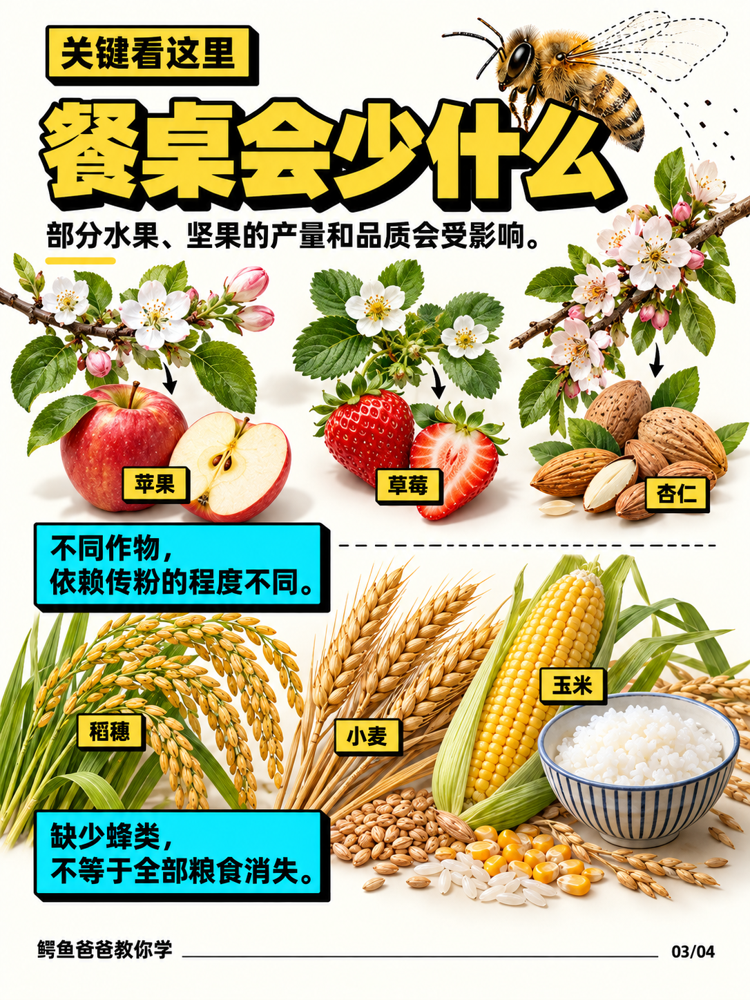

```text

视觉母版：严格3:4竖版，1080×1440构图。依据Auto-Redbook-Skills neo-brutalism CSS实际令牌：奶油白#FFFDF5、纯黑#000、黄色#FECA57、青色#00D2D3、少量红#FF4757。超粗无衬线中文标题，明确黑色细粗边和偏移硬阴影，非圆角卡片；一张精美科学切贴主体占半版，周围以2到3个大文字模块组织。大胆有设计感，黄色只强调关键结论，不要花哨贴纸、emoji、紫色渐变、网页截图或PPT。图文分稿，精确手动分页，每页单一知识任务。左右72px安全边距，署名左下页码右下。用户要求统一AI生图，故不使用HTML截图作为最终成品。
Series visual master lock: 1080x1440px, strict 3:4 vertical portrait canvas. Same safe margins 72px horizontal 80px vertical; 12-column grid, 8px spacing. ONE finished premium Xiaohongshu infographic, not mockup, no contact sheet, no square, no landscape, no different template. 清楚准确的简体中文，全幅原创插图与文字，不加额外标题。标题最大不超过8字，必须醒目，手机缩略图可读。标题上方小栏目、底部署名和右下页码。不要另绘鳄鱼头像或装饰卡通脸，不要二维码网址。每页最多三段短说明，科学图解为视觉主角，拒绝平庸PPT分栏和过密字堆。
本页为同一系列内页，参考封面锁定调色、字体与插画语言，改变信息构图而不换模板。
画面：上下分明的丰盛食物平铺。上方苹果、草莓、杏仁及开花枝条，配标签部分果蔬坚果，显示较少的果实与更多未结果花枝的并置概念；下方稻穗、小麦、玉米及一碗米饭，完整保留，标签主粮仍在。不加75%食物消失等数字。不把蜜蜂画为水稻小麦玉米授粉必需者。画面有明确从花到果实因果，科学食物插画而非购物清单。
逐字绘制文字：
栏目：关键看这里
主标题：餐桌会少什么
说明：部分水果、坚果的产量和品质会受影响。
短句：不同作物，依赖传粉的程度不同。
短句：缺少蜂类，不等于全部粮食消失。
署名：鳄鱼爸爸教你学
页码：03/04
仅使用上列文字与画面指定标签，不得补造数字、因果或排名。工程与自然插画须结构可信，不加无关英文。

```

### 第4张 · 还有谁在帮忙

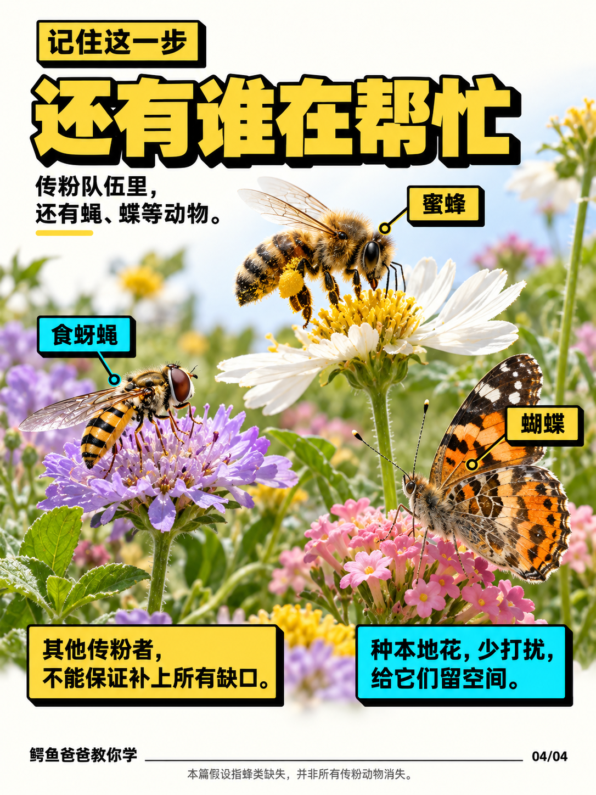

```text

视觉母版：严格3:4竖版，1080×1440构图。依据Auto-Redbook-Skills neo-brutalism CSS实际令牌：奶油白#FFFDF5、纯黑#000、黄色#FECA57、青色#00D2D3、少量红#FF4757。超粗无衬线中文标题，明确黑色细粗边和偏移硬阴影，非圆角卡片；一张精美科学切贴主体占半版，周围以2到3个大文字模块组织。大胆有设计感，黄色只强调关键结论，不要花哨贴纸、emoji、紫色渐变、网页截图或PPT。图文分稿，精确手动分页，每页单一知识任务。左右72px安全边距，署名左下页码右下。用户要求统一AI生图，故不使用HTML截图作为最终成品。
Series visual master lock: 1080x1440px, strict 3:4 vertical portrait canvas. Same safe margins 72px horizontal 80px vertical; 12-column grid, 8px spacing. ONE finished premium Xiaohongshu infographic, not mockup, no contact sheet, no square, no landscape, no different template. 清楚准确的简体中文，全幅原创插图与文字，不加额外标题。标题最大不超过8字，必须醒目，手机缩略图可读。标题上方小栏目、底部署名和右下页码。不要另绘鳄鱼头像或装饰卡通脸，不要二维码网址。每页最多三段短说明，科学图解为视觉主角，拒绝平庸PPT分栏和过密字堆。
本页为同一系列内页，参考封面锁定调色、字体与插画语言，改变信息构图而不换模板。
画面：一幅美丽的本地花丛生态微景观，主角有蜜蜂、食蚜蝇、蝴蝶，物种形态可分：蜜蜂较多毛两对翅，食蚜蝇一对翅大复眼，蝶鳞翅。三条细引线标蜜蜂、食蚜蝇、蝴蝶，背景只有健康自然栖息地，没有人伸手摸昆虫或端水盘。底部小注“本篇假设指蜂类缺失，并非所有传粉动物消失。” 结尾温柔有行动，不画人类灭亡倒计时。
逐字绘制文字：
栏目：记住这一步
主标题：还有谁在帮忙
说明：传粉队伍里，还有蝇、蝶等动物。
短句：其他传粉者，不能保证补上所有缺口。
短句：种本地花，少打扰，给它们留空间。
署名：鳄鱼爸爸教你学
页码：04/04
仅使用上列文字与画面指定标签，不得补造数字、因果或排名。工程与自然插画须结构可信，不加无关英文。

```

## 蜜蜂 / XHS Visual Director

发布标题：蜜蜂消失后，先改变的是餐桌

我们想象的消失，先从一张仍然有食物的餐桌开始。

米饭与面包还在，水果和坚果却可能没那么丰富。原因藏在花里：蜂类移动时，把花粉带到同种花的柱头，为许多植物的授粉、结籽提供帮助。

不同作物对这项服务的依赖有强有弱。少了蜂类，部分作物的产量和品质可能下降，生产者也可能付出更多代价；这不是所有食物按同一比例减少。

还有蝇、蝶等传粉动物，但它们不能保证在所有环境、所有作物上替代蜂类。粮食并不会因此全部消失，餐桌的多样性却值得珍惜。

本文是蜂类缺失的反事实推演，不引用“人类四年灭绝”的传言，也不把全部传粉者的数据算到蜜蜂一类身上。

下次路过一朵花，留意一下：今天谁在替它送花粉？

学通识，就找鳄鱼爸爸。
#鳄鱼爸爸教你学 #通识教育 #亲子共学 #蜜蜂 #科普


### 视觉母版

Series visual master lock: create one page of the same Xiaohongshu carousel series, 1080x1440px, strict 3:4 vertical portrait canvas, no square, no landscape, no crop, no extra border. Identical safe margins 72px sides and 80px top/bottom, 12-column grid and 8px spacing, identical typography system, small bottom-right page number. 视觉导演母版：高级白底自然历史杂志风，淡象牙白#F7F3E9底、炭黑#18251E大字、森林绿#23563C、极少朱砂红#C34B36。像世界级自然博物馆科普特刊，生动精细的自然史写实插画/微距摄影质感，准确叶脉与虫体纹理，切面清晰、主体巨大。上方短黑体标题大胆占30%，留白精确，细编辑线和小标注，不用卡片堆叠，不用纯科技界面、霓虹、玻璃、塑料、低幼卡通。以视觉反差和局部放大讲解，而不是普通幻灯片。

### 第1张 · 假如蜜蜂消失

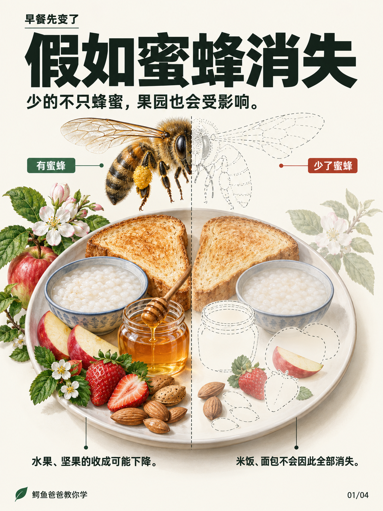

```text

Series visual master lock: create one page of the same Xiaohongshu carousel series, 1080x1440px, strict 3:4 vertical portrait canvas, no square, no landscape, no crop, no extra border. Identical safe margins 72px sides and 80px top/bottom, 12-column grid and 8px spacing, identical typography system, small bottom-right page number. 视觉导演母版：高级白底自然历史杂志风，淡象牙白#F7F3E9底、炭黑#18251E大字、森林绿#23563C、极少朱砂红#C34B36。像世界级自然博物馆科普特刊，生动精细的自然史写实插画/微距摄影质感，准确叶脉与虫体纹理，切面清晰、主体巨大。上方短黑体标题大胆占30%，留白精确，细编辑线和小标注，不用卡片堆叠，不用纯科技界面、霓虹、玻璃、塑料、低幼卡通。以视觉反差和局部放大讲解，而不是普通幻灯片。
Series visual master lock: 1080x1440px, strict 3:4 vertical portrait canvas. Same safe margins 72px horizontal 80px vertical; 12-column grid, 8px spacing. ONE finished premium Xiaohongshu infographic, not mockup, no contact sheet, no square, no landscape, no different template. 清楚准确的简体中文，全幅原创插图与文字，不加额外标题。标题最大不超过8字，必须醒目，手机缩略图可读。标题上方小栏目、底部署名和右下页码。不要另绘鳄鱼头像或装饰卡通脸，不要二维码网址。每页最多三段短说明，科学图解为视觉主角，拒绝平庸PPT分栏和过密字堆。
封面：标题占宽80%，主视觉巨大，制造好奇。
画面：一个极有食欲的巨大早餐餐盘被细线从中分成同一世界的两半，左边自然丰盛：吐司、一小碗米粥、苹果片、草莓、杏仁、蜂蜜；右边仍有相同吐司和米粥，但蜂蜜罐轮廓变空，水果坚果少量淡化成虚线缺口。不是右半全空或骷髅末日。上方一只精细蜜蜂局部消失成轮廓，标题巨大。标签只用有蜜蜂、少了蜜蜂。右侧食物变化是概念示意，不代表这些食物全灭或精确预测。
逐字绘制文字：
栏目：早餐先变了
主标题：假如蜜蜂消失
说明：少的不只蜂蜜，果园也会受影响。
短句：水果、坚果的收成可能下降。
短句：米饭、面包不会因此全部消失。
署名：鳄鱼爸爸教你学
页码：01/04
仅使用上列文字与画面指定标签，不得补造数字、因果或排名。工程与自然插画须结构可信，不加无关英文。

```

### 第2张 · 花粉谁来送

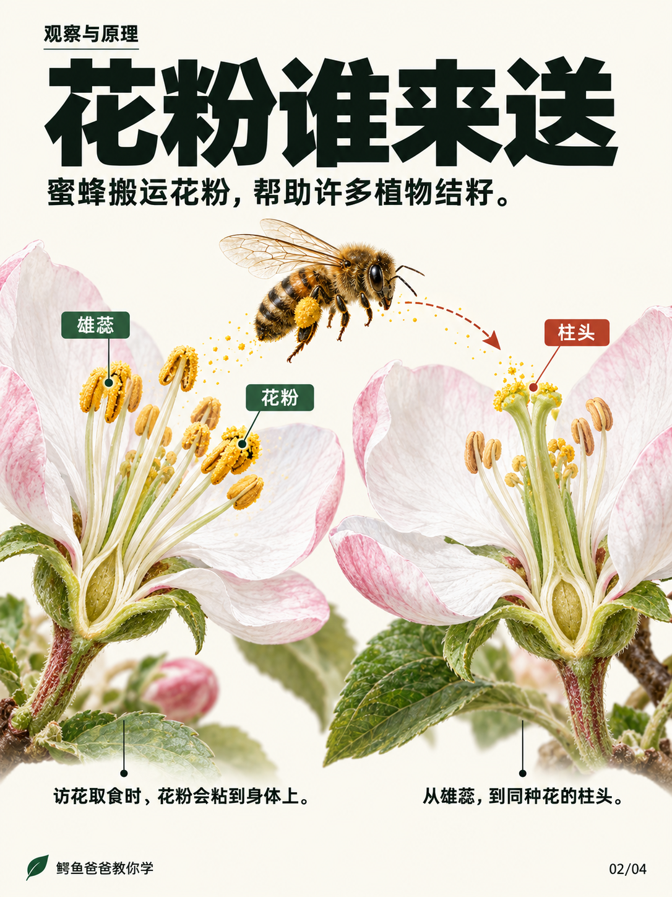

```text

Series visual master lock: create one page of the same Xiaohongshu carousel series, 1080x1440px, strict 3:4 vertical portrait canvas, no square, no landscape, no crop, no extra border. Identical safe margins 72px sides and 80px top/bottom, 12-column grid and 8px spacing, identical typography system, small bottom-right page number. 视觉导演母版：高级白底自然历史杂志风，淡象牙白#F7F3E9底、炭黑#18251E大字、森林绿#23563C、极少朱砂红#C34B36。像世界级自然博物馆科普特刊，生动精细的自然史写实插画/微距摄影质感，准确叶脉与虫体纹理，切面清晰、主体巨大。上方短黑体标题大胆占30%，留白精确，细编辑线和小标注，不用卡片堆叠，不用纯科技界面、霓虹、玻璃、塑料、低幼卡通。以视觉反差和局部放大讲解，而不是普通幻灯片。
Series visual master lock: 1080x1440px, strict 3:4 vertical portrait canvas. Same safe margins 72px horizontal 80px vertical; 12-column grid, 8px spacing. ONE finished premium Xiaohongshu infographic, not mockup, no contact sheet, no square, no landscape, no different template. 清楚准确的简体中文，全幅原创插图与文字，不加额外标题。标题最大不超过8字，必须醒目，手机缩略图可读。标题上方小栏目、底部署名和右下页码。不要另绘鳄鱼头像或装饰卡通脸，不要二维码网址。每页最多三段短说明，科学图解为视觉主角，拒绝平庸PPT分栏和过密字堆。
本页为同一系列内页，参考封面锁定调色、字体与插画语言，改变信息构图而不换模板。
画面：中央两个巨大苹果花纵剖科学插画，左花有细长雄蕊及黄色花粉，右花中央柱头有粘到的黄色花粉；一只真实蜜蜂沿弧线路径从左花雄蕊飞向右花柱头。不要花粉直接变成果实或蜂蜜，不画蜂从花里搬种子。只标雄蕊、花粉、柱头，路径一条清楚方向左→右。苹果花五瓣，昆虫六足且两对翅，不拟人化。
逐字绘制文字：
栏目：观察与原理
主标题：花粉谁来送
说明：蜜蜂搬运花粉，帮助许多植物结籽。
短句：从雄蕊，到同种花的柱头。
短句：访花取食时，花粉会粘到身体上。
署名：鳄鱼爸爸教你学
页码：02/04
仅使用上列文字与画面指定标签，不得补造数字、因果或排名。工程与自然插画须结构可信，不加无关英文。

```

### 第3张 · 餐桌会少什么

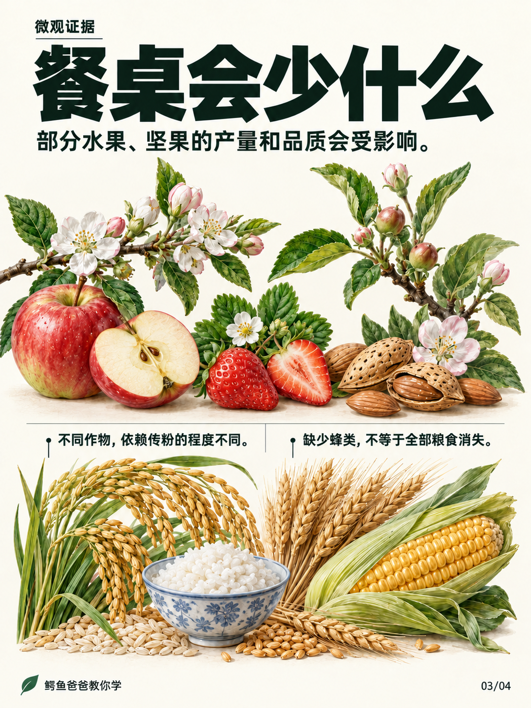

```text

Series visual master lock: create one page of the same Xiaohongshu carousel series, 1080x1440px, strict 3:4 vertical portrait canvas, no square, no landscape, no crop, no extra border. Identical safe margins 72px sides and 80px top/bottom, 12-column grid and 8px spacing, identical typography system, small bottom-right page number. 视觉导演母版：高级白底自然历史杂志风，淡象牙白#F7F3E9底、炭黑#18251E大字、森林绿#23563C、极少朱砂红#C34B36。像世界级自然博物馆科普特刊，生动精细的自然史写实插画/微距摄影质感，准确叶脉与虫体纹理，切面清晰、主体巨大。上方短黑体标题大胆占30%，留白精确，细编辑线和小标注，不用卡片堆叠，不用纯科技界面、霓虹、玻璃、塑料、低幼卡通。以视觉反差和局部放大讲解，而不是普通幻灯片。
Series visual master lock: 1080x1440px, strict 3:4 vertical portrait canvas. Same safe margins 72px horizontal 80px vertical; 12-column grid, 8px spacing. ONE finished premium Xiaohongshu infographic, not mockup, no contact sheet, no square, no landscape, no different template. 清楚准确的简体中文，全幅原创插图与文字，不加额外标题。标题最大不超过8字，必须醒目，手机缩略图可读。标题上方小栏目、底部署名和右下页码。不要另绘鳄鱼头像或装饰卡通脸，不要二维码网址。每页最多三段短说明，科学图解为视觉主角，拒绝平庸PPT分栏和过密字堆。
本页为同一系列内页，参考封面锁定调色、字体与插画语言，改变信息构图而不换模板。
画面：上下分明的丰盛食物平铺。上方苹果、草莓、杏仁及开花枝条，配标签部分果蔬坚果，显示较少的果实与更多未结果花枝的并置概念；下方稻穗、小麦、玉米及一碗米饭，完整保留，标签主粮仍在。不加75%食物消失等数字。不把蜜蜂画为水稻小麦玉米授粉必需者。画面有明确从花到果实因果，科学食物插画而非购物清单。
逐字绘制文字：
栏目：微观证据
主标题：餐桌会少什么
说明：部分水果、坚果的产量和品质会受影响。
短句：不同作物，依赖传粉的程度不同。
短句：缺少蜂类，不等于全部粮食消失。
署名：鳄鱼爸爸教你学
页码：03/04
仅使用上列文字与画面指定标签，不得补造数字、因果或排名。工程与自然插画须结构可信，不加无关英文。
复核修订：不画“蜜蜂→较少果实”的歧义连线；删除“更多花朵”“较少果实”额外标签和上方小蜜蜂、虚线弧箭头，保留作物与食物插画。

```

### 第4张 · 还有谁在帮忙

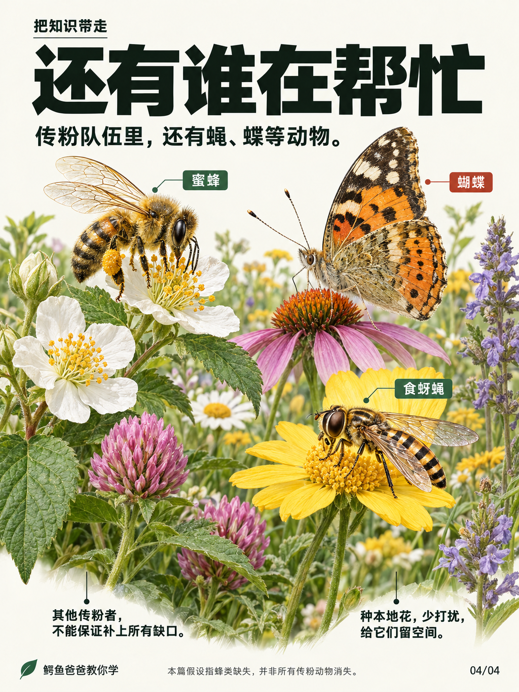

```text

Series visual master lock: create one page of the same Xiaohongshu carousel series, 1080x1440px, strict 3:4 vertical portrait canvas, no square, no landscape, no crop, no extra border. Identical safe margins 72px sides and 80px top/bottom, 12-column grid and 8px spacing, identical typography system, small bottom-right page number. 视觉导演母版：高级白底自然历史杂志风，淡象牙白#F7F3E9底、炭黑#18251E大字、森林绿#23563C、极少朱砂红#C34B36。像世界级自然博物馆科普特刊，生动精细的自然史写实插画/微距摄影质感，准确叶脉与虫体纹理，切面清晰、主体巨大。上方短黑体标题大胆占30%，留白精确，细编辑线和小标注，不用卡片堆叠，不用纯科技界面、霓虹、玻璃、塑料、低幼卡通。以视觉反差和局部放大讲解，而不是普通幻灯片。
Series visual master lock: 1080x1440px, strict 3:4 vertical portrait canvas. Same safe margins 72px horizontal 80px vertical; 12-column grid, 8px spacing. ONE finished premium Xiaohongshu infographic, not mockup, no contact sheet, no square, no landscape, no different template. 清楚准确的简体中文，全幅原创插图与文字，不加额外标题。标题最大不超过8字，必须醒目，手机缩略图可读。标题上方小栏目、底部署名和右下页码。不要另绘鳄鱼头像或装饰卡通脸，不要二维码网址。每页最多三段短说明，科学图解为视觉主角，拒绝平庸PPT分栏和过密字堆。
本页为同一系列内页，参考封面锁定调色、字体与插画语言，改变信息构图而不换模板。
画面：一幅美丽的本地花丛生态微景观，主角有蜜蜂、食蚜蝇、蝴蝶，物种形态可分：蜜蜂较多毛两对翅，食蚜蝇一对翅大复眼，蝶鳞翅。三条细引线标蜜蜂、食蚜蝇、蝴蝶，背景只有健康自然栖息地，没有人伸手摸昆虫或端水盘。底部小注“本篇假设指蜂类缺失，并非所有传粉动物消失。” 结尾温柔有行动，不画人类灭亡倒计时。
逐字绘制文字：
栏目：把知识带走
主标题：还有谁在帮忙
说明：传粉队伍里，还有蝇、蝶等动物。
短句：其他传粉者，不能保证补上所有缺口。
短句：种本地花，少打扰，给它们留空间。
署名：鳄鱼爸爸教你学
页码：04/04
仅使用上列文字与画面指定标签，不得补造数字、因果或排名。工程与自然插画须结构可信，不加无关英文。

```

## 大力王 / 宝玉 · baoyu-xhs-images

发布标题：谁才是大力王？先别急着选大象

先押一票：大象、蚂蚁、一只小甲虫，谁才是大力王？

先说比赛规则：这次看的是“拉力相对自身重力有多大”，不是谁举得最重，更不是给所有动物做总排名。

2010年的研究里，一种屎壳郎 Onthophagus taurus 的雄虫，实验测得的最大拉力约为自身重力的1141倍。研究让甲虫在隧道里撑住身体，测量把它向后拉出所需的力量。

这里有三个容易看错的点：
① 测的是拉力，不是举起千倍重量。
② 1141倍是受试雄虫中的最大值，不是每只甲虫的日常水平。
③ 其他动物若测试条件不同，不能把网上的倍率凑成严谨排行榜。

这股力气有它的用处：有角雄虫在狭窄洞道里争夺配偶，需要顶住、挤走对手。小家伙的成绩足够惊人。更有意思的知识是：问“谁最强”，先问比什么。你想看下一场比跳高、速度，还是咬合？

学通识，就找鳄鱼爸爸。
#鳄鱼爸爸教你学 #通识教育 #亲子共学 #大力王 #科普


### 视觉母版

视觉母版：严格3:4竖版，1080×1440构图，暖奶油纸底#F5F0E8，墨黑手绘粗标题，珊瑚红关键词，薄荷绿、淡蓝、杏色少量分区。遵循baoyu sketch-notes：高级科学手绘，轻微不规则线条、自然手涂色、弯曲箭头；充足留白，鲜明的大主体，绝不是满版小卡片或幼儿园贴纸。所有文字为清楚的中文手写黑体，标题极粗巨大。左右安全边距72，上下80。固定左上小栏目、右下页码。

### 第1张 · 谁才是大力王

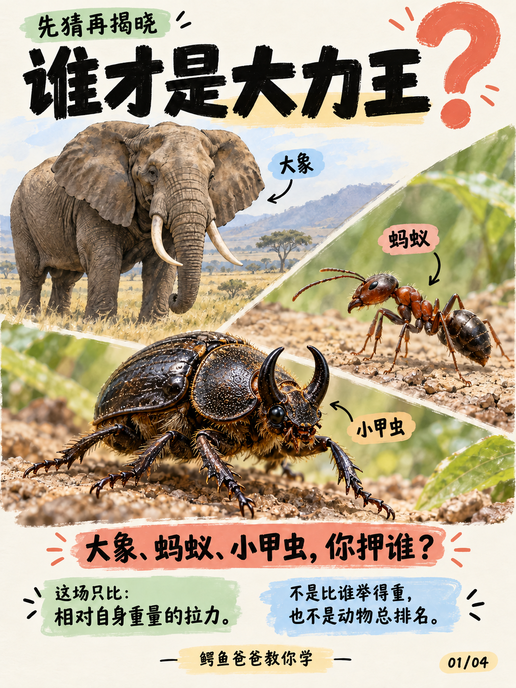

```text

视觉母版：严格3:4竖版，1080×1440构图，暖奶油纸底#F5F0E8，墨黑手绘粗标题，珊瑚红关键词，薄荷绿、淡蓝、杏色少量分区。遵循baoyu sketch-notes：高级科学手绘，轻微不规则线条、自然手涂色、弯曲箭头；充足留白，鲜明的大主体，绝不是满版小卡片或幼儿园贴纸。所有文字为清楚的中文手写黑体，标题极粗巨大。左右安全边距72，上下80。固定左上小栏目、右下页码。
Series visual master lock: 1080x1440px, strict 3:4 vertical portrait canvas. Same safe margins 72px horizontal 80px vertical; 12-column grid, 8px spacing. ONE finished premium Xiaohongshu infographic, not mockup, no contact sheet, no square, no landscape, no different template. 清楚准确的简体中文，全幅原创插图与文字，不加额外标题。标题最大不超过8字，必须醒目，手机缩略图可读。标题上方小栏目、底部署名和右下页码。不要另绘鳄鱼头像或装饰卡通脸，不要二维码网址。每页最多三段短说明，科学图解为视觉主角，拒绝平庸PPT分栏和过密字堆。
封面：标题占宽80%，主视觉巨大，制造好奇。
画面：极具对峙张力的三种动物自然写实插画：大象巨大轮廓在远景，蚂蚁中景，前景极致微距一只小型有角屎壳郎雄虫成为视觉焦点，有硬翅壳、六足及两枚头部弯角。它们在三个不同尺度场景中通过对角分割呈现，明确非同尺度，标注仅大象、蚂蚁、小甲虫。不画举哑铃、不画屎球，不给大象蚂蚁虚构倍率或分数。上部巨大问号与标题制造竞猜，页底规则大而清楚。
逐字绘制文字：
栏目：先猜再揭晓
主标题：谁才是大力王
说明：大象、蚂蚁、小甲虫，你押谁？
短句：这场只比：相对自身重量的拉力。
短句：不是比谁举得重，也不是动物总排名。
署名：鳄鱼爸爸教你学
页码：01/04
仅使用上列文字与画面指定标签，不得补造数字、因果或排名。工程与自然插画须结构可信，不加无关英文。
复核修订：Onthophagus taurus雄虫的双角并排生于头部两侧，前胸背板无角；不能画成一枚头角加一枚胸角的独角仙。图为原理示意，不是物种鉴定或实验设备复刻。

```

### 第2张 · 小虫怎么测力

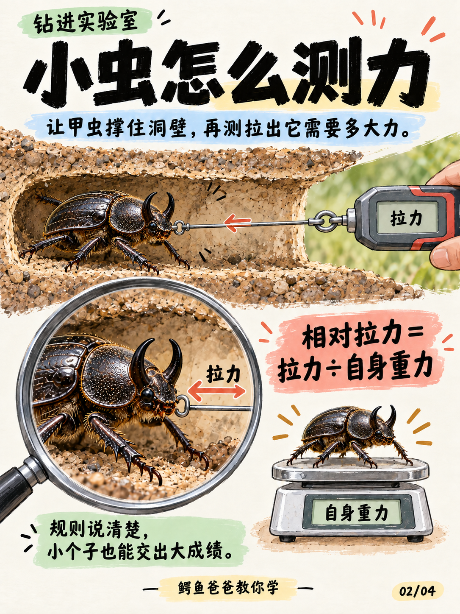

```text

视觉母版：严格3:4竖版，1080×1440构图，暖奶油纸底#F5F0E8，墨黑手绘粗标题，珊瑚红关键词，薄荷绿、淡蓝、杏色少量分区。遵循baoyu sketch-notes：高级科学手绘，轻微不规则线条、自然手涂色、弯曲箭头；充足留白，鲜明的大主体，绝不是满版小卡片或幼儿园贴纸。所有文字为清楚的中文手写黑体，标题极粗巨大。左右安全边距72，上下80。固定左上小栏目、右下页码。
Series visual master lock: 1080x1440px, strict 3:4 vertical portrait canvas. Same safe margins 72px horizontal 80px vertical; 12-column grid, 8px spacing. ONE finished premium Xiaohongshu infographic, not mockup, no contact sheet, no square, no landscape, no different template. 清楚准确的简体中文，全幅原创插图与文字，不加额外标题。标题最大不超过8字，必须醒目，手机缩略图可读。标题上方小栏目、底部署名和右下页码。不要另绘鳄鱼头像或装饰卡通脸，不要二维码网址。每页最多三段短说明，科学图解为视觉主角，拒绝平庸PPT分栏和过密字堆。
本页为同一系列内页，参考封面锁定调色、字体与插画语言，改变信息构图而不换模板。
画面：用一只昆虫通过细水平线连测力装置的简洁实验示意，昆虫六足撑在粗糙隧道壁，不悬空、不举重。旁边一个直观等式：拉力 ÷ 自身重力；图像下半以放大镜聚焦同一昆虫及自身重量基准，标签仅拉力、自身重力、相对拉力。无大象蚂蚁虚构数值，无负重杠铃。教人看懂比较尺度。
逐字绘制文字：
栏目：钻进实验室
主标题：小虫怎么测力
说明：让甲虫撑住洞壁，再测拉出它需要多大力。
短句：相对拉力＝拉力÷自身重力
短句：规则说清楚，小个子也能交出大成绩。
署名：鳄鱼爸爸教你学
页码：02/04
仅使用上列文字与画面指定标签，不得补造数字、因果或排名。工程与自然插画须结构可信，不加无关英文。
复核修订：Onthophagus taurus雄虫的双角并排生于头部两侧，前胸背板无角；不能画成一枚头角加一枚胸角的独角仙。图为原理示意，不是物种鉴定或实验设备复刻。

```

### 第3张 · 它能拉动千倍


```text

视觉母版：严格3:4竖版，1080×1440构图，暖奶油纸底#F5F0E8，墨黑手绘粗标题，珊瑚红关键词，薄荷绿、淡蓝、杏色少量分区。遵循baoyu sketch-notes：高级科学手绘，轻微不规则线条、自然手涂色、弯曲箭头；充足留白，鲜明的大主体，绝不是满版小卡片或幼儿园贴纸。所有文字为清楚的中文手写黑体，标题极粗巨大。左右安全边距72，上下80。固定左上小栏目、右下页码。
Series visual master lock: 1080x1440px, strict 3:4 vertical portrait canvas. Same safe margins 72px horizontal 80px vertical; 12-column grid, 8px spacing. ONE finished premium Xiaohongshu infographic, not mockup, no contact sheet, no square, no landscape, no different template. 清楚准确的简体中文，全幅原创插图与文字，不加额外标题。标题最大不超过8字，必须醒目，手机缩略图可读。标题上方小栏目、底部署名和右下页码。不要另绘鳄鱼头像或装饰卡通脸，不要二维码网址。每页最多三段短说明，科学图解为视觉主角，拒绝平庸PPT分栏和过密字堆。
本页为同一系列内页，参考封面锁定调色、字体与插画语言，改变信息构图而不换模板。
画面：焦点是一只小型Onthophagus taurus雄性有角屎壳郎科学微距：黑褐硬翅壳、头部两枚弯曲角、六足撑在狭窄粗糙土质隧道里。背部细实验线水平连接测力仪，箭头沿水平方向向后，体现受拉抵抗，不画推屎球、举物或千倍真实砝码。数字1141巨大成为视觉锤，后接倍，清楚小注“雄虫实验最大值；拉力／自身重力”。不写世界所有动物冠军。
逐字绘制文字：
栏目：小虫亮成绩
主标题：它能拉动千倍
说明：一种屎壳郎雄虫，测得最高约1141倍。
短句：指拉力与自身重力之比。
短句：这是实验最大值，不是每只都能。
署名：鳄鱼爸爸教你学
页码：03/04
仅使用上列文字与画面指定标签，不得补造数字、因果或排名。工程与自然插画须结构可信，不加无关英文。
复核修订：Onthophagus taurus雄虫的双角并排生于头部两侧，前胸背板无角；不能画成一枚头角加一枚胸角的独角仙。图为原理示意，不是物种鉴定或实验设备复刻。

```

### 第4张 · 洞道里的较量


```text

视觉母版：严格3:4竖版，1080×1440构图，暖奶油纸底#F5F0E8，墨黑手绘粗标题，珊瑚红关键词，薄荷绿、淡蓝、杏色少量分区。遵循baoyu sketch-notes：高级科学手绘，轻微不规则线条、自然手涂色、弯曲箭头；充足留白，鲜明的大主体，绝不是满版小卡片或幼儿园贴纸。所有文字为清楚的中文手写黑体，标题极粗巨大。左右安全边距72，上下80。固定左上小栏目、右下页码。
Series visual master lock: 1080x1440px, strict 3:4 vertical portrait canvas. Same safe margins 72px horizontal 80px vertical; 12-column grid, 8px spacing. ONE finished premium Xiaohongshu infographic, not mockup, no contact sheet, no square, no landscape, no different template. 清楚准确的简体中文，全幅原创插图与文字，不加额外标题。标题最大不超过8字，必须醒目，手机缩略图可读。标题上方小栏目、底部署名和右下页码。不要另绘鳄鱼头像或装饰卡通脸，不要二维码网址。每页最多三段短说明，科学图解为视觉主角，拒绝平庸PPT分栏和过密字堆。
本页为同一系列内页，参考封面锁定调色、字体与插画语言，改变信息构图而不换模板。
画面：巨大横切土质洞道自然科学插画，两只有角Onthophagus taurus雄虫在洞中头部相对顶住、六足撑住粗糙洞壁，角生于头部两侧不是锹甲大颚。不画流血，不画人类擂台，不画屎球。放大其中足端与洞壁接触，一条引线标撑住洞壁，另一条引线标雄虫较量。底部一条很小知识回扣：绝对力量≠相对力量。让读者看到惊人力量在它生活中的用途，非泛泛方法论清单。
逐字绘制文字：
栏目：力气用在哪
主标题：洞道里的较量
说明：雄虫在狭窄洞道里，和对手争夺配偶。
短句：撑住洞壁、顶住对手，力气派上用场。
短句：大力王也有规则：拉、举、咬要分开比。
署名：鳄鱼爸爸教你学
页码：04/04
仅使用上列文字与画面指定标签，不得补造数字、因果或排名。工程与自然插画须结构可信，不加无关英文。
复核修订：Onthophagus taurus雄虫的双角并排生于头部两侧，前胸背板无角；不能画成一枚头角加一枚胸角的独角仙。图为原理示意，不是物种鉴定或实验设备复刻。

```

## 大力王 / Auto-Redbook-Skills

发布标题：小甲虫拉力千倍？先看比赛规则

大力王投票开始：🐘 大象，🐜 蚂蚁，还是小甲虫？

先亮规则：只谈相对拉力＝拉力÷自身重力。绝对力量、举重、咬合力，暂时不进这个赛道。

答案里藏着一只不起眼的屎壳郎。Onthophagus taurus 的雄虫实验，出现过约1141倍自身重力的最大拉力。

🔎 实验怎么测？甲虫在隧道中撑住，研究者通过细线向后拉，测它抵抗拉出的力量。这个数字说的是特定实验里最强受试者的拉力比，不是每只虫都能背起千倍重量。

雄虫在洞道里争夺配偶，得靠力气顶住对手。它没有“举着千倍重物跑”，我们也不拿不同条件的动物数据硬拼冠军榜。

标题可以问谁是王者，答案必须把规则说清。看完这四张，下次听到“最强动物”，记得先问一句：比的到底是哪种强？

学通识，就找鳄鱼爸爸。
#鳄鱼爸爸教你学 #通识教育 #亲子共学 #大力王 #科普


### 视觉母版

视觉母版：严格3:4竖版，1080×1440构图。依据Auto-Redbook-Skills neo-brutalism CSS实际令牌：奶油白#FFFDF5、纯黑#000、黄色#FECA57、青色#00D2D3、少量红#FF4757。超粗无衬线中文标题，明确黑色细粗边和偏移硬阴影，非圆角卡片；一张精美科学切贴主体占半版，周围以2到3个大文字模块组织。大胆有设计感，黄色只强调关键结论，不要花哨贴纸、emoji、紫色渐变、网页截图或PPT。图文分稿，精确手动分页，每页单一知识任务。左右72px安全边距，署名左下页码右下。用户要求统一AI生图，故不使用HTML截图作为最终成品。

### 第1张 · 谁才是大力王


```text

视觉母版：严格3:4竖版，1080×1440构图。依据Auto-Redbook-Skills neo-brutalism CSS实际令牌：奶油白#FFFDF5、纯黑#000、黄色#FECA57、青色#00D2D3、少量红#FF4757。超粗无衬线中文标题，明确黑色细粗边和偏移硬阴影，非圆角卡片；一张精美科学切贴主体占半版，周围以2到3个大文字模块组织。大胆有设计感，黄色只强调关键结论，不要花哨贴纸、emoji、紫色渐变、网页截图或PPT。图文分稿，精确手动分页，每页单一知识任务。左右72px安全边距，署名左下页码右下。用户要求统一AI生图，故不使用HTML截图作为最终成品。
Series visual master lock: 1080x1440px, strict 3:4 vertical portrait canvas. Same safe margins 72px horizontal 80px vertical; 12-column grid, 8px spacing. ONE finished premium Xiaohongshu infographic, not mockup, no contact sheet, no square, no landscape, no different template. 清楚准确的简体中文，全幅原创插图与文字，不加额外标题。标题最大不超过8字，必须醒目，手机缩略图可读。标题上方小栏目、底部署名和右下页码。不要另绘鳄鱼头像或装饰卡通脸，不要二维码网址。每页最多三段短说明，科学图解为视觉主角，拒绝平庸PPT分栏和过密字堆。
封面：标题占宽80%，主视觉巨大，制造好奇。
画面：极具对峙张力的三种动物自然写实插画：大象巨大轮廓在远景，蚂蚁中景，前景极致微距一只小型有角屎壳郎雄虫成为视觉焦点，有硬翅壳、六足及两枚头部弯角。它们在三个不同尺度场景中通过对角分割呈现，明确非同尺度，标注仅大象、蚂蚁、小甲虫。不画举哑铃、不画屎球，不给大象蚂蚁虚构倍率或分数。上部巨大问号与标题制造竞猜，页底规则大而清楚。
逐字绘制文字：
栏目：先猜再揭晓
主标题：谁才是大力王
说明：大象、蚂蚁、小甲虫，你押谁？
短句：这场只比：相对自身重量的拉力。
短句：不是比谁举得重，也不是动物总排名。
署名：鳄鱼爸爸教你学
页码：01/04
仅使用上列文字与画面指定标签，不得补造数字、因果或排名。工程与自然插画须结构可信，不加无关英文。
复核修订：Onthophagus taurus雄虫的双角并排生于头部两侧，前胸背板无角；不能画成一枚头角加一枚胸角的独角仙。图为原理示意，不是物种鉴定或实验设备复刻。

```

### 第2张 · 小虫怎么测力


```text

视觉母版：严格3:4竖版，1080×1440构图。依据Auto-Redbook-Skills neo-brutalism CSS实际令牌：奶油白#FFFDF5、纯黑#000、黄色#FECA57、青色#00D2D3、少量红#FF4757。超粗无衬线中文标题，明确黑色细粗边和偏移硬阴影，非圆角卡片；一张精美科学切贴主体占半版，周围以2到3个大文字模块组织。大胆有设计感，黄色只强调关键结论，不要花哨贴纸、emoji、紫色渐变、网页截图或PPT。图文分稿，精确手动分页，每页单一知识任务。左右72px安全边距，署名左下页码右下。用户要求统一AI生图，故不使用HTML截图作为最终成品。
Series visual master lock: 1080x1440px, strict 3:4 vertical portrait canvas. Same safe margins 72px horizontal 80px vertical; 12-column grid, 8px spacing. ONE finished premium Xiaohongshu infographic, not mockup, no contact sheet, no square, no landscape, no different template. 清楚准确的简体中文，全幅原创插图与文字，不加额外标题。标题最大不超过8字，必须醒目，手机缩略图可读。标题上方小栏目、底部署名和右下页码。不要另绘鳄鱼头像或装饰卡通脸，不要二维码网址。每页最多三段短说明，科学图解为视觉主角，拒绝平庸PPT分栏和过密字堆。
本页为同一系列内页，参考封面锁定调色、字体与插画语言，改变信息构图而不换模板。
画面：用一只昆虫通过细水平线连测力装置的简洁实验示意，昆虫六足撑在粗糙隧道壁，不悬空、不举重。旁边一个直观等式：拉力 ÷ 自身重力；图像下半以放大镜聚焦同一昆虫及自身重量基准，标签仅拉力、自身重力、相对拉力。无大象蚂蚁虚构数值，无负重杠铃。教人看懂比较尺度。
逐字绘制文字：
栏目：机制拆开看
主标题：小虫怎么测力
说明：让甲虫撑住洞壁，再测拉出它需要多大力。
短句：相对拉力＝拉力÷自身重力
短句：规则说清楚，小个子也能交出大成绩。
署名：鳄鱼爸爸教你学
页码：02/04
仅使用上列文字与画面指定标签，不得补造数字、因果或排名。工程与自然插画须结构可信，不加无关英文。
复核修订：Onthophagus taurus雄虫的双角并排生于头部两侧，前胸背板无角；不能画成一枚头角加一枚胸角的独角仙。图为原理示意，不是物种鉴定或实验设备复刻。

```

### 第3张 · 它能拉动千倍


```text

视觉母版：严格3:4竖版，1080×1440构图。依据Auto-Redbook-Skills neo-brutalism CSS实际令牌：奶油白#FFFDF5、纯黑#000、黄色#FECA57、青色#00D2D3、少量红#FF4757。超粗无衬线中文标题，明确黑色细粗边和偏移硬阴影，非圆角卡片；一张精美科学切贴主体占半版，周围以2到3个大文字模块组织。大胆有设计感，黄色只强调关键结论，不要花哨贴纸、emoji、紫色渐变、网页截图或PPT。图文分稿，精确手动分页，每页单一知识任务。左右72px安全边距，署名左下页码右下。用户要求统一AI生图，故不使用HTML截图作为最终成品。
Series visual master lock: 1080x1440px, strict 3:4 vertical portrait canvas. Same safe margins 72px horizontal 80px vertical; 12-column grid, 8px spacing. ONE finished premium Xiaohongshu infographic, not mockup, no contact sheet, no square, no landscape, no different template. 清楚准确的简体中文，全幅原创插图与文字，不加额外标题。标题最大不超过8字，必须醒目，手机缩略图可读。标题上方小栏目、底部署名和右下页码。不要另绘鳄鱼头像或装饰卡通脸，不要二维码网址。每页最多三段短说明，科学图解为视觉主角，拒绝平庸PPT分栏和过密字堆。
本页为同一系列内页，参考封面锁定调色、字体与插画语言，改变信息构图而不换模板。
画面：焦点是一只小型Onthophagus taurus雄性有角屎壳郎科学微距：黑褐硬翅壳、头部两枚弯曲角、六足撑在狭窄粗糙土质隧道里。背部细实验线水平连接测力仪，箭头沿水平方向向后，体现受拉抵抗，不画推屎球、举物或千倍真实砝码。数字1141巨大成为视觉锤，后接倍，清楚小注“雄虫实验最大值；拉力／自身重力”。不写世界所有动物冠军。
逐字绘制文字：
栏目：关键看这里
主标题：它能拉动千倍
说明：一种屎壳郎雄虫，测得最高约1141倍。
短句：指拉力与自身重力之比。
短句：这是实验最大值，不是每只都能。
署名：鳄鱼爸爸教你学
页码：03/04
仅使用上列文字与画面指定标签，不得补造数字、因果或排名。工程与自然插画须结构可信，不加无关英文。
复核修订：Onthophagus taurus雄虫的双角并排生于头部两侧，前胸背板无角；不能画成一枚头角加一枚胸角的独角仙。图为原理示意，不是物种鉴定或实验设备复刻。

```

### 第4张 · 洞道里的较量


```text

视觉母版：严格3:4竖版，1080×1440构图。依据Auto-Redbook-Skills neo-brutalism CSS实际令牌：奶油白#FFFDF5、纯黑#000、黄色#FECA57、青色#00D2D3、少量红#FF4757。超粗无衬线中文标题，明确黑色细粗边和偏移硬阴影，非圆角卡片；一张精美科学切贴主体占半版，周围以2到3个大文字模块组织。大胆有设计感，黄色只强调关键结论，不要花哨贴纸、emoji、紫色渐变、网页截图或PPT。图文分稿，精确手动分页，每页单一知识任务。左右72px安全边距，署名左下页码右下。用户要求统一AI生图，故不使用HTML截图作为最终成品。
Series visual master lock: 1080x1440px, strict 3:4 vertical portrait canvas. Same safe margins 72px horizontal 80px vertical; 12-column grid, 8px spacing. ONE finished premium Xiaohongshu infographic, not mockup, no contact sheet, no square, no landscape, no different template. 清楚准确的简体中文，全幅原创插图与文字，不加额外标题。标题最大不超过8字，必须醒目，手机缩略图可读。标题上方小栏目、底部署名和右下页码。不要另绘鳄鱼头像或装饰卡通脸，不要二维码网址。每页最多三段短说明，科学图解为视觉主角，拒绝平庸PPT分栏和过密字堆。
本页为同一系列内页，参考封面锁定调色、字体与插画语言，改变信息构图而不换模板。
画面：巨大横切土质洞道自然科学插画，两只有角Onthophagus taurus雄虫在洞中头部相对顶住、六足撑住粗糙洞壁，角生于头部两侧不是锹甲大颚。不画流血，不画人类擂台，不画屎球。放大其中足端与洞壁接触，一条引线标撑住洞壁，另一条引线标雄虫较量。底部一条很小知识回扣：绝对力量≠相对力量。让读者看到惊人力量在它生活中的用途，非泛泛方法论清单。
逐字绘制文字：
栏目：记住这一步
主标题：洞道里的较量
说明：雄虫在狭窄洞道里，和对手争夺配偶。
短句：撑住洞壁、顶住对手，力气派上用场。
短句：大力王也有规则：拉、举、咬要分开比。
署名：鳄鱼爸爸教你学
页码：04/04
仅使用上列文字与画面指定标签，不得补造数字、因果或排名。工程与自然插画须结构可信，不加无关英文。
复核修订：Onthophagus taurus雄虫的双角并排生于头部两侧，前胸背板无角；不能画成一枚头角加一枚胸角的独角仙。图为原理示意，不是物种鉴定或实验设备复刻。

```

## 大力王 / XHS Visual Director

发布标题：大象还是小甲虫？最强得看比什么

体型最大的，是否就一定最强？

这道题，先要选择尺子。绝对力量衡量力有多大；相对力量，则还要考虑动物自身的重力。拉、举、咬，又是不同的测试。

我们把镜头放进一条小隧道。2010年的实验中，Onthophagus taurus 雄性屎壳郎撑住身体，抵抗向后的牵拉。最强受试者的拉力，约为自身重力的1141倍。

这股力量关系到洞道里的竞争：雄虫要顶住对手、争夺配偶。这个成绩惊人，却有清楚边界：它是特定实验条件下的最大相对拉力，不是平均值，不等于举重能力，也不足以排出所有动物的总冠军。

因此，这一篇的悬念从“谁最强”开始，落在“怎么比较”上。真正值得和孩子一起学会的，是为一个漂亮的数字找到它的单位、对象和条件。

你原来押的是谁？

学通识，就找鳄鱼爸爸。
#鳄鱼爸爸教你学 #通识教育 #亲子共学 #大力王 #科普


### 视觉母版

Series visual master lock: create one page of the same Xiaohongshu carousel series, 1080x1440px, strict 3:4 vertical portrait canvas, no square, no landscape, no crop, no extra border. Identical safe margins 72px sides and 80px top/bottom, 12-column grid and 8px spacing, identical typography system, small bottom-right page number. 视觉导演母版：高级白底自然历史杂志风，淡象牙白#F7F3E9底、炭黑#18251E大字、森林绿#23563C、极少朱砂红#C34B36。像世界级自然博物馆科普特刊，生动精细的自然史写实插画/微距摄影质感，准确叶脉与虫体纹理，切面清晰、主体巨大。上方短黑体标题大胆占30%，留白精确，细编辑线和小标注，不用卡片堆叠，不用纯科技界面、霓虹、玻璃、塑料、低幼卡通。以视觉反差和局部放大讲解，而不是普通幻灯片。

### 第1张 · 谁才是大力王


```text

Series visual master lock: create one page of the same Xiaohongshu carousel series, 1080x1440px, strict 3:4 vertical portrait canvas, no square, no landscape, no crop, no extra border. Identical safe margins 72px sides and 80px top/bottom, 12-column grid and 8px spacing, identical typography system, small bottom-right page number. 视觉导演母版：高级白底自然历史杂志风，淡象牙白#F7F3E9底、炭黑#18251E大字、森林绿#23563C、极少朱砂红#C34B36。像世界级自然博物馆科普特刊，生动精细的自然史写实插画/微距摄影质感，准确叶脉与虫体纹理，切面清晰、主体巨大。上方短黑体标题大胆占30%，留白精确，细编辑线和小标注，不用卡片堆叠，不用纯科技界面、霓虹、玻璃、塑料、低幼卡通。以视觉反差和局部放大讲解，而不是普通幻灯片。
Series visual master lock: 1080x1440px, strict 3:4 vertical portrait canvas. Same safe margins 72px horizontal 80px vertical; 12-column grid, 8px spacing. ONE finished premium Xiaohongshu infographic, not mockup, no contact sheet, no square, no landscape, no different template. 清楚准确的简体中文，全幅原创插图与文字，不加额外标题。标题最大不超过8字，必须醒目，手机缩略图可读。标题上方小栏目、底部署名和右下页码。不要另绘鳄鱼头像或装饰卡通脸，不要二维码网址。每页最多三段短说明，科学图解为视觉主角，拒绝平庸PPT分栏和过密字堆。
封面：标题占宽80%，主视觉巨大，制造好奇。
画面：极具对峙张力的三种动物自然写实插画：大象巨大轮廓在远景，蚂蚁中景，前景极致微距一只小型有角屎壳郎雄虫成为视觉焦点，有硬翅壳、六足及两枚头部弯角。它们在三个不同尺度场景中通过对角分割呈现，明确非同尺度，标注仅大象、蚂蚁、小甲虫。不画举哑铃、不画屎球，不给大象蚂蚁虚构倍率或分数。上部巨大问号与标题制造竞猜，页底规则大而清楚。
逐字绘制文字：
栏目：先猜再揭晓
主标题：谁才是大力王
说明：大象、蚂蚁、小甲虫，你押谁？
短句：这场只比：相对自身重量的拉力。
短句：不是比谁举得重，也不是动物总排名。
署名：鳄鱼爸爸教你学
页码：01/04
仅使用上列文字与画面指定标签，不得补造数字、因果或排名。工程与自然插画须结构可信，不加无关英文。
复核修订：Onthophagus taurus雄虫的双角并排生于头部两侧，前胸背板无角；不能画成一枚头角加一枚胸角的独角仙。图为原理示意，不是物种鉴定或实验设备复刻。

```

### 第2张 · 小虫怎么测力


```text

Series visual master lock: create one page of the same Xiaohongshu carousel series, 1080x1440px, strict 3:4 vertical portrait canvas, no square, no landscape, no crop, no extra border. Identical safe margins 72px sides and 80px top/bottom, 12-column grid and 8px spacing, identical typography system, small bottom-right page number. 视觉导演母版：高级白底自然历史杂志风，淡象牙白#F7F3E9底、炭黑#18251E大字、森林绿#23563C、极少朱砂红#C34B36。像世界级自然博物馆科普特刊，生动精细的自然史写实插画/微距摄影质感，准确叶脉与虫体纹理，切面清晰、主体巨大。上方短黑体标题大胆占30%，留白精确，细编辑线和小标注，不用卡片堆叠，不用纯科技界面、霓虹、玻璃、塑料、低幼卡通。以视觉反差和局部放大讲解，而不是普通幻灯片。
Series visual master lock: 1080x1440px, strict 3:4 vertical portrait canvas. Same safe margins 72px horizontal 80px vertical; 12-column grid, 8px spacing. ONE finished premium Xiaohongshu infographic, not mockup, no contact sheet, no square, no landscape, no different template. 清楚准确的简体中文，全幅原创插图与文字，不加额外标题。标题最大不超过8字，必须醒目，手机缩略图可读。标题上方小栏目、底部署名和右下页码。不要另绘鳄鱼头像或装饰卡通脸，不要二维码网址。每页最多三段短说明，科学图解为视觉主角，拒绝平庸PPT分栏和过密字堆。
本页为同一系列内页，参考封面锁定调色、字体与插画语言，改变信息构图而不换模板。
画面：用一只昆虫通过细水平线连测力装置的简洁实验示意，昆虫六足撑在粗糙隧道壁，不悬空、不举重。旁边一个直观等式：拉力 ÷ 自身重力；图像下半以放大镜聚焦同一昆虫及自身重量基准，标签仅拉力、自身重力、相对拉力。无大象蚂蚁虚构数值，无负重杠铃。教人看懂比较尺度。
逐字绘制文字：
栏目：观察与原理
主标题：小虫怎么测力
说明：让甲虫撑住洞壁，再测拉出它需要多大力。
短句：相对拉力＝拉力÷自身重力
短句：规则说清楚，小个子也能交出大成绩。
署名：鳄鱼爸爸教你学
页码：02/04
仅使用上列文字与画面指定标签，不得补造数字、因果或排名。工程与自然插画须结构可信，不加无关英文。
复核修订：Onthophagus taurus雄虫的双角并排生于头部两侧，前胸背板无角；不能画成一枚头角加一枚胸角的独角仙。图为原理示意，不是物种鉴定或实验设备复刻。

```

### 第3张 · 它能拉动千倍


```text

Series visual master lock: create one page of the same Xiaohongshu carousel series, 1080x1440px, strict 3:4 vertical portrait canvas, no square, no landscape, no crop, no extra border. Identical safe margins 72px sides and 80px top/bottom, 12-column grid and 8px spacing, identical typography system, small bottom-right page number. 视觉导演母版：高级白底自然历史杂志风，淡象牙白#F7F3E9底、炭黑#18251E大字、森林绿#23563C、极少朱砂红#C34B36。像世界级自然博物馆科普特刊，生动精细的自然史写实插画/微距摄影质感，准确叶脉与虫体纹理，切面清晰、主体巨大。上方短黑体标题大胆占30%，留白精确，细编辑线和小标注，不用卡片堆叠，不用纯科技界面、霓虹、玻璃、塑料、低幼卡通。以视觉反差和局部放大讲解，而不是普通幻灯片。
Series visual master lock: 1080x1440px, strict 3:4 vertical portrait canvas. Same safe margins 72px horizontal 80px vertical; 12-column grid, 8px spacing. ONE finished premium Xiaohongshu infographic, not mockup, no contact sheet, no square, no landscape, no different template. 清楚准确的简体中文，全幅原创插图与文字，不加额外标题。标题最大不超过8字，必须醒目，手机缩略图可读。标题上方小栏目、底部署名和右下页码。不要另绘鳄鱼头像或装饰卡通脸，不要二维码网址。每页最多三段短说明，科学图解为视觉主角，拒绝平庸PPT分栏和过密字堆。
本页为同一系列内页，参考封面锁定调色、字体与插画语言，改变信息构图而不换模板。
画面：焦点是一只小型Onthophagus taurus雄性有角屎壳郎科学微距：黑褐硬翅壳、头部两枚弯曲角、六足撑在狭窄粗糙土质隧道里。背部细实验线水平连接测力仪，箭头沿水平方向向后，体现受拉抵抗，不画推屎球、举物或千倍真实砝码。数字1141巨大成为视觉锤，后接倍，清楚小注“雄虫实验最大值；拉力／自身重力”。不写世界所有动物冠军。
逐字绘制文字：
栏目：微观证据
主标题：它能拉动千倍
说明：一种屎壳郎雄虫，测得最高约1141倍。
短句：指拉力与自身重力之比。
短句：这是实验最大值，不是每只都能。
署名：鳄鱼爸爸教你学
页码：03/04
仅使用上列文字与画面指定标签，不得补造数字、因果或排名。工程与自然插画须结构可信，不加无关英文。
复核修订：Onthophagus taurus雄虫的双角并排生于头部两侧，前胸背板无角；不能画成一枚头角加一枚胸角的独角仙。图为原理示意，不是物种鉴定或实验设备复刻。

```

### 第4张 · 洞道里的较量


```text

Series visual master lock: create one page of the same Xiaohongshu carousel series, 1080x1440px, strict 3:4 vertical portrait canvas, no square, no landscape, no crop, no extra border. Identical safe margins 72px sides and 80px top/bottom, 12-column grid and 8px spacing, identical typography system, small bottom-right page number. 视觉导演母版：高级白底自然历史杂志风，淡象牙白#F7F3E9底、炭黑#18251E大字、森林绿#23563C、极少朱砂红#C34B36。像世界级自然博物馆科普特刊，生动精细的自然史写实插画/微距摄影质感，准确叶脉与虫体纹理，切面清晰、主体巨大。上方短黑体标题大胆占30%，留白精确，细编辑线和小标注，不用卡片堆叠，不用纯科技界面、霓虹、玻璃、塑料、低幼卡通。以视觉反差和局部放大讲解，而不是普通幻灯片。
Series visual master lock: 1080x1440px, strict 3:4 vertical portrait canvas. Same safe margins 72px horizontal 80px vertical; 12-column grid, 8px spacing. ONE finished premium Xiaohongshu infographic, not mockup, no contact sheet, no square, no landscape, no different template. 清楚准确的简体中文，全幅原创插图与文字，不加额外标题。标题最大不超过8字，必须醒目，手机缩略图可读。标题上方小栏目、底部署名和右下页码。不要另绘鳄鱼头像或装饰卡通脸，不要二维码网址。每页最多三段短说明，科学图解为视觉主角，拒绝平庸PPT分栏和过密字堆。
本页为同一系列内页，参考封面锁定调色、字体与插画语言，改变信息构图而不换模板。
画面：巨大横切土质洞道自然科学插画，两只有角Onthophagus taurus雄虫在洞中头部相对顶住、六足撑住粗糙洞壁，角生于头部两侧不是锹甲大颚。不画流血，不画人类擂台，不画屎球。放大其中足端与洞壁接触，一条引线标撑住洞壁，另一条引线标雄虫较量。底部一条很小知识回扣：绝对力量≠相对力量。让读者看到惊人力量在它生活中的用途，非泛泛方法论清单。
逐字绘制文字：
栏目：把知识带走
主标题：洞道里的较量
说明：雄虫在狭窄洞道里，和对手争夺配偶。
短句：撑住洞壁、顶住对手，力气派上用场。
短句：大力王也有规则：拉、举、咬要分开比。
署名：鳄鱼爸爸教你学
页码：04/04
仅使用上列文字与画面指定标签，不得补造数字、因果或排名。工程与自然插画须结构可信，不加无关英文。
复核修订：Onthophagus taurus雄虫的双角并排生于头部两侧，前胸背板无角；不能画成一枚头角加一枚胸角的独角仙。图为原理示意，不是物种鉴定或实验设备复刻。

```